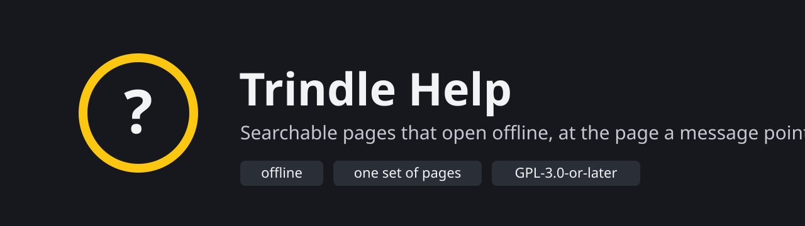
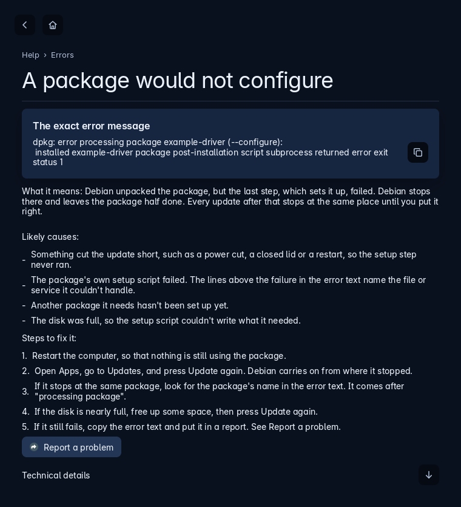

<p align="center"></p>

<p align="center">
  
  
  
  
</p>

Help is the help window of [Trindle](https://trindle.org), a small desktop for Debian. It is a program of its own. It contains Trindle's help pages, searches them, and opens at the page a message points to. Every "More" button beside a failure in Trindle starts it.

The pages are written once. The same files make both the website and the program, so they always match. Help needs no network, because the pages are inside the program.

<p align="center"></p>

## How it works

1. A message in Trindle names a page and a section, such as `errors#the-package-database-is-locked`, and starts `trindle-help` with it.
2. Help opens at that section. If the message includes the system's own error text, Help also picks the section from the words in it, and shows the text in a box you can copy.
3. Search finds any other page. If you start Help a second time, it brings the first window forward instead of opening another.

## Running it

```
trindle-help                         the first page
trindle-help errors#a-download-failed    a section
trindle-help errors "E: Could not get lock ..."   the section for that error, with its text
```

The text is only ever shown as words. Help never runs it and never treats it as an option.

## Building it

```
cargo build --release
cargo test --release
packaging/build-deb.sh
```

The tests need a session bus: `dbus-run-session -- cargo test --release`. One test paints the window in every Trindle theme, so it needs the themes folder: clone Trindle beside this folder, or set `TRINDLE_THEMES` to its `share/themes`. Cargo fetches the Trindle Toolkit from its repository at the commit `Cargo.toml` names. To work on the Toolkit and Help together, check the Toolkit out beside this folder and put a `[patch]` for it in `.cargo/config.toml` (not committed).

The website is built from the same pages with one Rust file that needs no crates:

```
rustc --edition 2021 -O tools/site/docs.rs -o target/site-docs
target/site-docs --check --features ../trindle/spec/features.md
```

`--check` fails for a banned word, an em dash, a picture without alt text, a broken link, a heading not in sentence case, or a colour pair below WCAG 2.2 AA. The features page is made from Trindle's own features list, so `--features` says where to find it. `site/README.md` describes the pages and pictures.

## Writing a page

A page is one Markdown file in `site/content/` with `title`, `summary`, `group` and `order` in its front matter. A line `Questions: a; b; c` under a heading lists the questions that section answers, for the search. Anything for a more technical reader goes between `:::expert` and `:::`. Help keeps that part closed until you press its button.

## Reporting problems

Bugs and ideas go to the [Buildmorphic community](https://trindle.buildmorphic.com) first; GitHub issues are welcome too. Security problems: see [SECURITY.md](SECURITY.md).

## Licence

Copyright the Trindle project. GPL-3.0-or-later, in [LICENSE](LICENSE). Changes are in [CHANGELOG.md](CHANGELOG.md).

## Disclaimer

Help comes without warranty, as the licence says. The steps it gives for fixing a fault are guidance. Read what a command does before you run it.
