Trindle comes with only the basics. Apps is where you add the rest. Open it from the ring.

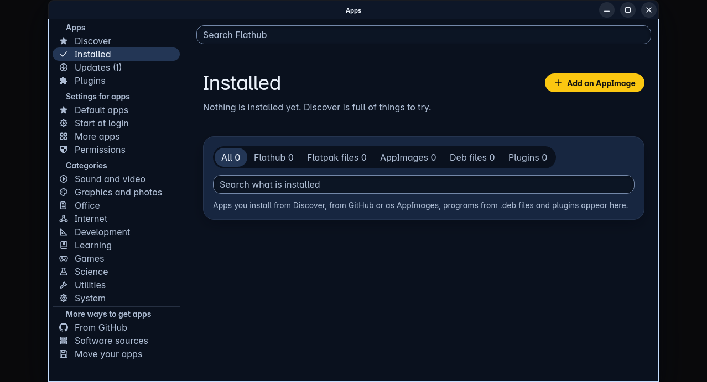

## The pages

The side bar on the left has four sections.

- **Apps:** Discover, Installed, Updates and Plugins.
- **Settings for apps:** Default apps, Start at login and Permissions.
- **Categories:** Sound and video, Graphics and photos, Office, Internet, Development, Learning, Games, Science, Utilities and System.
- **More ways to get apps:** From GitHub, Software sources and Move your apps.

For Steam and games, see [Playing games](games.html).

## Finding and installing an app

1. Open Apps and choose Discover.
2. Look through the tiles, or type a name in the search box at the top.
3. Press a tile to read about the app first.
4. Press the round button at the far edge of the tile. The button reads Install, or Open if you already have the app.

Discover shows apps from Flathub. Flathub is an online shop of apps, and each app runs separately from the others.

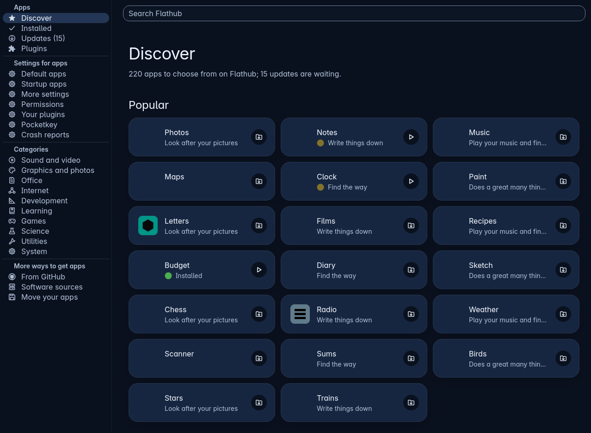

The first time you open Apps, the list of apps takes a minute to arrive. Apps tells you while it waits. Installed, Updates and Plugins don't need the list, so they work straight away.

## Everything you have added, in one list

Installed lists everything you've added. That includes apps from Flathub, Flatpak files, AppImages, programs from `.deb` files, and plugins. It leaves out what came with Trindle, so you only see what you chose.

Each row shows the app's picture, name, where it came from and its version. Remove is always the button furthest from the edge. It asks twice, so you can't remove an app by accident. To go ahead, press it again within three seconds.

To add an AppImage, press Add an AppImage at the top of the page. An AppImage is a program that comes as a single file.

## Apps that leave nothing behind

Each app you install lives in a folder of its own, with everything it needs.

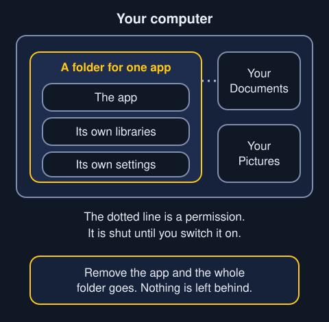

If you remove the app, it's gone completely. Nothing is left behind and nothing else breaks. A `.deb` file you download from anywhere gets its own sealed box with its own libraries, instead of spreading files across the system. Libraries are the shared pieces of code a program needs.

Only the parts the computer itself needs are installed for the whole system. Those are graphics, sound, networking and the login screen. Apps won't install drivers or background services, and it tells you why in plain words.

## What an app may do

When you install an app, Trindle lists in plain words what the app wants to do. For example, "your Documents and Pictures folders" or "your microphone". Each line tells you what happens if you don't allow it. Each has its own switch, which stays off until you switch it on.

If a request looks odd, Trindle shows a warning with it. A photo app that wants your keyboard is an example.

- An app you allow to see your files can see Documents, Downloads, Pictures and the rest. It can never see the hidden settings files that control how your computer starts things.
- An app you allow to play sound can't listen to you unless you also allow the microphone.
- You can change any of this later under Permissions.

## Updates

Security updates install themselves every day without asking. If you switch off Check for updates in Settings, About this computer, that stops them too. Other updates wait for you on the Updates page. You can update one thing at a time, or press Install all.

Install all never installs a plugin update that asks for something new. That update waits for you, with a label that says so.

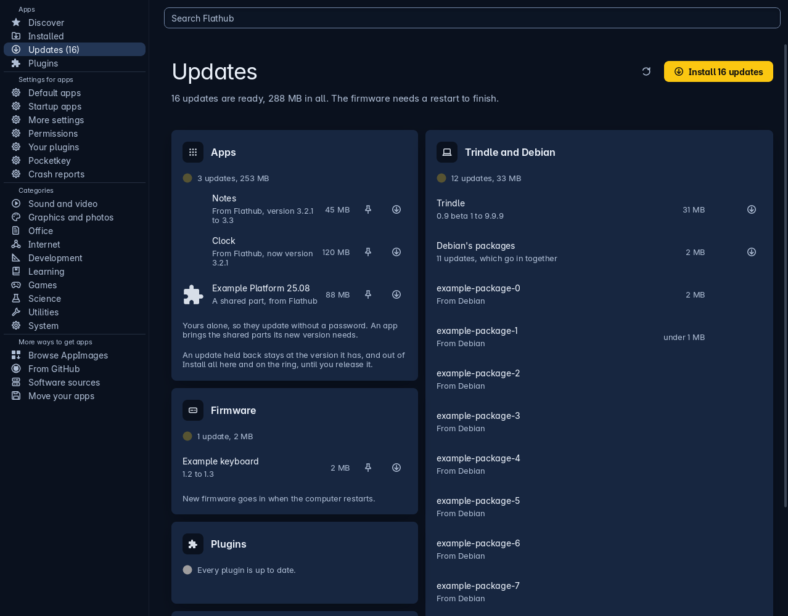

## Updates removed

After an update, Trindle removes programs that nothing needs any more, and tells you which. It never removes a screen reader, speech, braille or the libraries they use, even when nothing else needs them. If it removed something you use, install it again from Debian. The update won't remove it a second time.

## Plugins

Plugins are small extras you can add to Trindle, such as Flow and Text. Each one lives in its own folder and can't do anything until you allow it.

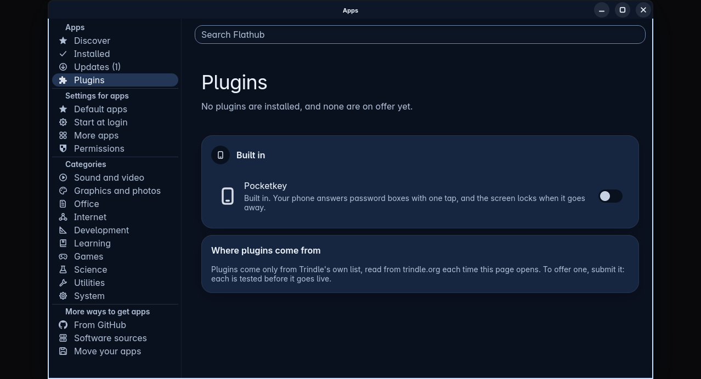

Plugins come only from Trindle's own list. The list is signed, so nobody can sneak one in. Each plugin is tested before it's added. Nothing is installed until you press Install.

If a plugin needs your permission to work, its card shows a note at the top, with one button, Allow.

Pocketkey comes with Trindle and starts switched off. When it's on, your phone can answer password boxes with one tap. The screen locks when the phone goes out of range. Your password always works too.

## Without the internet

Apps opens even when you're not online. Installed, Updates, Plugins, Software sources, Move your apps and the settings for apps all work. Only Discover has to wait, because it is built from the online list. Discover tells you so.

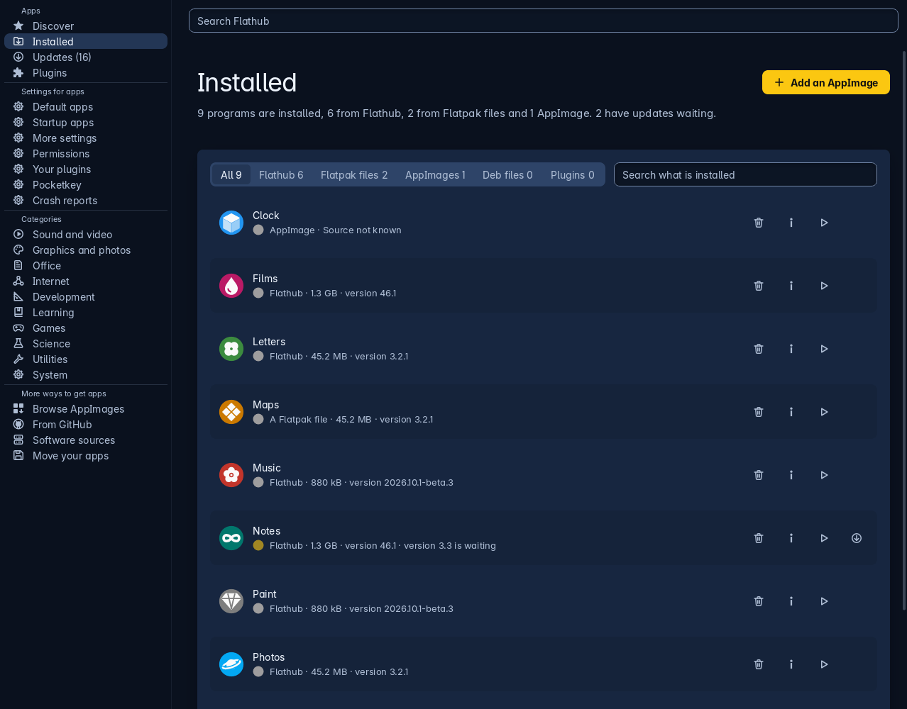

## When something goes wrong

When Apps can't do what you asked, it shows red words under the thing you were doing, with a small round **More** button beside them. Press it and Help opens at the page for that message. Each page below explains what happened, why, and what to do.

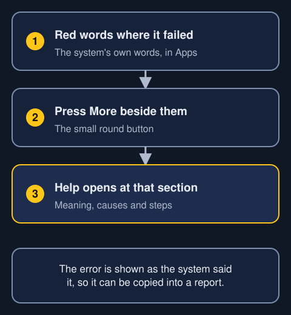

- [Apps could not reach the internet](apps.html#apps-could-not-reach-the-internet): Flathub, ratings, pictures, GitHub and the list of apps.
- [An app would not install or remove](apps.html#an-app-would-not-install-or-remove): Flatpak refused, an AppImage, a Flatpak reference, a dropped file.
- [An update did not finish](apps.html#an-update-did-not-finish): an app, Debian's and Trindle's updates, or a check that stopped.
- [Holding an update back did not work](apps.html#holding-an-update-back-did-not-work): the Hold back and Release buttons.
- [Firmware did not update](apps.html#firmware-did-not-update): a device's firmware, or the list of new firmware.
- [GitHub would not answer](apps.html#github-would-not-answer): the limit, a refusal, or a project with nothing to install.
- [The GitHub key was not kept](apps.html#the-github-key-was-not-kept): a key that GitHub refused, or that the keyring could not store.
- [A backup was not made](apps.html#a-backup-was-not-made): Move your apps, Back up.
- [A backup was not put back](apps.html#a-backup-was-not-put-back): Move your apps, Put a backup back.
- [A backup link is not encrypted](apps.html#a-backup-link-is-not-encrypted): a backup that gets its apps from an address that is not secure.
- [A deb file would not install](apps.html#a-deb-file-would-not-install): the window for one package.
- [A plugin is not working](apps.html#a-plugin-is-not-working): a plugin, Pocketkey, or the plugin list.
- [A software source was refused](apps.html#a-software-source-was-refused): Software sources.

## Apps could not reach the internet
Questions: why does Apps say this computer is not connected to the internet; why is Discover empty; why does Apps say it could not reach Flathub; why are the pictures missing; why are there no ratings; what does the catalogue could not be read mean; how do I make Apps try again

Apps stores a copy of Flathub's list of apps on this computer. If the copy is more than a day old, Apps gets a fresh one when it opens. Discover is built from that list, so it has to wait for it. Pictures, ratings and what people say about an app come from the internet when you open the app's page.

Apps can show you four different messages.

- **"This computer is not connected to the internet."** Apps shows this in plain words, not red, because it isn't a fault. Apps asks the computer whether it has a way to reach the internet. If it hasn't, Apps tells you. As soon as a connection comes back, Apps notices and tries again by itself, for the list and for updates.
- **"Apps could not reach Flathub."** The computer can reach the internet, but Apps couldn't get Flathub's list. The red words under it give the reason. Press **Try again**. If your connection is poor or the Flathub site is down, wait a little and press it again.
- **"The list of apps could not be fetched from Flathub."** There is no copy of the list on this computer, and getting one failed. Check the connection in Settings, Network, then press **Try again**.
- **"The catalogue could not be read."** The computer has a copy of the list, but Apps couldn't read it. The reason follows. Press **Try again**. If you see the same message again, the copy may be damaged.

Pages that don't need the list keep working: Installed, Updates, Plugins, Software sources, Move your apps and the settings for apps.

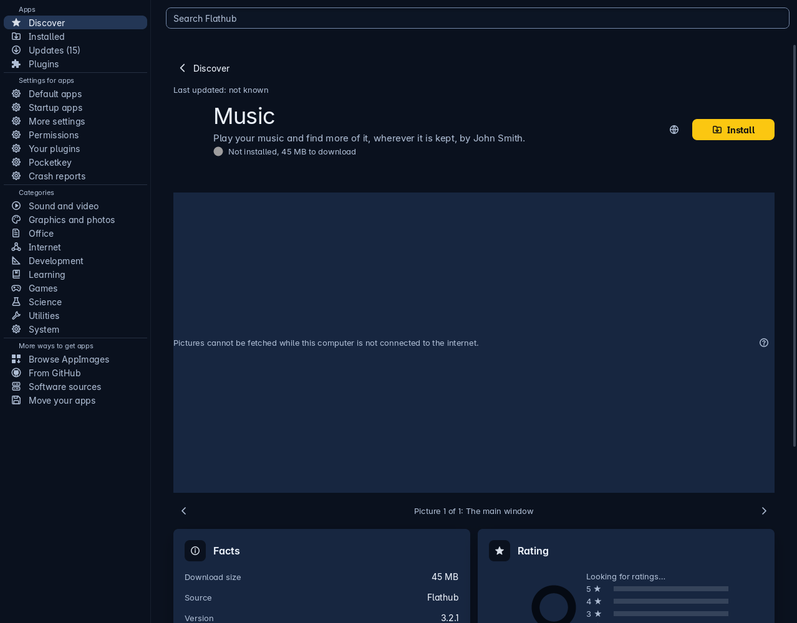

On an app's page:

- **"This picture could not be fetched."** That picture's address didn't answer. The other pictures may still appear.
- **"Pictures cannot be fetched while this computer is not connected to the internet."** Once you're connected, open the page again.
- **"No ratings to show." and "What people say cannot be fetched while this computer is not connected to the internet."**: ratings and what people write come from GNOME's open review service, over the internet. This doesn't affect the app itself.

On From GitHub, **"GitHub was not asked: there is no internet to ask it over."** means the same thing: nothing was searched. Connect to the internet, then search again.

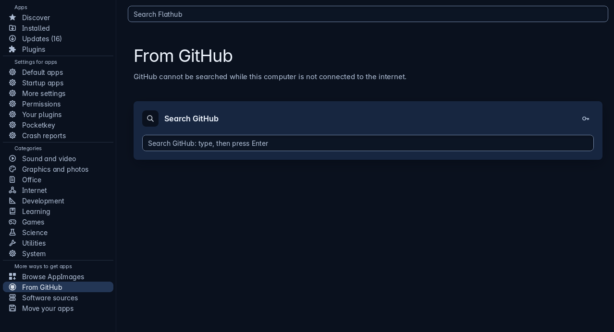

:::expert
The list is Flathub's appstream data, which Flatpak stores for your user. Apps refreshes it when it is more than 24 hours old, using the same refresh that Flatpak does for its own `flathub` remote. If the remote is missing, for example because the computer was first set up offline, Apps adds it again. It uses the copy of `flathub.flatpakrepo` that comes with Trindle. Only if that copy is missing does it fall back to `https://dl.flathub.org/repo/flathub.flatpakrepo`. "Connected" means the kernel has a route to everywhere, either the usual kind or the newer IPv6 kind. That doesn't prove the internet is answering, which is why a connected computer can still say Flathub could not be reached. Ratings come from `https://odrs.gnome.org/1.0/reviews/api`.
:::

## An app would not install or remove
Questions: why does it say Flatpak refused; why did my app not install; what does could not be installed mean; why won't my AppImage add; why won't Apps take the file I dropped; why can't I uninstall this; what does it did not finish and gave no reason mean

When you press Install or Remove, Flatpak does the work. The ring round the button shows progress until the job is done. If Flatpak stops, the ring ends with "Not done" and Apps shows the reason in red under the app. The reason is the last message Flatpak gave. If Flatpak gave none, you see "Flatpak refused."

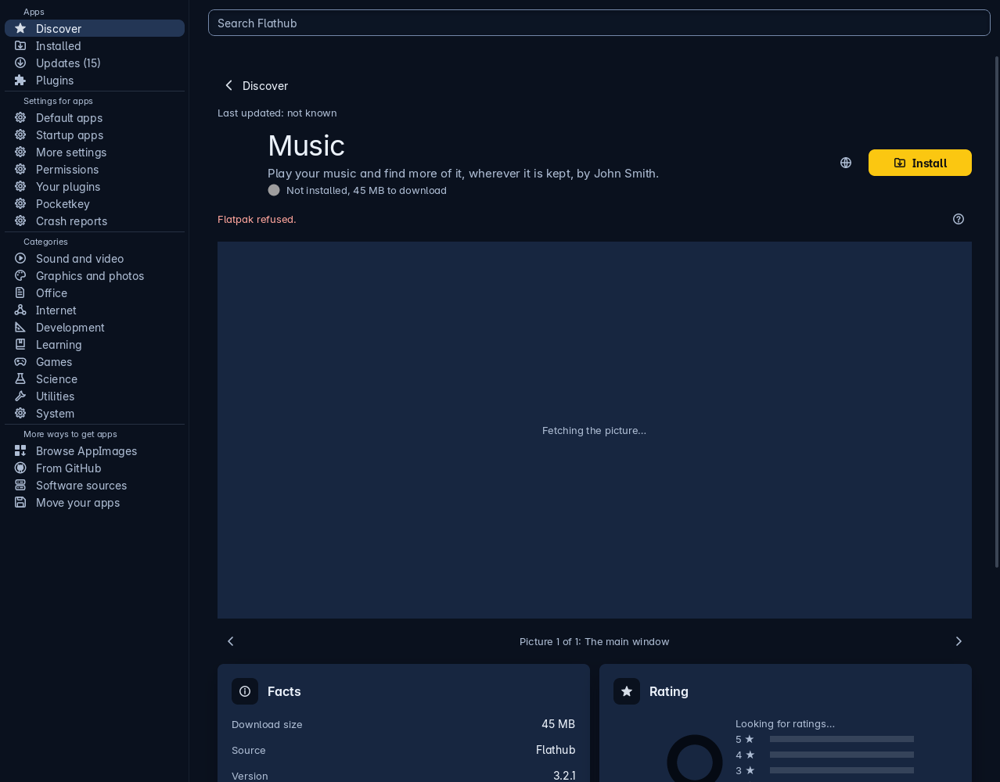

The reason comes from Flatpak, so it changes from case to case. It might be a full disk or a download that stopped. If it's the download, check your connection first: see [Apps could not reach the internet](apps.html#apps-could-not-reach-the-internet). Then press Install again.

Other words you may see:

- **"It did not finish, and gave no reason."** The job ended without succeeding and without giving a reason. Press the button again.
- **"{ name } is not in the Flathub catalogue."** Apps was asked to open an app by its identifier, but Flathub's list doesn't have it. Search for it by name in Discover.

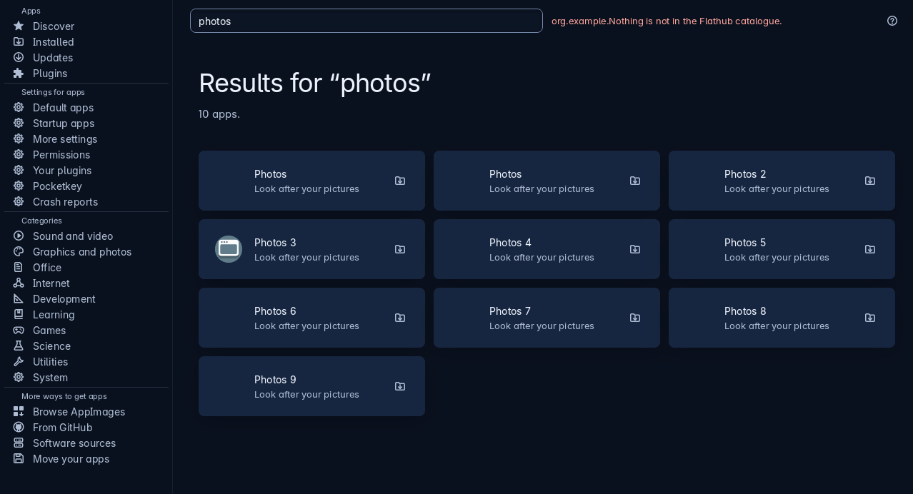

- **"There is no web browser to open the address. Get one in Apps first."** You pressed a link in Apps, such as an app's website, and the computer has nothing to open it with.

You add an AppImage from Installed, with **Add an AppImage**.

- **"There is no session bus to ask which file."** and **"The file chooser could not be asked."** Apps couldn't open the window where you pick a file. Try once more, or drop the file on the Apps window instead.
- **"The AppImage could not be added."** Apps couldn't copy the file into the AppImages folder or give it a launcher. The red words under the Installed list give the reason, such as no room left.

A Flatpak reference is a short `.flatpakref` file that names an app and where it comes from.

- **"That is not a Flatpak reference this computer can use."** Apps only accepts a reference that names an app (not a runtime) and uses an `https://` address. It turns away anything else.
- **"Flatpak would not install it."** or **"{ name } could not be installed."** with a reason: Flatpak tried the address in the file, then stopped. The reason is the last message Flatpak gave.

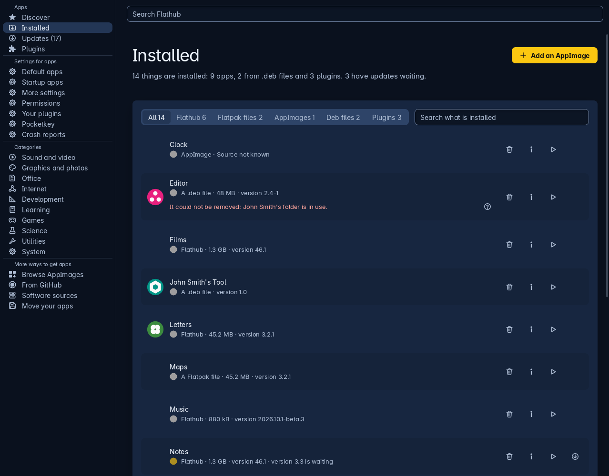

You can drop files on the Apps window. Apps accepts `.deb`, `.AppImage` and `.flatpakref` files, and looks inside each one instead of trusting its name. If a file ends in `.AppImage` but isn't a program, Apps turns it away. It does the same with a `.flatpakref` larger than 64 KB. For anything else you see "Only .deb, .AppImage and .flatpakref files can be dropped here."

In the ring, Uninstall can be greyed out. Its tip tells you why: "Can't uninstall: part of Trindle", "the computer needs it" or "part of Trindle needs it". Those programs are what Trindle is made of, so removing them would break the computer.

:::expert
Installing runs `flatpak install --user -y flathub <id>` in a low-priority scheduling class, so it doesn't slow your work. Removing runs `flatpak uninstall` in whichever place the app is installed, with `--delete-data` only when you chose Delete its data too. The red words are the last line of Flatpak's output that looks like a message and not progress. A `.flatpakref` is installed with `flatpak install --user --noninteractive -y --from=<file>`.
:::

## An update did not finish
Questions: why does it say not updated; what does Flatpak said mean; why were Debian's and Trindle's updates not installed; why does Apps ask for a password to update; why does it say updates could not be checked; what does it took too long to answer mean; why does an update say it did not finish

Updates for the apps you installed yourself need no password. Debian's and Trindle's updates change the whole computer for everyone who uses it, so they need an administrator's password.

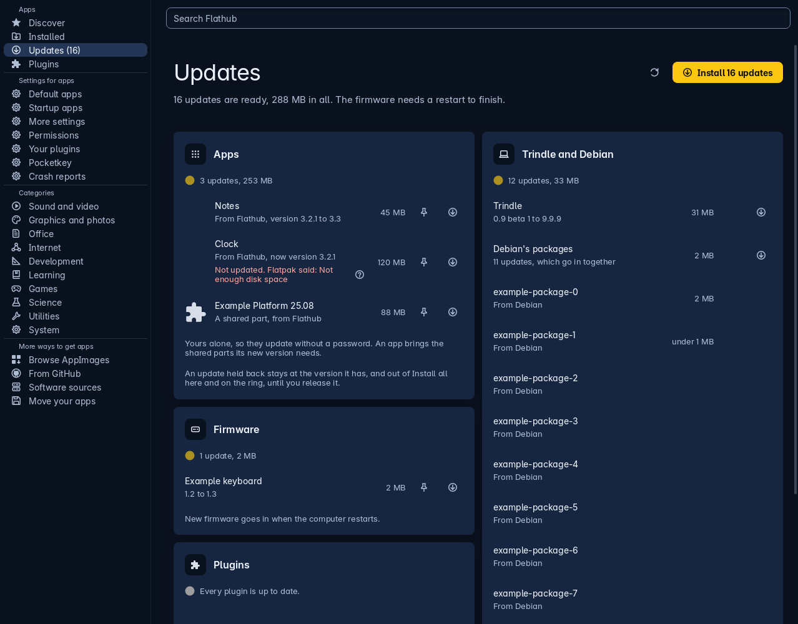

Here's what the red words can say:

- **"Not updated. Flatpak said: ..."** Flatpak gave a reason, and Apps shows it. It's the last message that wasn't a progress update. For example, the disk might be full or the network might have dropped.
- **"Not updated, and Flatpak gave no reason."** The update ended without a message. Press Update again.
- **"Not installed, because no administrator's password was given."** You closed the password box, so nothing was installed. Press Install all and enter the password. The same row can also say "because the administrator's password was not accepted". It can say "because this login is not allowed to do that, whatever password is given" or "because nothing was there to ask for the administrator's password". Or it can say "because the administrator's password was not accepted, or this login is not allowed to do that".
- **"Not installed, because the lists of what is new could not be fetched."** Before installing, Apps gets Debian's lists of what is new. If that fails, Apps installs nothing from the old lists, and the reason follows. Check your connection: see [Apps could not reach the internet](apps.html#apps-could-not-reach-the-internet).
- **"It did not finish. ..."** or **"It did not finish, and gave no reason."** The step started and then stopped. The reason is the message the system gave.

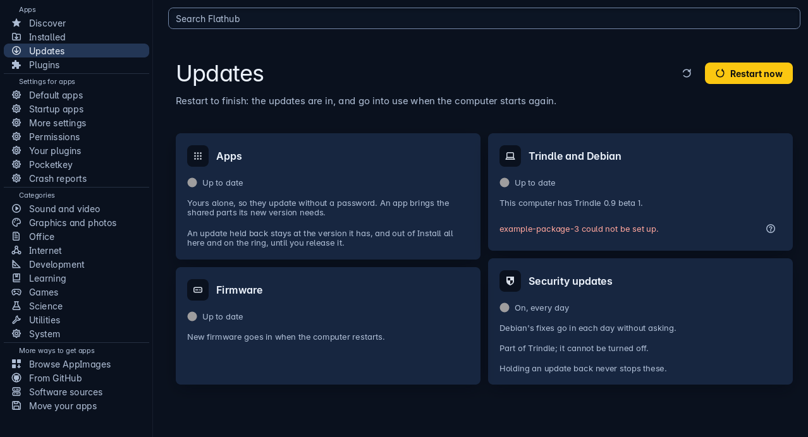

When Apps checks for updates, each card on the Updates page shows its own result.

- **"Could not check. Flathub could not be reached."** The apps card couldn't get Flathub's list.
- **"Could not check. Debian's lists could not be fetched."** The Trindle and Debian card couldn't get Debian's lists. If a reason follows, it's the message the system gave.
- **"Could not check. It took too long to answer."** A check gets three minutes. After that, Apps stops waiting, so a spinner never turns for ever. If the answer arrives late, the card corrects itself.

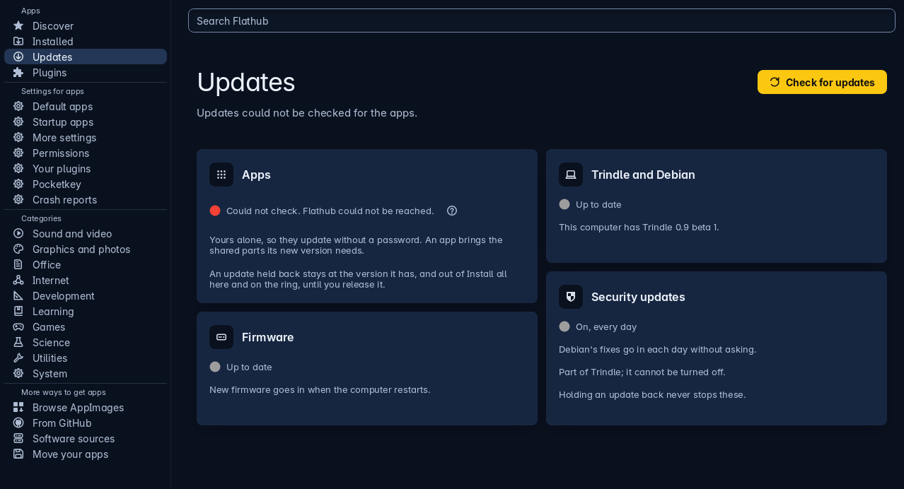

With no internet, none of these is red. The page just says it can't look.

If you hold an update back, it stays out of Install all. See [Holding an update back did not work](apps.html#holding-an-update-back-did-not-work).

:::expert
An app update runs `flatpak update --user -y` for that app or shared part. A check runs `flatpak update --user --appstream flathub` and then reads what is waiting from Flatpak's own records. The system's part runs in this order: get Debian's lists, count what is waiting, then install. If a list can't be fetched, or you close the password box, that part stops there. If the first password isn't accepted, Apps doesn't ask for a second one. If nothing is waiting once the lists are fetched, Apps doesn't ask for a password.
:::

## Holding an update back did not work
Questions: why does it say not held back; why was the held back list not kept; why could Flatpak not be told; why does it say not released

Hold back leaves one app's, plugin's or device's update out of Install all, on this page and on the ring, until you release it. Trindle has its own list of what you've held back. For a Flatpak app it also tells Flatpak to skip that app (it "masks" it), so no other program that updates apps can update it behind your back.

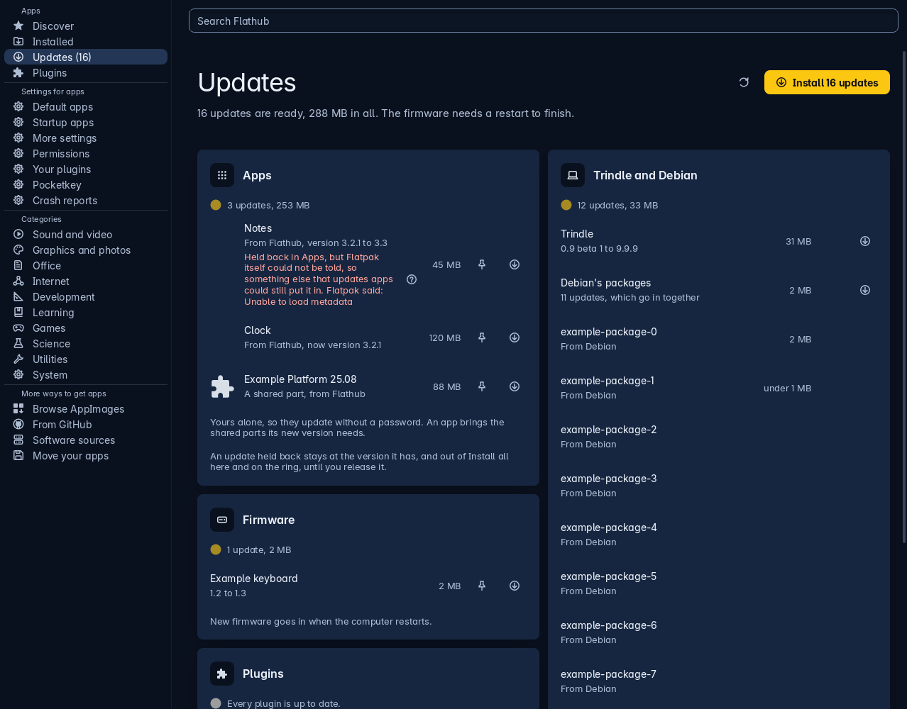

- **"Not held back. The list of what is held back could not be kept: ..."** Apps couldn't save the list to your folder, for example because the disk is full. Nothing changed. Install all will still update the app.
- **"Not released. The list of what is held back could not be kept: ..."** It's the same problem the other way round: the update is still held back.
- **"Held back in Apps, but Flatpak itself could not be told."** Trindle's list has changed, and Apps will leave the app alone. Flatpak didn't accept the mask, so another program that updates apps could still update it. If Flatpak gave a message, it follows. Each time Apps checks for updates, it tells Flatpak again about everything that is held back, so a lost mask gets put back then.

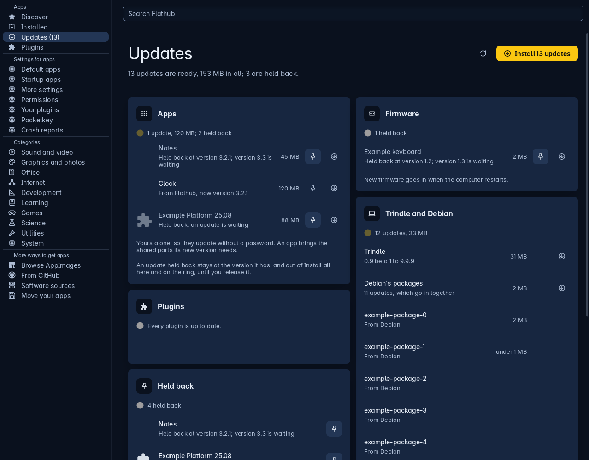

- **"Released in Apps, but Flatpak itself could not be told and may still leave it out."** Hold it back, then release it again.

You can't hold back Trindle's or Debian's updates, because they carry security fixes for the whole computer.

:::expert
Trindle's list is the one that counts, and Apps writes it first. Apps then masks a Flatpak with `flatpak mask --user <pattern>` and unmasks it with `--remove`. Releasing something Flatpak never masked ("No current mask") is not an error. Each time Apps checks for updates, it tells Flatpak again about every held Flatpak, so a mask someone removed by hand gets put back.
:::

## Firmware did not update
Questions: why does firmware not update; why does it say fwupd could not fetch the newest list; why does the firmware row say not installed; do I need to restart after a firmware update

Firmware is the small program inside a part of your computer, such as the main board. New firmware comes from fwupd and the Linux Vendor Firmware Service. It changes the computer itself, so installing it needs an administrator's password.

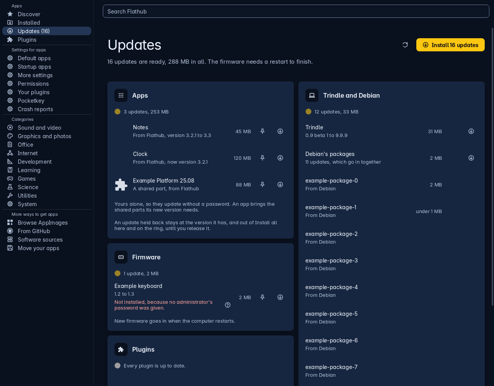

- **"Could not check. fwupd could not fetch the newest list."** fwupd couldn't download the list of what's new. Check your connection and press Check for updates. fwupd also gets the list by itself twice a day.
- **A row in red under a device, such as "Not installed, because no administrator's password was given."** The firmware for that device wasn't installed. The words give the reason, as for any other update. See [An update did not finish](apps.html#an-update-did-not-finish) for the other reasons.
- **"It did not finish. ..."** The device or fwupd stopped the update. The reason is the message they gave.

After firmware is installed, the card shows "Restart to finish". The computer starts using the new firmware when it restarts.

:::expert
Apps lists devices with `fwupdmgr get-updates --json` and refreshes the list with `fwupdmgr refresh --force --no-authenticate`. It then updates each device in turn through `trindle-admin firmware-update <device>`, which asks for the administrator's password. If one device fails, Apps carries on with the next.
:::

## GitHub would not answer
Questions: why does GitHub say it has stopped answering; what is the GitHub limit; why does it say no AppImage or Flatpak file for this computer; why was a project not looked at; why did the download not finish; what does GitHub refused this mean

From GitHub finds apps that people publish as AppImage or Flatpak files in their GitHub releases. Nobody checks these files, so install only from people you trust. Apps asks GitHub about each project it finds.

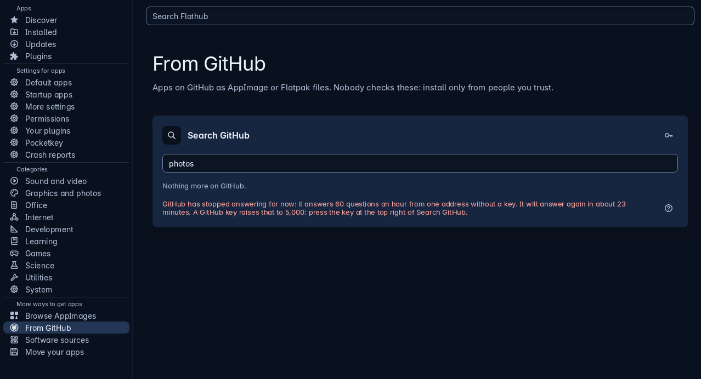

- **"GitHub has stopped answering for now."** GitHub limits how many questions one computer can ask. The words tell you which limit you've used up and when GitHub will answer again. The limit is one of these: 60 questions an hour from one address without a key, 10 searches a minute, 30 searches a minute with a key, or 5,000 questions an hour with a key. Wait for the time it gives. If it only says "Try again later", wait a while. A [key](apps.html#the-github-key-was-not-kept) raises the limit from 60 to 5,000 an hour.
- **"GitHub refused this: ..."** or **"GitHub refused this, though it has not run out of answers."** GitHub said no for a reason other than its limit. For example, GitHub may have shut the project. GitHub's own words follow.
- **"GitHub could not be reached."** Nothing came back at all. Check your connection: see [Apps could not reach the internet](apps.html#apps-could-not-reach-the-internet).

- **"GitHub answered 500."** and the like: GitHub sent a code but no reason.
- **"This project's releases have no AppImage or Flatpak file for this computer."** and **"GitHub has no releases for this project."** and **"Nothing in its newest release installs here."**: this is an answer, not a fault. The project has nothing that Trindle can install on this kind of computer.
- **"Only projects with an AppImage were searched for: GitHub did not answer the search for Flatpaks."** Only half of the search worked.
- **"3 projects found could not be looked at, so they are not listed: ..."** This is the number of projects Apps couldn't read, with the reason for the last one.

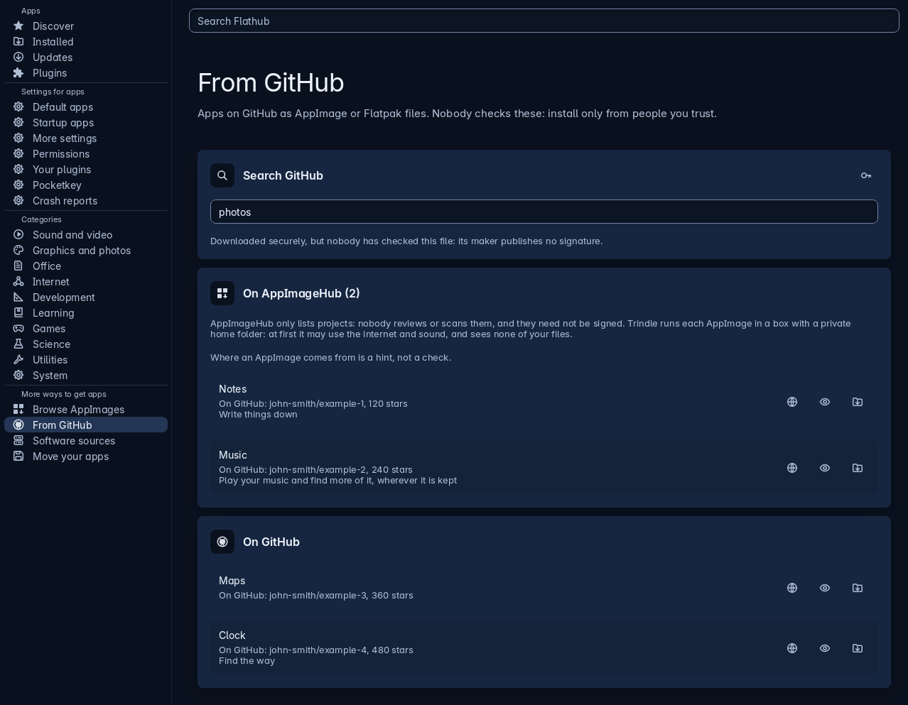

- **"The download did not finish."** The file stopped downloading part of the way through. Try again.

Apps downloads the files over a secure link. If the maker doesn't publish a signature, the page shows "Downloaded securely, but nobody has checked this file: its maker publishes no signature."

:::expert
Apps sends questions to the GitHub API with curl, over https only, with a 20-second limit and a cap on the size of the answer. A reply of 403 or 429 counts as a limit when no questions are left, when GitHub says how long to wait, or when its words say so. A 403 with questions left and no mention of a limit is shown as a refusal with GitHub's own words, because advice about a key would be wrong then. The wait is the time until the reset that GitHub reports, rounded up to whole minutes.
:::

## The GitHub key was not kept
Questions: do I need a GitHub key; why did GitHub not accept the key; why does it say the key has a space in it; why is my key still in a plain file; why can the keyring not be reached

You almost certainly don't need a key. Without one, GitHub answers 60 questions an hour from this computer. With one, it answers 5,000. Trindle uses the key only to look at public files.

To make one, press the key at the top right of the Search GitHub card. Press **Make a key on GitHub**, give it any name and leave every permission as it is. Press Generate token, then paste what it shows into the box and press **Keep the key**. Trindle stores it in the computer's keyring, not in a file.

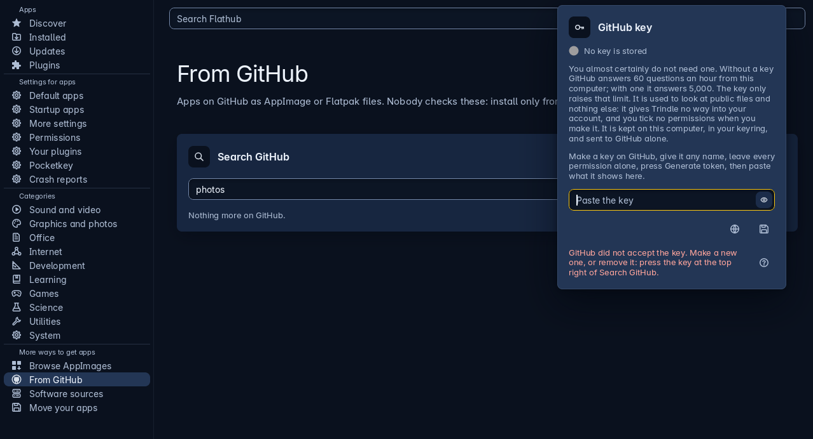

- **"GitHub did not accept the key. Make a new one, or remove it: press the key at the top right of Search GitHub."** The key is wrong, has expired or was cancelled on GitHub. Make a new one, or press **Remove the key**. Searching works without one.
- **"A key is one line with no spaces in it, and this has a line break or a space inside it. Paste the key alone."** The key was split across lines when you pasted it. Paste it again, on its own.

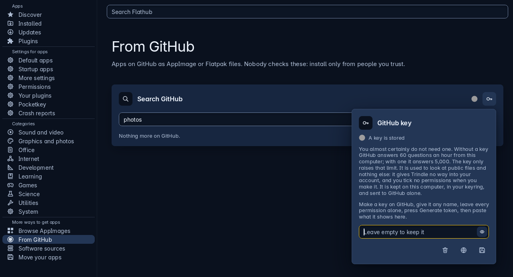

- **"A GitHub key is stored, but it cannot be sent: ..."** An older version of Trindle stored whatever you pasted, including any space. Until you remove the key and paste it again, Apps asks GitHub without a key.
- **"Your GitHub key is still in a plain file on this computer, and is used from there: it could not be moved into the keyring."** The keyring didn't accept it, and the reason follows. The key still works. When the keyring is available, remove the key and paste it again.
- **"The keyring could not be reached." and similar.** The keyring is locked, missing or slow. Meanwhile, Apps asks GitHub without a key, and the page says so. Unlock the keyring, then try again.
- **"Could not keep it" and "Could not remove it"** with a reason: the keyring or the file didn't allow the change. Nothing changed.

:::expert
Apps reads the key from the keyring on a separate thread, so a keyring that hangs doesn't freeze the window. It goes to curl as a header through standard input, never on the command line, and backups leave it out. Apps never sends a key that has a space or line break in it.
:::

## A backup was not made
Questions: why was the backup not made; what is in a backup; where does the backup go; how big is a backup

Move your apps makes one file with your apps and settings, to take to another computer. The file contains the list of your Flatpak apps. The other computer installs them fresh from Flathub, so the file stays small. It also contains each app's own data without its caches, your AppImages in full, and Trindle's settings: the ring, wallpaper choice, colours, keyboard, power, default apps and your picture. It doesn't contain your documents and pictures, so copy those over yourself. You can leave out any part.

The file is saved in your home folder. Its name is `trindle-backup-`, then the date, ending in `.fmpack`.

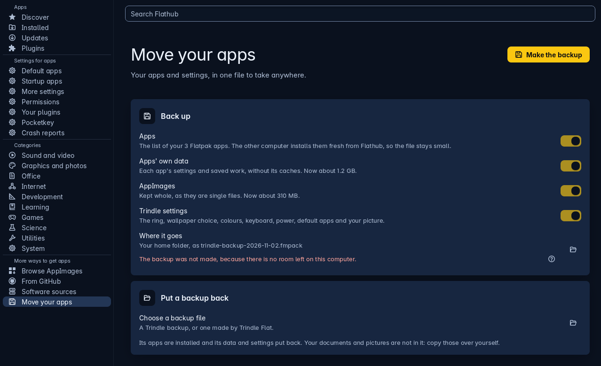

**"The backup was not made, because ..."** The reason follows, in plain words. These are the reasons Apps can give:

- **this computer would not let Trindle write there.**
- **there is no room left on this computer**, or **the space allowed for this account is used up.**
- **that part of this computer is read-only.**
- **a file or program it needs is missing.**
- **it gave no reason.**

Free some space, or leave out the biggest part. Apps' own data is usually the biggest, and Apps shows its size. Then press Make the backup again.

## A backup was not put back
Questions: why was nothing put back; why does it say part of the backup was not put back; what does something is already where part of the backup needs to go mean; why was my account picture not put back; why is that file not a Trindle backup; why did these apps not install

Put a backup back installs the apps in a backup, puts back their data and settings, and puts back Trindle's settings. It can read a backup made by Trindle or by Trindle Flat. A backup is just a file, and anyone can write one, so Apps checks all of it before it moves anything. If Apps finds one problem, it rejects the whole backup and puts nothing back. That way a restore never stops half done because of something Apps could have spotted beforehand.

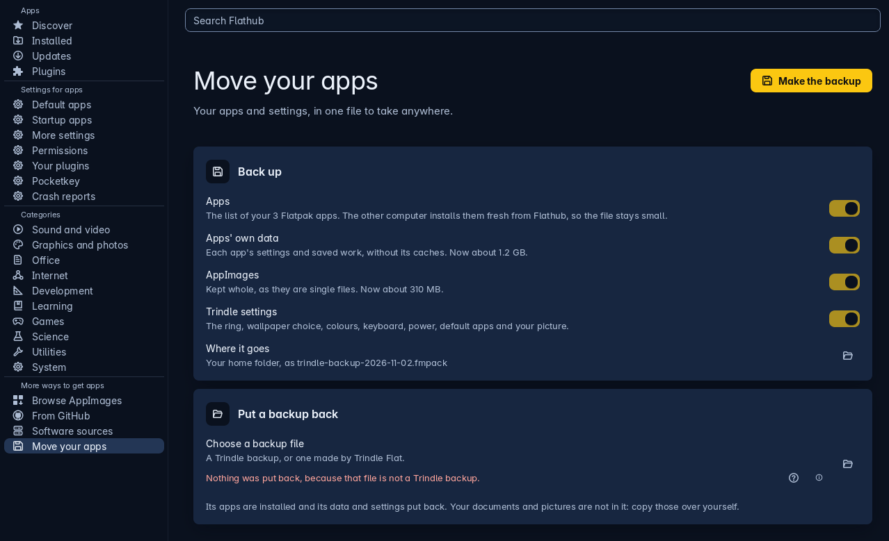

**"Nothing was put back, because ..."** These are the reasons Apps can give:

- **the backup file could not be read.** The file is missing, damaged, or you don't have permission to read it.
- **that file is not a Trindle backup**, **that file does not look like a Flat backup**, **that file does not hold a Flat app list**; **there are no apps in that file**, or **the backup is damaged and its list could not be read.** It isn't the kind of file the page expects, or it has been cut short. Make the backup again.
- **this was made by a newer Flat than Trindle can read.** Update Trindle, then try again.
- **it is too big to be read whole.**

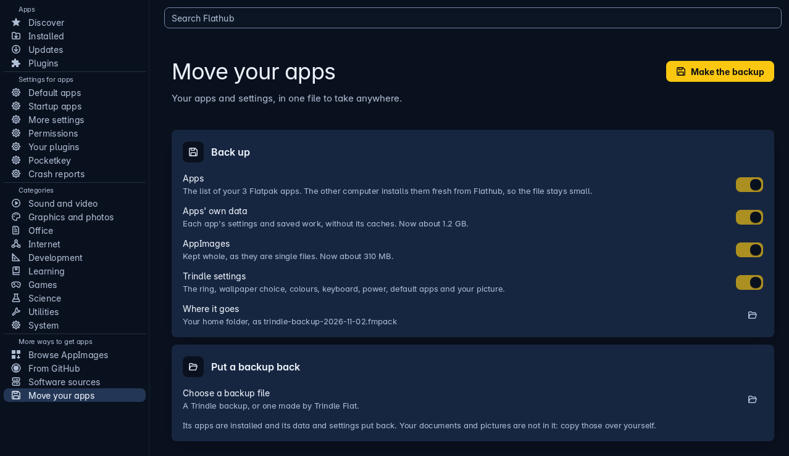

- **the backup holds a link or something else that would reach outside the folder it goes into**, or **its settings in the backup reach outside its own folder.** The file is built in a way that a backup made by Trindle never is, so Apps rejects all of it.
- **something on this computer is already where part of the backup needs to go.** The round **i** beside the words lists the paths in the way. Move or rename them, then try again.

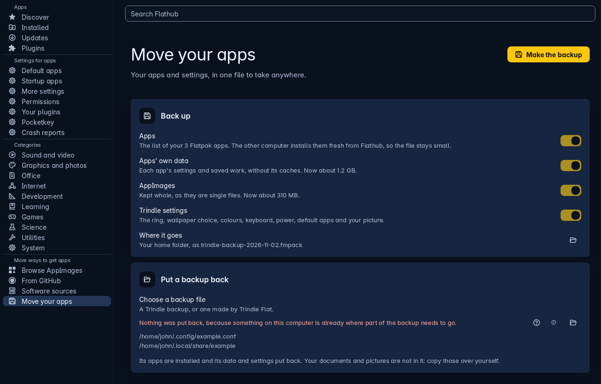

- **there is nowhere to unpack the backup**, **there is no room left on this computer**; **this computer would not let Trindle write there**, or **that part of this computer is read-only.**
- **its settings in the backup do not match their checksum**, or **it has no name.** Something changed in the file after it was made.

**"Part of the backup was not put back, because ..."** Most of it was put back. The words say which part wasn't, and why.

- **"Put back, except your account picture."** Apps couldn't save the picture. Everything else was put back.
- **"Settings and data were put back, but these apps were not installed, because Flatpak refused them."** The apps are listed with Flatpak's reason for each. Install them from Discover.
- **"Not put back: ..."** A list follows, each item with its reason: a source that isn't encrypted, so Apps didn't use it; a source the backup doesn't say where to find; or a name that isn't valid.

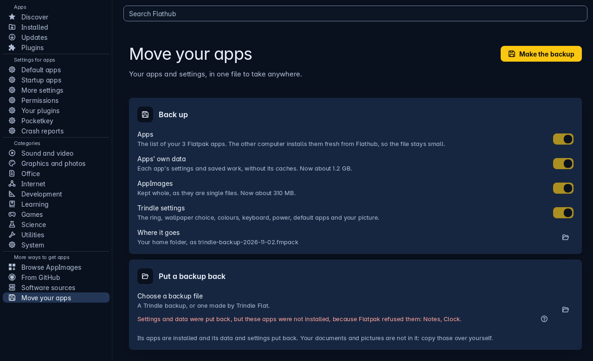

An app's data goes back as it was. Trindle's settings and AppImages go back as plain files and folders only.

:::expert
Apps never unpacks anything straight to where it will end up. It unpacks first into a new folder made for the purpose, inside the destination folder. It then moves each item into place by name with `renameat`, so it never follows a link. Apps looks at everything twice before moving anything, and the first pass changes nothing. It limits how much it reads into memory. A backup made by Trindle Flat follows the same rules. Apps sets the account picture through the administrator's helper, as Settings does, so it asks for the administrator's password. If the helper can't start, or you close the password box, the picture is the part that isn't put back, and the reason appears in the words.
:::

## A backup link is not encrypted
Questions: why does the backup warn me that a link is not encrypted; what does not encrypted mean; why must I tick I understand; is it safe to put back this backup

A backup lists the places its apps come from. Most use `https://`, which is encrypted. If one uses `http://`, anyone on the way can read what is sent, and could swap it for a different app.

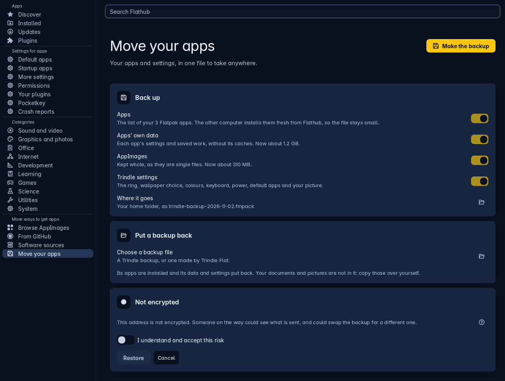

- **On your own network, you get one line and the restore goes ahead:** "The link to the apps is not encrypted." Your own network means this computer, a name ending `.local`, and the addresses that a home router hands out.
- **Over the internet, the restore waits.** A card called **Not encrypted** says "This address is not encrypted. Someone on the way could see what is sent, and could swap the backup for a different one." Tick **I understand and accept this risk**, then press **Restore**. Or press **Cancel**. Apps doesn't reject the backup outright.

If you don't know why a backup uses an `http://` address, press Cancel.

:::expert
Home addresses are: this computer's own name, `localhost`, 127.x, `::1`, 10.x, 172.16 to 172.31, 192.168, 169.254, `fc00::/7`, `fe80::/10`, and names ending `.local`. Apps treats a name that only looks like an address in another notation as the internet. When a backup lists several addresses, the least safe one decides.
:::

## A deb file would not install
Questions: why is this not a Debian package that can be installed; why does it say this is for another kind of computer; why can't a driver be installed; why does it say this is Trindle itself; why does it say these parts could not be found

A `.deb` file is a program packed the Debian way. Apps doesn't spread its files across the computer. It opens the file in a window of its own, then puts the program in a folder of its own, with the libraries it needs. The program can only do the basics until you allow more. Install only packages from makers you trust.

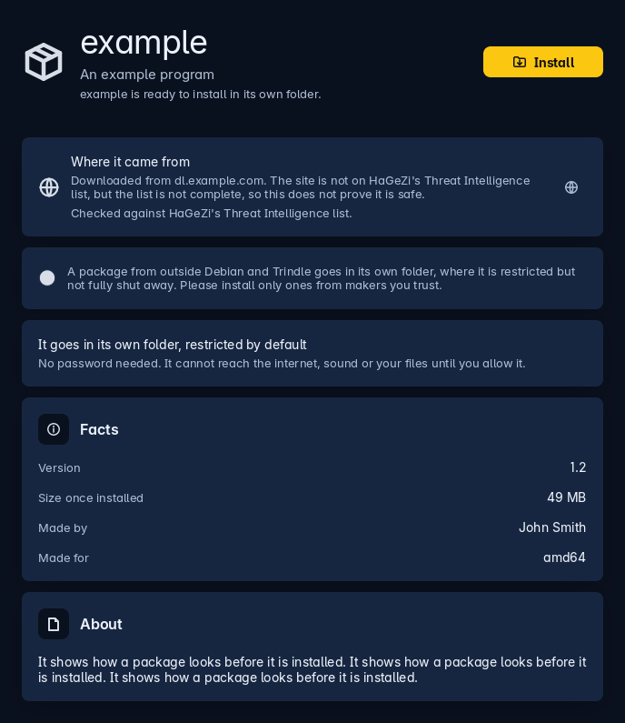

- **"This file is not a Debian package that can be installed. It may not have finished downloading."** Apps couldn't read the file as a package, or its name isn't a valid package name. Download it again.

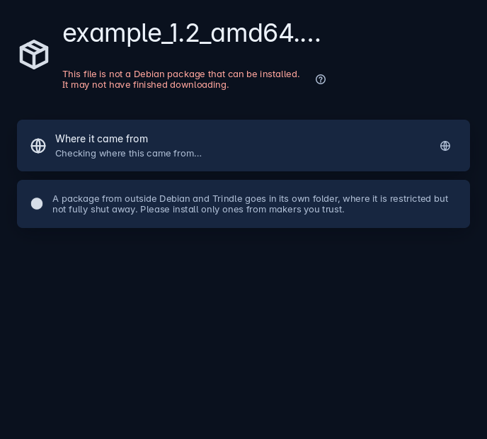

- **"This package is for arm64 computers, so it cannot go on this one."** The package is made for another kind of processor. Get the one made for this computer.
- **"This is Trindle itself. It updates from Apps' Updates page, not from a file."** Packages named `trindle` or starting with `trindle-` are Trindle's own.

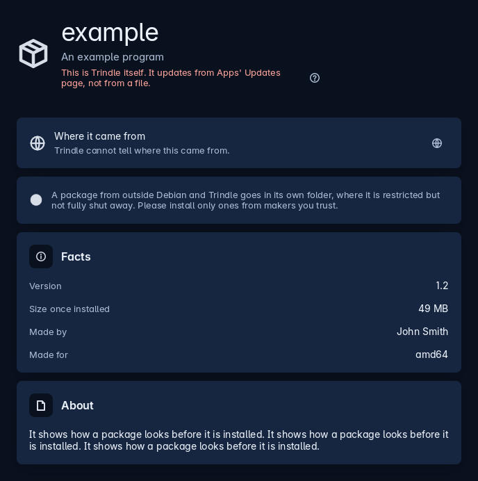

- **"{ name } is a driver or a background service, which cannot work from its own folder, so it cannot be installed here."** Apps looks inside the package. Some packages put files in places such as kernel modules, firmware, systemd services, udev rules, printer or scanner drivers, or the system's message bus. A package like that can't work from a folder of its own. Apps doesn't put drivers or background services in its own folders, as [Apps that leave nothing behind](apps.html#apps-that-leave-nothing-behind) explains.

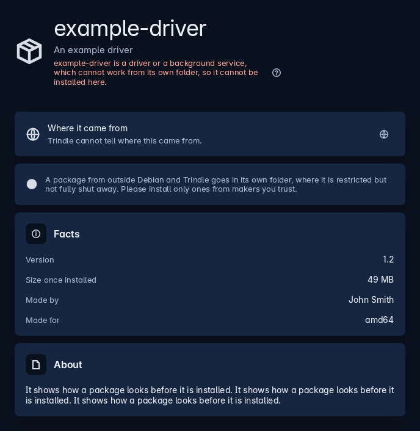

- **"Installed in its own folder, but these parts could not be found, so it may not start: ..."** The package needs parts that Apps couldn't find. The list names them.
- **"... could not be unpacked."** or **"... is not a Debian package that can be installed."** The file is damaged. Download it again.
- **"That program is not kept in a box."** You tried to change what a program is allowed to do. That program isn't one that Apps keeps in its own folder.

When you remove a `.deb` program, everything it saved goes with it.

:::expert
Apps reads the package with `dpkg-deb -f` and lists its contents with `dpkg-deb -c` without unpacking it. It checks the name against Debian's rule for package names before running anything. A package fits if its architecture is this computer's, `all`, or one of the foreign architectures that dpkg has set up. Apps turns a package away as a service if it has files in kernel module, firmware, systemd, udev, modprobe, D-Bus system service, CUPS or SANE places. It also does so if the package has a DKMS configuration.
:::

## A plugin is not working
Questions: why does it say its background part is not running; why was the plugin not removed; why is Pocketkey not answering; why was the plugin catalogue not used; why does it say the file is not the one the catalogue lists; why are plugin updates paused

Plugins are small extras you can add to Trindle. They come only from Trindle's own list. The list is signed, so nobody can sneak one in, and each plugin is tested before it's added.

If a plugin failed the check, wouldn't download or install, or its background part isn't running, you'll find help on the [Plugins](plugins.html#when-something-goes-wrong) page. The same page covers a list that couldn't be used.

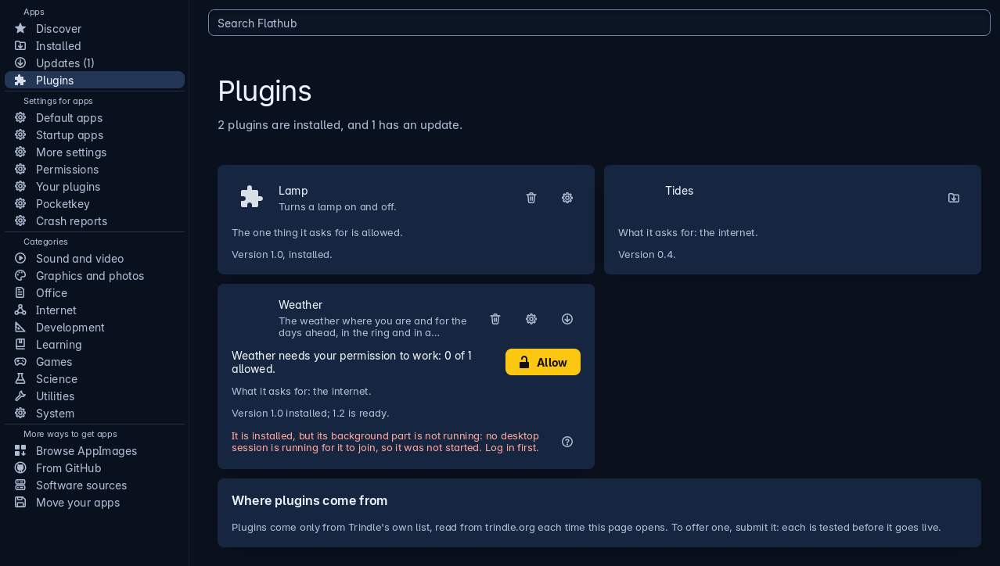

- **"It is installed, but its background part is not running: ..."** The plugin is installed, but the part that runs all the time didn't start. The reason follows. It can be one of these: no desktop session is running (log in first); it didn't start within the time it was given; Trindle couldn't find the program that starts plugins; or there are several desktop sessions and Trindle can't tell which one to join.
- **"Not done: ..."** You see this under Where plugins come from, after you press **Start again**. Apps couldn't remove the record, and the reason follows.
- **"It could not be removed: ..."** Apps couldn't remove the plugin's folder. Nothing else changed.
- **"It could not be downloaded: ..."**, **"The archive could not be unpacked: ..."**, **"It does not pass Trindle's plugin check, so nothing was installed: ..."**, **"The plugin's files could not be copied."** and **"It could not be saved: ..."** The step named in the message failed, and nothing was installed.
- **"Its file is not the one the catalogue lists (the SHA-256 differs), so nothing was installed."** The downloaded file doesn't match the list, so Apps didn't install it. This protects you from a file that has been changed.

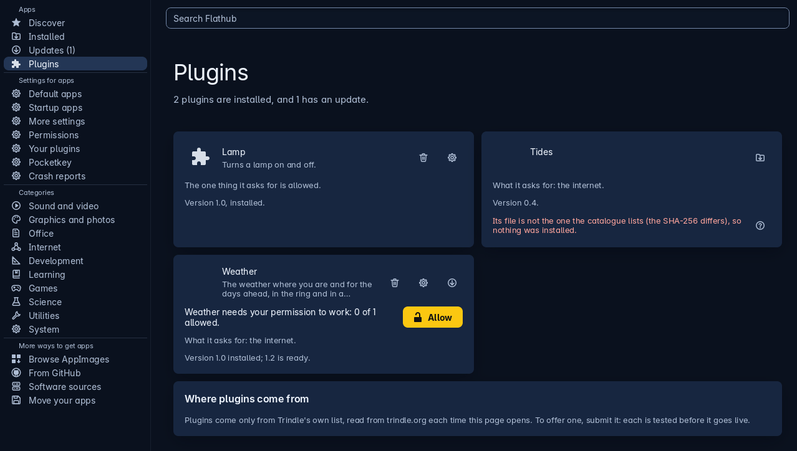

- **"Pocketkey is not answering, so the switch has not changed."** Pocketkey is built in. Its background part didn't answer when you pressed the switch. Try again in a moment.
- **Under Where plugins come from, "Trindle's plugin catalogue ... was not used."** Apps checks the list of plugins before it trusts it. Apps didn't use the list for one of these reasons: it has no signature; the signature is the wrong size; it isn't signed with Trindle's key; it doesn't give its number; it is older than the last good one; it is signed but can't be read; or this Trindle has no key to check it with. Apps shows the last good list when there is one.
- **"Plugin updates are paused: the plugin list is damaged."** The **Start again** button asks for the administrator's password and starts the list over.

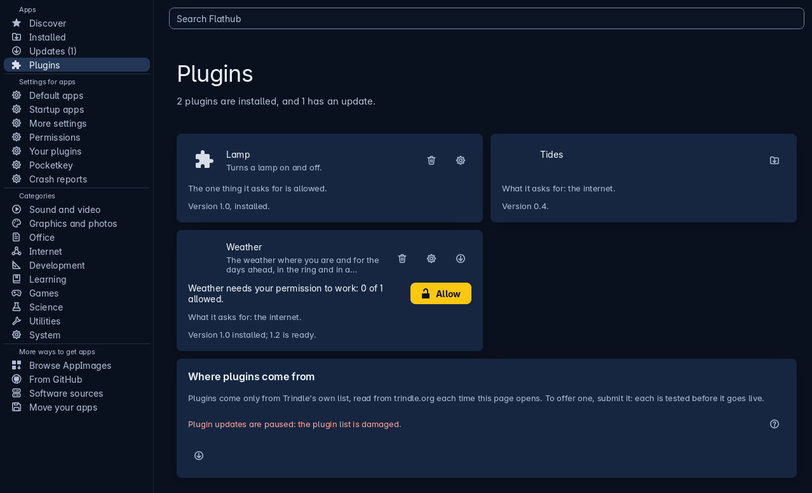

- **"Not held back" or "Not released"** on a plugin: Apps couldn't save the list of what is held back. See [Holding an update back did not work](apps.html#holding-an-update-back-did-not-work).

:::expert
Apps reads the catalogue from trindle.org each time the Plugins page opens. It accepts the catalogue only if its signature checks out with the key that comes with Trindle and its number is not older than the last one it accepted. It accepts a plugin's archive only if its SHA-256 matches the one in the catalogue.
:::

## A software source was refused
Questions: why does it say both addresses must start with https; why is that not a package name; why can't I add a source; what is a suite and a component

A software source lets a maker's own repository install and update a program for the whole computer. Apps already knows some makers. You can add another under Software sources, with **Add this source**.

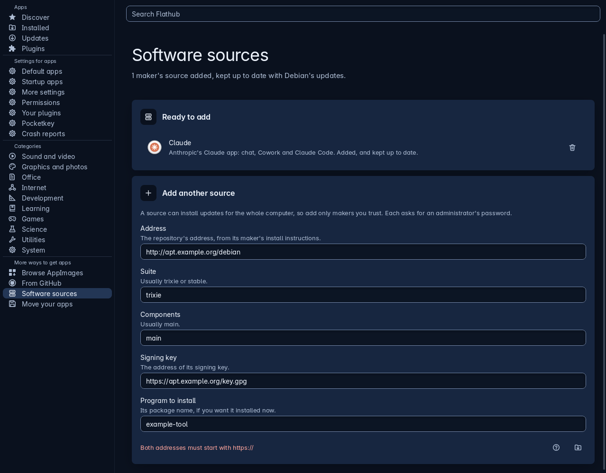

- **"Both addresses must start with https://"** The repository's address and the signing key's address must both be secure links. They also can't contain a quote mark, a semicolon or a dollar sign.
- **"The suite and components must be plain words."** The suite is usually `trixie` or `stable`. The components are usually `main`. They can only contain letters, digits, dots, slashes and dashes, and none can start with a dash.
- **"That is not a package name."** The optional program to install must be a Debian package name. It can contain lower-case letters, digits, plus signs, dots and dashes, and must start with a letter or digit.
- If a source's job failed, the reason appears under its row. Adding or removing a source asks for an administrator's password, so if you close the password box, the job stops and nothing changes.

A source can install updates for the whole computer, so only add makers you trust.

:::expert
Apps saves sources you add from the list of known makers as `trindle-<name>.sources` files for apt, and Already on this computer lists the ones it finds. The checks listed above run before Apps asks the administrator for anything.
:::

## Related

- [Flow](flow.html): a plugin that shares one mouse and keyboard.
- [Glossary](glossary.html): Flatpak, AppImage and `.deb`.
- [Troubleshooting](troubleshooting.html): an app that won't install.
