Drives shows every drive and what is on it. A drive is a disk or a USB stick. It also changes them.

You can do these things.

- Rename a drive.
- Choose the folder a part appears in.
- Mount a part at start-up. Mounting means making a drive's files show up as a folder.
- Resize a part, check and repair it, or format it. Formatting wipes a part and sets it up fresh.
- Erase a whole drive, delete a part, or make a new one.

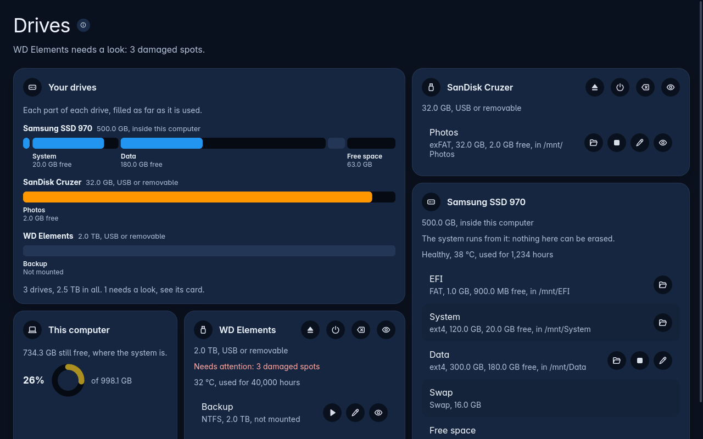

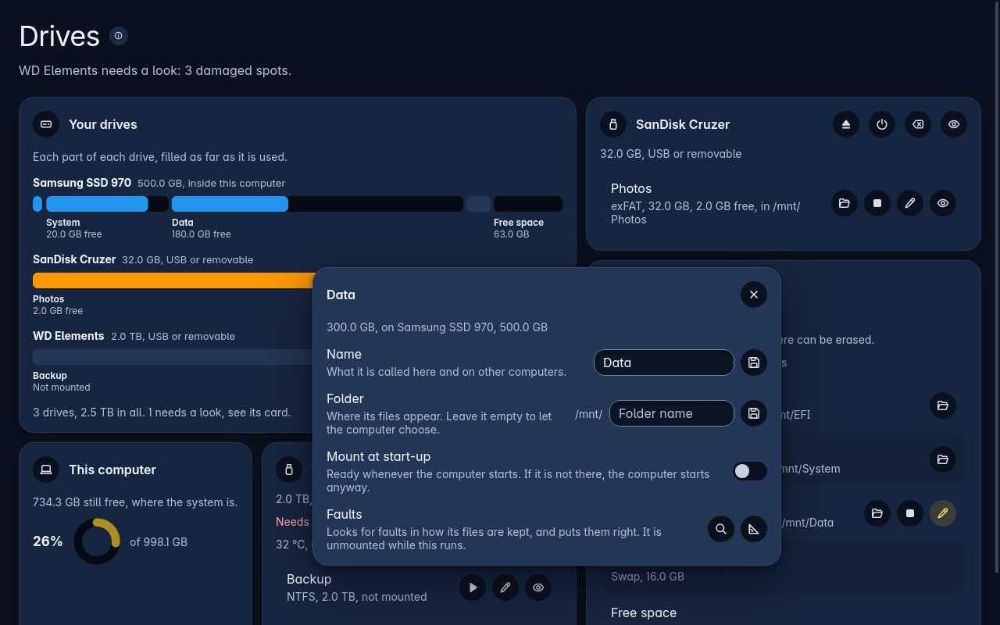

## A password before any change

Nothing that changes a drive happens without an administrator's password. An administrator is a person who is allowed to change the whole computer. Drives asks for the password at that moment.

This is true of a second disk inside the computer, the disk the system runs from, and a USB stick. A password you gave a few minutes ago does not count.

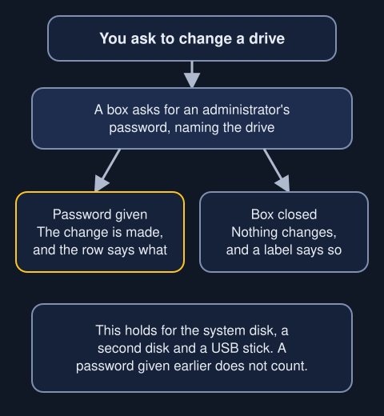

The password box says in plain words which drive and what will be done to it. If you close it without a password, nothing changes. A label under the row says so: "No password was given, so nothing changed."

If a change stops half way, the row says why. It also says exactly which steps were done and which were not.

## Making room for a new partition

A partition is one named part of a disk. On a Btrfs disk, Drives can make room for a new one while you work. Btrfs is a kind of disk layout that can take snapshots. A snapshot is a saved copy of the disk as it was at one moment.

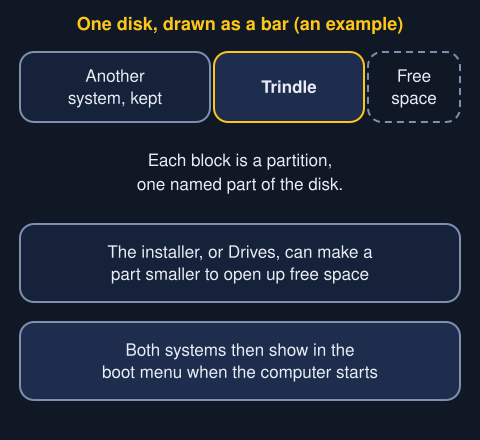

The system's own disk is Btrfs, encrypted or not. After the password, Drives does these steps.

1. It takes a snapshot first.
2. It makes the files.
3. It makes the encrypted copy.
4. It makes the part smaller, and checks the sizes after each step.

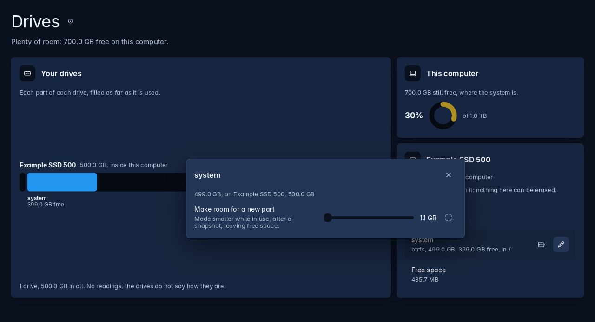

That leaves free space for you to make the new part in. Drives asks for the password twice, once for the snapshot and once for the change. Anything doubtful is refused with its reason.

Other kinds of disk say in a label why they cannot be made smaller while in use. They can only shrink when nothing is using them.

## Hiding a drive

A drive's card has a small round eye button. So does each part's row.

1. Press the eye to hide the drive or part.
2. It is left off the list in Drives and in the side bar of Folders.
3. A hidden drive's eye is struck through. Press it again to show the drive.

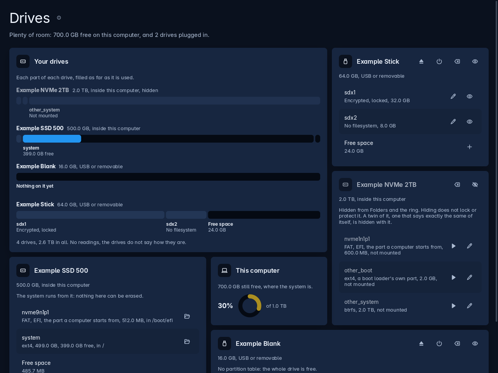

Hiding does not lock or protect a drive. It touches nothing on it, so it asks for no password. Hiding a drive hides everything on it.

The drive the system runs from has no eye. Nothing on it can be hidden.

## When something goes wrong

When Drives cannot do what you asked, it says so in red words under the thing you were doing, and a small round **More** button sits beside them. Press it and Help opens at the page for that message. Each page below says what happened, why, and what to do.

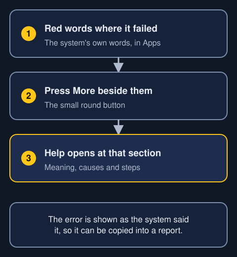

- [The drive service did not answer](drives.html#the-drive-service-did-not-answer): the list of drives, or a change, could not begin.
- [A change was not made without a password](drives.html#a-change-was-not-made-without-a-password): the password box was closed, refused, or not taken back.
- [A change did not finish](drives.html#a-change-did-not-finish): a step failed, a drive was busy, or Drives was closed in the middle.
- [Room could not be made](drives.html#room-could-not-be-made): the reasons a part cannot be made smaller to leave room.
- [A name or size was not accepted](drives.html#a-name-or-size-was-not-accepted): a drive's name, its folder, or a size that cannot be set.
- [A drive needs attention](drives.html#a-drive-needs-attention): a drive says it is failing, a repair did not mend it, or a drive does not answer.
- [The computer is nearly full](drives.html#the-computer-is-nearly-full): almost no room is left.
- [Hiding a drive was not kept](drives.html#hiding-a-drive-was-not-kept): the eye could not be remembered.

## The drive service did not answer
Questions: why does it say the drives cannot be read right now; why does it say the drive service could not be reached; why does it say the drive service is not available; why is the list of drives empty; what is udisks2; what does the system bus is not available mean

Drives does not talk to your drives itself. It asks a service that the computer already has, called udisks2, which is the part that sees disks and USB sticks and does the work for it. When that service does not answer, Drives has nothing to show or to change.

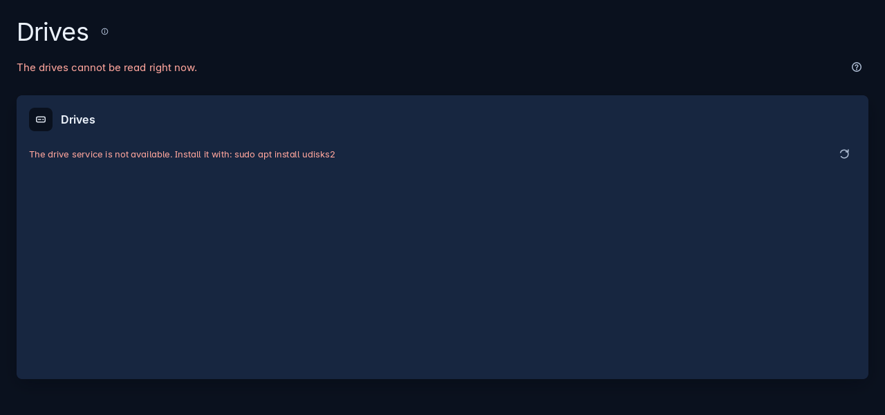

- **"The drives cannot be read right now."** This is the red sentence at the top. A card under it says what is missing: **"The drive service is not available."** or **"The system bus is not available."** with the command that installs it. Press **Try again**, the round arrow at the right of the card, when it is in.
- **"The drive service could not be reached, so nothing changed."** You pressed something, and Drives could not ask the service to do it. Nothing was begun. Press the button again in a moment.

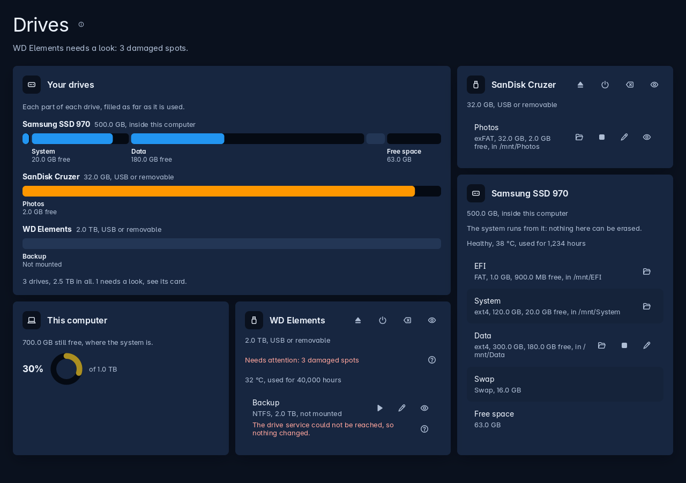

- **"The drive service could not be asked, so nothing changed."** A step could not be sent. If other steps had been done first, it says the work stopped part-way and lists which, as [A change did not finish](drives.html#a-change-did-not-finish) says.
- **"The drive service could not be reached."** after a part was formatted. The part is formatted, but its folder could not be kept for it. Choose the folder again from its row.

If it will not come back, restart the computer.

:::expert
Drives talks to `org.freedesktop.UDisks2` on the system bus. "The system bus is not available" means the connection to the bus itself could not be made, and is shown with `dbus` as the package to install; "the drive service" is `udisks2`. A change that cannot be sent at all counts as a change that did nothing, which is why the words say nothing changed.
:::

## A change was not made without a password
Questions: why does it say no password was given so nothing changed; why does it say the administrator's password was not accepted; why does it say another change is still being made; why does it say the password could not be taken back; why does it say this login is not allowed; why does Drives ask for a password every time

Every change to a drive asks for an administrator's password, each time. An administrator is a person who is allowed to change the whole computer. Drives never keeps the password for the next change, and it checks that the next one will ask again.

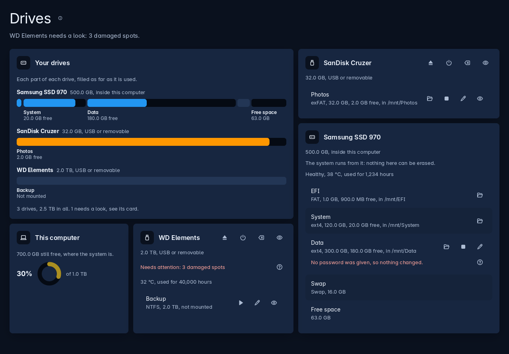

- **"No password was given, so nothing changed."** You closed the password box without a password. Press the button again and give it.
- **"No password was given, so the work stopped part-way."** The same, but some steps had already been done. The words after it say which. See [A change did not finish](drives.html#a-change-did-not-finish).
- **"The administrator's password was not accepted, so nothing changed."** The password was wrong. Press again and type it with care.

- **"This login is not allowed to do that, whatever password is given, so nothing changed."** This user may not change drives at all. Log out, log in as an administrator, and try again.
- **"Nothing was there to ask for the administrator's password, so nothing changed."** The box that asks for the password did not appear. Log out and back in, then try again.
- **"Another change is still being made. Try again when it has finished."** Drives makes one change at a time. A second change would otherwise ride on the first one's password.

- **"It could not be made sure that the password would be asked for, so nothing changed."** Drives checks before each change that it will really be asked. It could not be sure, so it did nothing.
- **"The password just given could not be taken back, so for a few minutes another change to a drive may not ask for one."** The change itself is done. The system (polkit) can keep a password for a few minutes. Drives tries again every fifteen seconds, for about five minutes, and the red words stay until it works. When it does, the row says so in plain words.

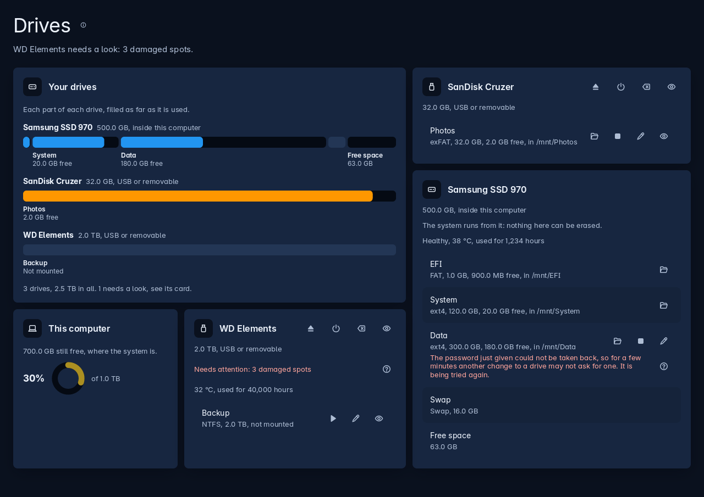

- **"... was unmounted for this, and mounting it again needs a password of its own: mount it from its row."** The change was refused after Drives had unmounted a part for it. Mount the part again from its row.

:::expert
The password is asked by polkit for each step that changes a drive. Mounting, unmounting, ejecting and powering off ask for none. Drives asks polkit to take back the leave it was given as soon as the change ends. If that cannot be done at once, the red "could not be taken back" words are shown and the attempt is repeated up to 21 times, 15 seconds apart.
:::

## A change did not finish
Questions: why does it say the work stopped part-way; why does it say something is still using it; why does it say there is not enough room for what is on it; why does it say a part is still unmounted; why does it say Drives was closed while this change was being made; how do I know what was done

A change to a drive is a list of steps, such as unmount, resize, check, mount. If a step cannot be done, Drives stops there. It does not carry on after a failure. It then tells you exactly what happened, so you are never left guessing.

The red words come in this order.

1. Why it stopped, such as "The work stopped part-way." with the reason.
2. **Done:** the steps that were done.
3. **Failed:** the step that failed. Nobody can know how far it got.
4. **Not done:** the steps after it, which were left alone.
5. **Not known:** used only when Drives itself was closed in the middle, and the step it was in the middle of may or may not have happened.

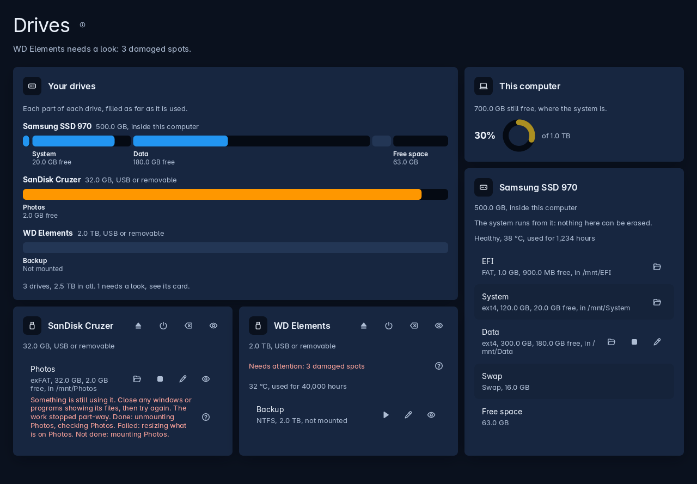

Then, for each part Drives had unmounted for the change and did not mount again, one of these.

- **"... was unmounted for this and is still unmounted: mount it from its row."** Nothing had been changed before it stopped.
- **"... was unmounted for this and is not mounted now."** A step had changed the drive, so mount it from its row when you are ready.
- **"... may have been unmounted: look at its row."** It stopped in a step that unmounts, and nobody knows if it did.
- **"... could not be mounted again (...)."** Drives tried to put it back and could not. The reason follows.

Other reasons you may read:

- **"Something is still using it. Close any windows or programs showing its files, then try again."** A part cannot be unmounted, resized or formatted while a program has its files open.
- **"There is not enough room for what is on it at that size."** The drive service said there was no space left. Or it said the size was too small for what is stored. Choose a larger size.

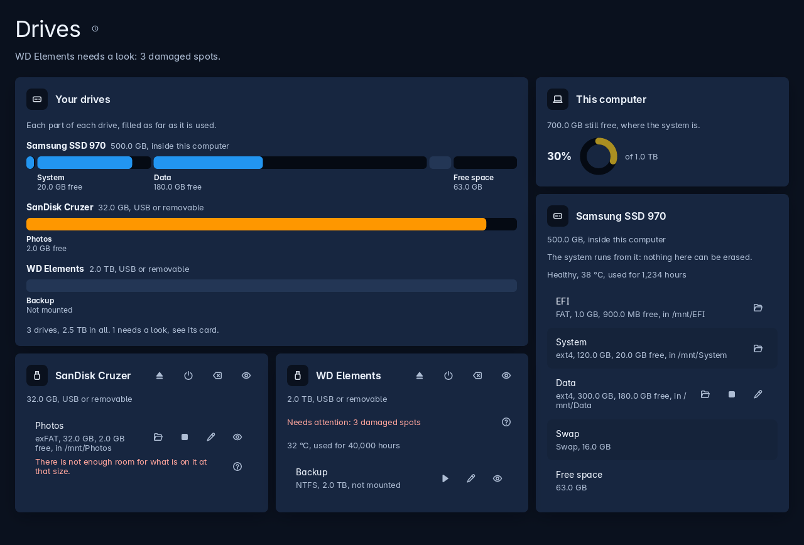

- **"Drives was closed while this change was being made."** Said the next time Drives opens. Look at the drive before trying again. Drives stays open until a change has ended, so that it can say how it ended.
- **"Formatted, but it was not given its folder ... again."** The part was formatted, but its folder or its start-up choice was lost on the way. Choose the folder again from its row.

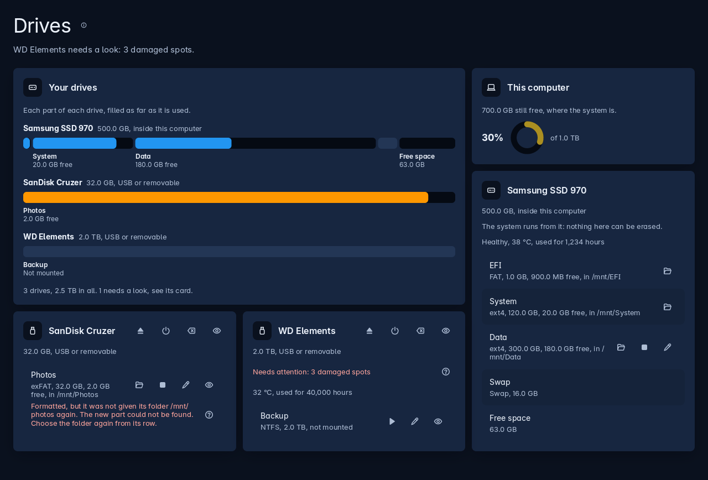

:::expert
Each step is one call to udisks2. The list is written to a note on disk while it runs. That is how a change that was cut short can be told about the next time Drives opens. A step that only mounts, unmounts, ejects or powers off changes nothing on the drive. For the other steps "nothing changed" is said only when no changing step was done before the stop.
:::

## Room could not be made
Questions: why does it say room cannot be made; why can I not make a partition smaller; why does it say mount it first; why does it say a swap file lies on it; why does it say it is mounted read-only; why does it say it is not a GPT drive; why does it say a snapshot can only be taken of the system's own disk

Making room means making one part smaller while the system is using it, so the freed space can hold a new part. Drives will do this only when it is certain, and it checks everything before it changes anything. Where it is not certain, it says why in a line under the part and does not offer the slider.

This is only for a Btrfs part, the kind the system's own disk uses. These are the reasons, in the order Drives checks them.

- **For a part that is not Btrfs:** an ext2, ext3 or ext4 part "can only be made smaller when it is not in use"; an xfs part "cannot be made smaller"; and any other kind "cannot be made smaller while it is in use". Unmount it and use the ordinary resize in its pencil box instead.

- **"It is not a part of a drive's table, so room cannot be made from it."** It is the whole drive, not a part.
- **"The drive service cannot make Btrfs smaller while it is in use here, so room cannot be made."** This computer's drive service does not offer it.
- **"It holds other parts"**, or **"Its drive does not have a GPT table"**. Only a plain part on a GPT drive is made smaller this way.
- **"Mount it first: Btrfs is made smaller while it is mounted."** and **"It is not mounted in exactly one place"**. Mount it once.
- **"It is mounted read-only"**, or Drives could not tell whether it is.
- **"The files spread over more than one drive"**, or Drives could not tell.
- **"A swap file lies on it"**, or Drives could not tell. A swap file is a file the computer uses as spare memory.

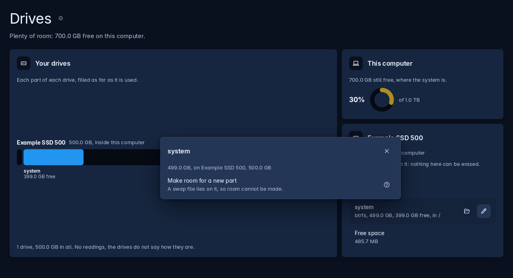

- **"How much of it is in use could not be read"**; **"The drive service does not say how big the files' area is"**; **"The open copy of it could not be found"**; and **"The sizes given for it do not agree"** (also for the encryption). Drives will not guess at a size.
- **"Another change is still being made."** Try again when it has finished.
- **"A snapshot can only be taken of the system's own disk, so room cannot be made here."** Drives takes a snapshot before it makes room. That way you can go back. A snapshot is a saved copy of the disk as it was at one moment. Only the system's own disk can have one.
- **"It holds ... and needs more than that kept, so too little can be freed."** The part must keep what is in it, plus a tenth more or 2 GB, whichever is more. At least 1 GB must be left to give. If less than that can be freed, nothing is offered.

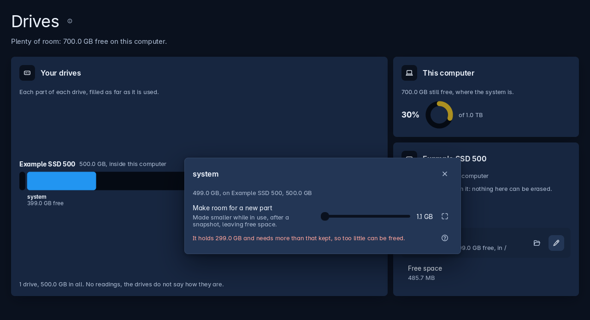

- **"Room from ... to ... can be made."** Said when the size you chose is outside that range. Choose one inside it.

If it goes wrong once it has begun, the snapshot is the way back. Then Drives checks after every step:

- **"The snapshot could not be found afterwards."** and **"Nothing was resized."** The snapshot did not appear, so nothing was changed.
- **"Things changed while the snapshot was taken, so nothing was resized."** The sizes were worked out again after the password, and they no longer fitted.
- **"... so the work was stopped."** A check after a step found the files, the encrypted copy or the part not the size they should be. Or it found one of them no longer listed by the drive service. Drives stops before the next step, so nothing is left outside what holds it.

:::expert
The order is always the files' area first, then the open copy of an encrypted part, then the part itself. Each is followed by a check of the sizes the drive service gives. The part keeps what is used plus the larger of a tenth of it and 2 GiB, and room of less than 1 GiB is not offered. An encrypted part's header, between its start and the open copy, must be between 1 MiB and 64 MiB. A size is accepted if it is within 4 MiB under the target, for rounding.
:::

## A name or size was not accepted
Questions: why does it say that name is too long; why does it say use only letters, numbers and dashes; why does it say a folder is already in use; why does it say FAT names cannot hold some marks; why does it say this kind cannot be made smaller; why does it say mount it first to make it larger

Drives checks what you typed before it asks for a password, so nothing is changed by a name it will not take. The words appear under the box you typed in.

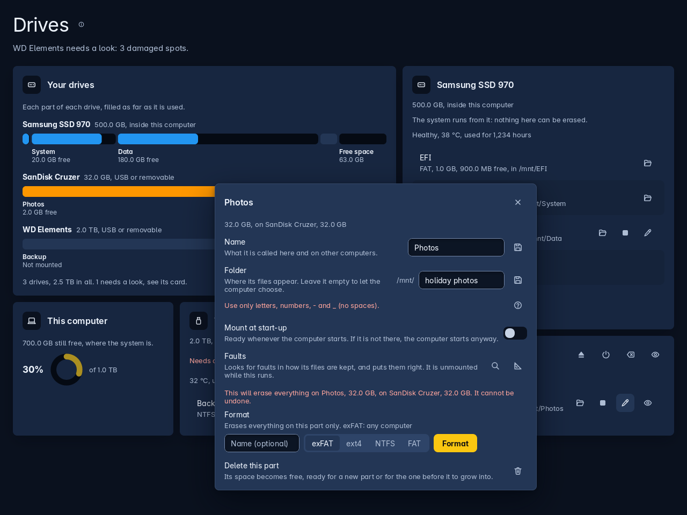

For the folder a drive appears in (it is made under `/mnt`):

- **"Give it a name first."** The box is empty.
- **"That name is too long: 32 letters at most."**
- **"Use only letters, numbers, - and _ (no spaces)."**
- **"Start it with a letter or a number."**
- **"/mnt/name is already in use."** Another drive has that folder. Choose another.

For the name of a part, which is its label, the longest each kind keeps is:

- FAT: 11 letters, and no `* ? . , ; : / \ | + = < > [ ] "`.
- xfs: 12. exFAT: 15. ext2, ext3 and ext4: 16. NTFS: 32. Btrfs: 255.

For a size:

- **"Mount it first: this kind can only be made larger while mounted."** (or smaller). Mount the part, then try again.
- **"This kind cannot be made larger."** (or smaller). Some kinds can only be made one way, or only unmounted. Drives uses what the drive service says each can do.

:::expert
Lengths are counted in bytes, so a name with accented letters may allow fewer than the figure. A part that is not mounted may be resized offline if the kind allows it. ext filesystems are checked before an offline change.
:::

## A drive needs attention
Questions: why does it say a drive is failing; why does it say copy anything you want to keep off it now; why does it say it needs a look; why does it say a drive is read-only; why does it say no drive answering; why does it say some faults could not be put right

A drive can report on its own health. Drives shows what it says, and nothing more than it says.

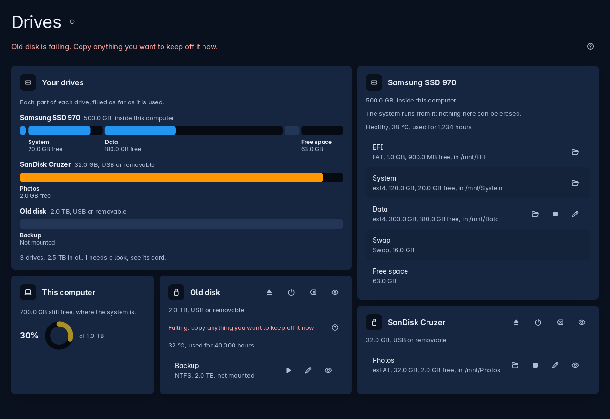

- **"Old disk is failing. Copy anything you want to keep off it now."** The drive's own check says it is going to fail. Copy what matters to another drive straight away. Do not repair, format or resize it first.
- **"Old disk needs a look: ..."**, with the reasons: damaged spots, wearing out, running out of spare space, too hot, has made itself read-only; its memory backup has failed, part of it has made itself read-only, or worn past what its maker expects. These are the drive's own warnings. Copy the files you care about and plan to replace it.
- **"Some faults could not be put right. Copy off anything you want to keep."** You pressed the spanner to repair a part, and the repair could not mend it.
- **"Faults found: press the spanner to repair them."** The check found faults. It is unmounted while it runs. Repair, or copy files off first.
- **"No drive answering."** The case answers, but not the drive inside it. Unplug it, wait ten seconds and plug it into a blue or USB-C port with its own cable. If it stays like this, the drive inside may have come loose or failed.

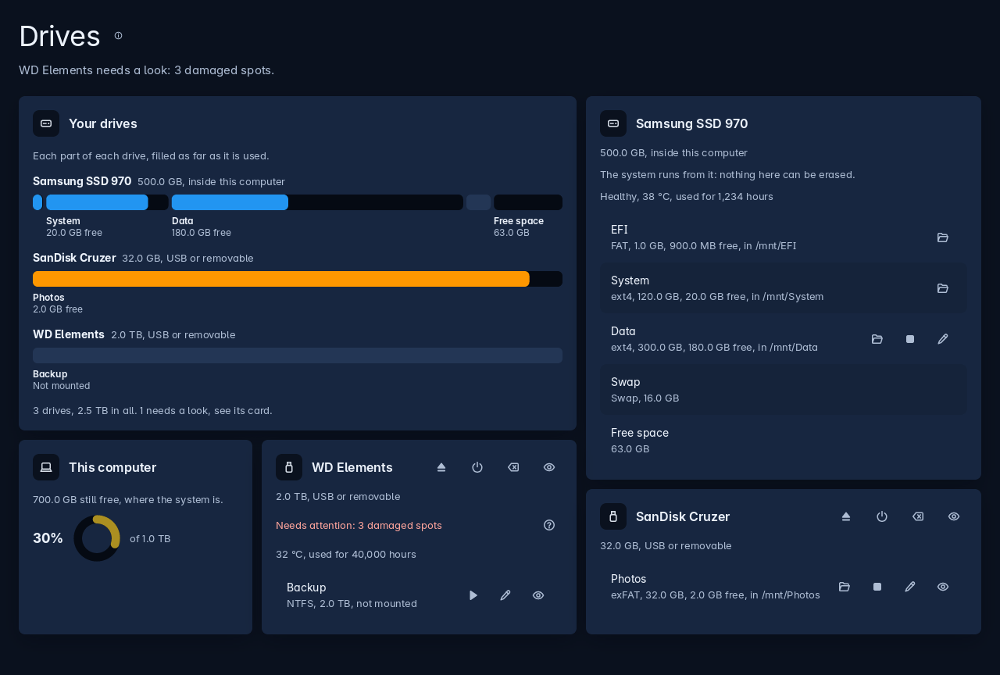

A drive that gives no health reading simply shows none. That is not a fault.

:::expert
Health comes from the drive's SMART report through udisks2: for drives that use ATA the failing flag, the damaged sectors and the number of failing attributes; for NVMe drives the critical warnings and the percentage of life used (100 or more is "worn past what its maker expects"). Drives never reads more into it than the drive says.
:::

## The computer is nearly full
Questions: why does it say nearly full; why does it say delete or move some files soon; how much space is left; what is the headline at the top of Drives; why does it say getting full

The sentence at the top of Drives says how much room is left on the place your own files are kept. Where there is no place of its own for them, it is the system's disk. It turns red when less than half a gigabyte is free, or when 95 per cent of the place is used.

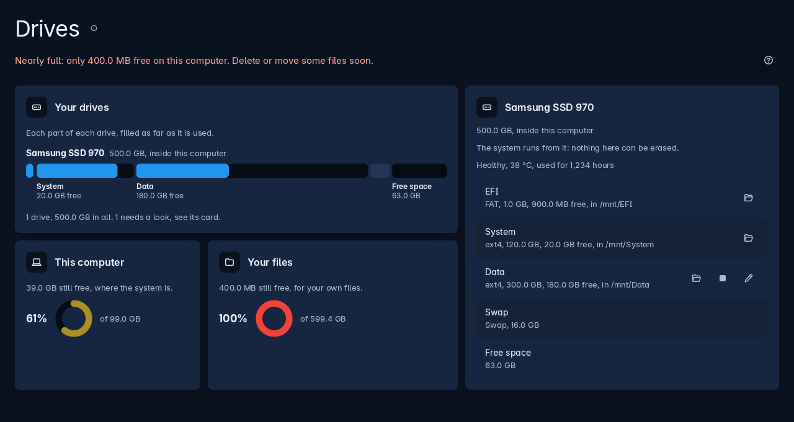

What to do:

1. Open Folders and look for large files you no longer need. Empty the bin.
2. Move big files, such as videos, to a USB drive.
3. Remove apps you do not use, in Apps.

An amber sentence, "Getting full", appears earlier: at 85 per cent used, or when less than 5 GB is free. It is a warning, not a fault.

:::expert
The figures are the filesystem's own counts of used and free blocks. It is called nearly full when the used share is at least 95 per cent or less than 500 MB (decimal) is free. It is called getting full at 85 per cent or less than 5 GB free.
:::

## Hiding a drive was not kept
Questions: why does it say that could not be kept; why does the eye not work; where does Drives remember which drives are hidden; why is a drive still showing in Folders

The eye on a drive or a part hides it from the list and from Folders. Drives remembers your choice in a small file of your own, `hidden-drives.conf`, in your own settings folder. If that file cannot be written, the choice is lost, and Drives says so.

- **"That could not be kept: ..."** The reason follows, such as the disk being full or the settings folder being read-only. Free some room on the system's disk, or put the settings folder right, and press the eye again.

Hiding touches nothing on the drive and asks for no password, so nothing about the drive has changed.

:::expert
The hidden drives are kept one to a line. Each is known by what the drive says of itself (its identifier from model and serial number), never by its device name or its port. Two drives that say exactly the same of themselves are hidden together. A drive that gives nothing to know it by again has no eye.
:::

