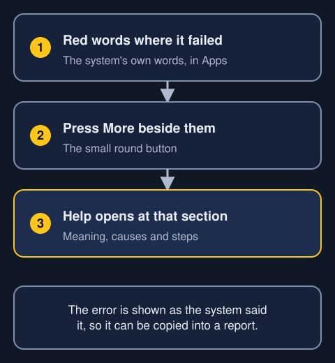
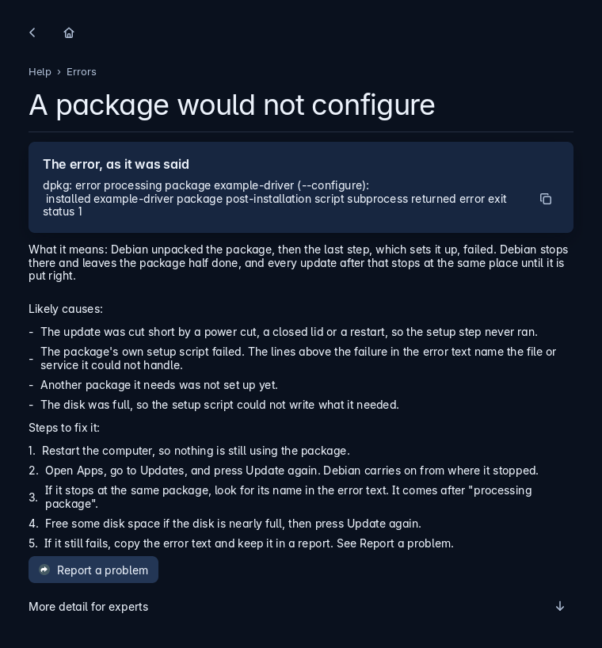
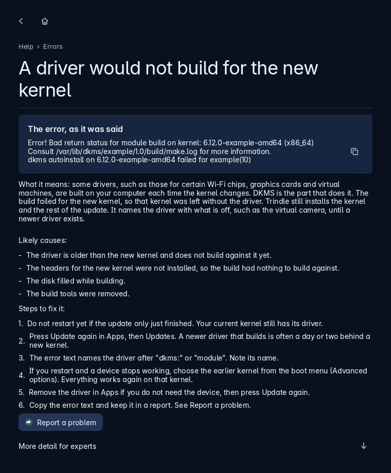
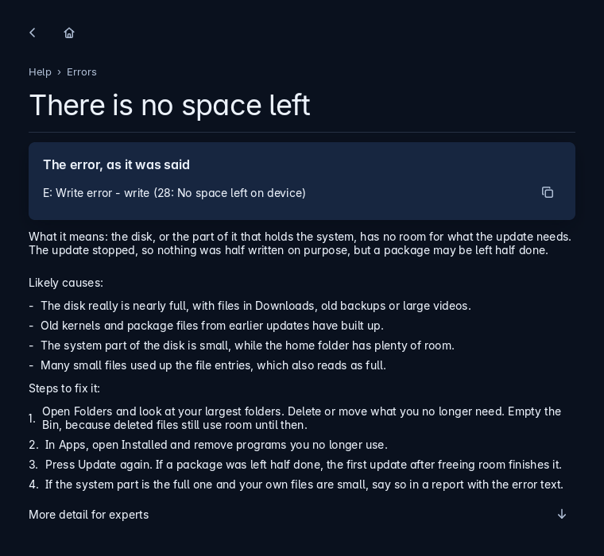
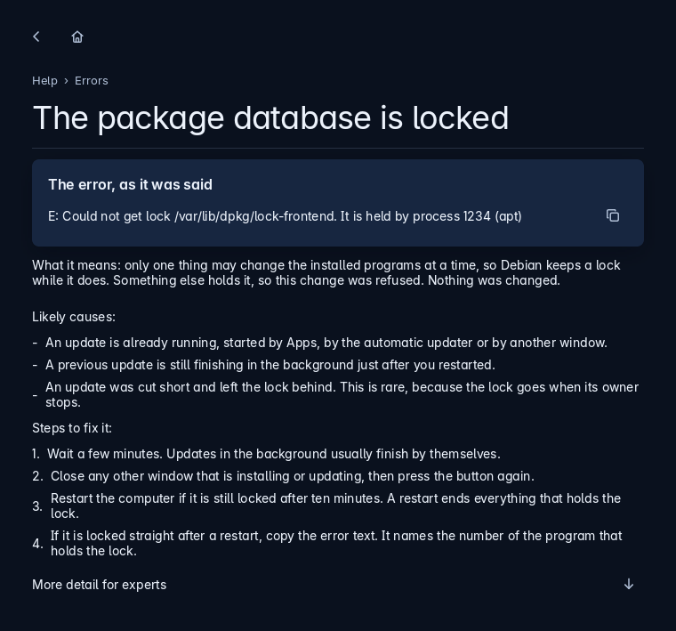
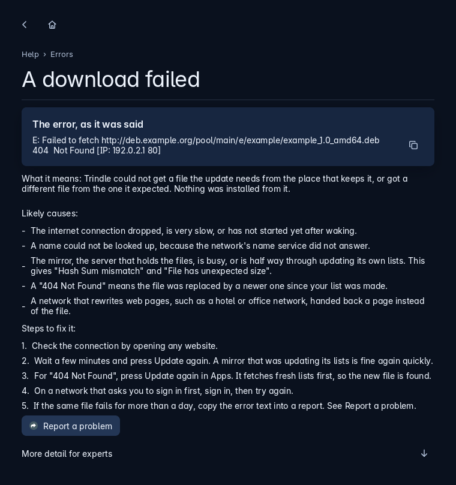
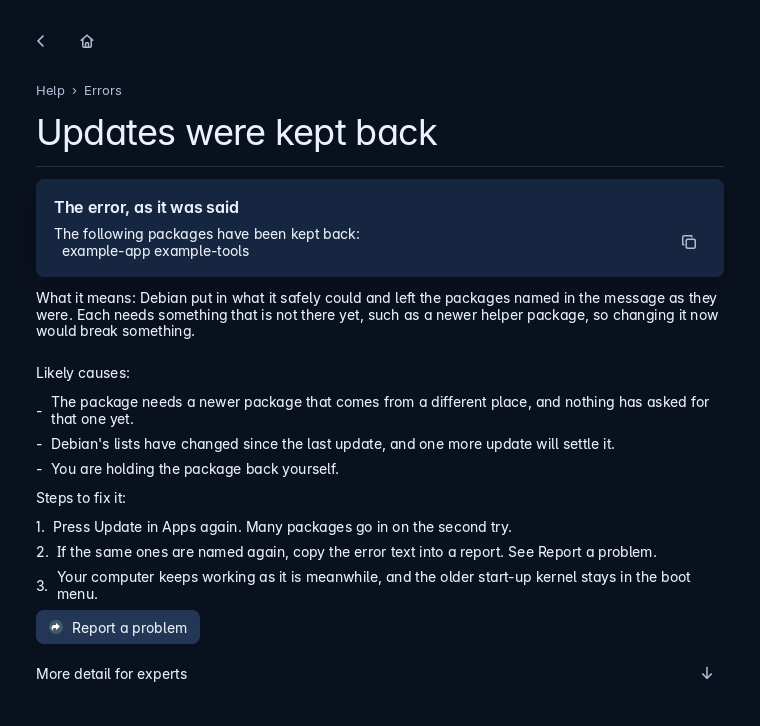
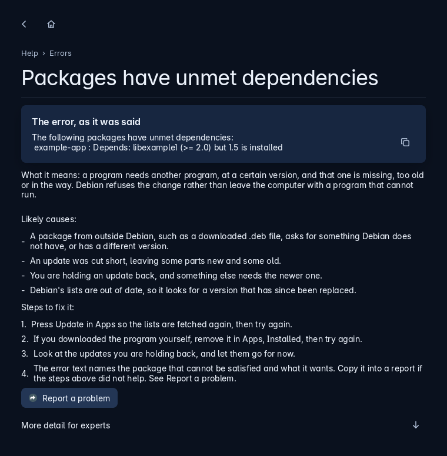
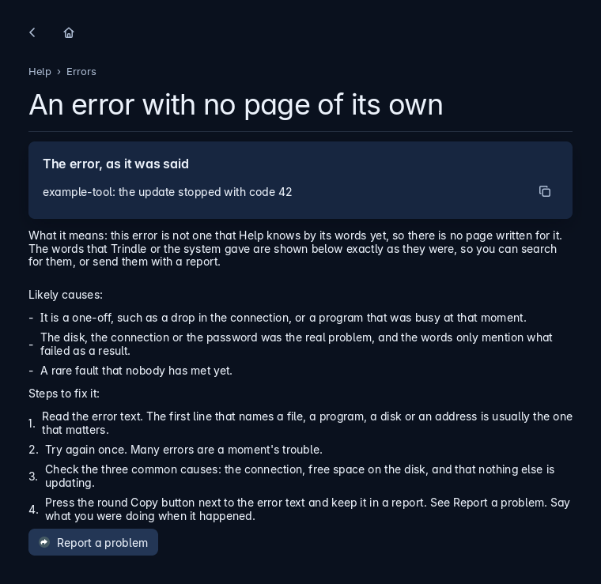

When something fails, Trindle shows the system's own words, and a quiet More beside them opens the section here that fits those words. Each section says what the error means, the likely causes and the steps to fix it. It also shows the error exactly as the system said it, so you can copy it into a report.

## A package would not configure
Questions: what does dpkg error processing package mean; why does it say errors were encountered while processing; what does subprocess installed post-installation script returned error mean; why does an update stop on one package; what does dpkg was interrupted mean; why is a package half installed

What it means: Debian unpacked the package, then the last step, which sets it up, failed. Debian stops there and leaves the package half done, and every update after that stops at the same place until it is put right.

Likely causes:

- The update was cut short by a power cut, a closed lid or a restart, so the setup step never ran.
- The package's own setup script failed. The lines above the failure in the error text name the file or service it could not handle.
- Another package it needs was not set up yet.
- The disk was full, so the setup script could not write what it needed.

Steps to fix it:

1. Restart the computer, so nothing is still using the package.
2. Open Apps, go to Updates, and press Update again. Debian carries on from where it stopped.
3. If it stops at the same package, look for its name in the error text. It comes after "processing package".
4. Free some disk space if the disk is nearly full, then press Update again.
5. If it still fails, copy the error text and keep it in a report. See [Report a problem](report-a-problem.html).

:::expert
The same repair by hand, in a terminal, as an administrator:

- `dpkg --configure -a` sets up every package that was left half done.
- `apt --fix-broken install` finishes anything that is missing.
- `dpkg --audit` lists packages that are still not set up.
:::

## A driver would not build for the new kernel
Questions: what does dkms bad return status for module build mean; why did a driver not build after an update; why does a new kernel fail to install; what does dkms autoinstall failed mean; why does my Wi-Fi or graphics driver stop after a kernel update; what does module build for kernel failed mean

What it means: some drivers, such as those for certain Wi-Fi chips, graphics cards and virtual machines, are built on your computer each time the kernel changes. DKMS is the part that does it. The build failed for the new kernel, so that kernel was left without the driver. Trindle still installs the kernel and the rest of the update. It names the driver with what is off, such as the virtual camera, until a newer driver exists.

Likely causes:

- The driver is older than the new kernel and does not build against it yet.
- The headers for the new kernel were not installed, so the build had nothing to build against.
- The disk filled while building.
- The build tools were removed.

Steps to fix it:

1. Do not restart yet if the update only just finished. Your current kernel still has its driver.
2. Press Update again in Apps, then Updates. A newer driver that builds is often a day or two behind a new kernel.
3. The error text names the driver after "dkms:" or "module". Note its name.
4. If you restart and a device stops working, choose the earlier kernel from the boot menu (Advanced options). Everything works again on that kernel.
5. Remove the driver in Apps if you do not need the device, then press Update again.
6. Copy the error text and keep it in a report. See [Report a problem](report-a-problem.html).

:::expert
- `dkms status` lists each driver and the kernels it is built for.
- The build log is at `/var/lib/dkms/<name>/<version>/build/make.log`. The first error in it is the real cause.
- `apt install linux-headers-$(uname -r)` brings in the headers for the running kernel.
:::

## There is no space left
Questions: what does no space left on device mean; why does it say not enough disk space; why will an update not install because the disk is full; how do I free disk space for an update; what does ENOSPC mean

What it means: the disk, or the part of it that holds the system, has no room for what the update needs. The update stopped, so nothing was half written on purpose, but a package may be left half done.

Likely causes:

- The disk really is nearly full, with files in Downloads, old backups or large videos.
- Old kernels and package files from earlier updates have built up.
- The system part of the disk is small, while the home folder has plenty of room.
- Many small files used up the file entries, which also reads as full.

Steps to fix it:

1. Open Folders and look at your largest folders. Delete or move what you no longer need. Empty the Bin, because deleted files still use room until then.
2. In Apps, open Installed and remove programs you no longer use.
3. Press Update again. If a package was left half done, the first update after freeing room finishes it.
4. If the system part is the full one and your own files are small, say so in a report with the error text.

:::expert
- `df -h` shows each disk and how full it is, and `df -i` shows how many file entries are left.
- `apt clean` deletes the downloaded package files that are no longer needed.
- `apt autoremove --purge` removes old kernels and libraries nothing needs.
:::

## The package database is locked
Questions: what does could not get lock var lib dpkg lock mean; why does it say another process is using it; why can I not install while an update runs; what does unable to acquire the dpkg frontend lock mean; why does apt say the lock is held

What it means: only one thing may change the installed programs at a time, so Debian keeps a lock while it does. Something else holds it, so this change was refused. Nothing was changed.

Likely causes:

- An update is already running, started by Apps, by the automatic updater or by another window.
- A previous update is still finishing in the background just after you restarted.
- An update was cut short and left the lock behind. This is rare, because the lock goes when its owner stops.

Steps to fix it:

1. Wait a few minutes. Updates in the background usually finish by themselves.
2. Close any other window that is installing or updating, then press the button again.
3. Restart the computer if it is still locked after ten minutes. A restart ends everything that holds the lock.
4. If it is locked straight after a restart, copy the error text. It names the number of the program that holds the lock.

:::expert
- `fuser -v /var/lib/dpkg/lock-frontend` names the program that holds the lock.
- Never delete the lock files by hand while that program is running. It can leave the package database damaged.
:::

## A download failed
Questions: what does failed to fetch mean; why does it say hash sum mismatch; what does 404 not found mean in an update; why does it say some index files failed to download; what does temporary failure resolving mean; why do updates fail with could not resolve

What it means: Trindle could not get a file the update needs from the place that keeps it, or got a different file from the one it expected. Nothing was installed from it.

Likely causes:

- The internet connection dropped, is very slow, or has not started yet after waking.
- A name could not be looked up, because the network's name service did not answer.
- The mirror, the server that holds the files, is busy, or is half way through updating its own lists. This gives "Hash Sum mismatch" and "File has unexpected size".
- A "404 Not Found" means the file was replaced by a newer one since your list was made.
- A network that rewrites web pages, such as a hotel or office network, handed back a page instead of the file.

Steps to fix it:

1. Check the connection by opening any website.
2. Wait a few minutes and press Update again. A mirror that was updating its lists is fine again quickly.
3. For "404 Not Found", press Update again in Apps. It fetches fresh lists first, so the new file is found.
4. On a network that asks you to sign in first, sign in, then try again.
5. If the same file fails for more than a day, copy the error text into a report. See [Report a problem](report-a-problem.html).

:::expert
- `apt update` fetches the lists again and prints which address failed.
- `apt clean` removes half-downloaded files that would make a "size mismatch" repeat.
:::

## Updates were kept back
Questions: why does it say kept back; what does not all updates went in mean; why was the kernel not updated; why was firmware not updated; why does apt keep packages back

What it means: Debian put in what it safely could and left the packages named in the message as they were. Each needs something that is not there yet, such as a newer helper package, so changing it now would break something.

Likely causes:

- The package needs a newer package that comes from a different place, and nothing has asked for that one yet.
- Debian's lists have changed since the last update, and one more update will settle it.
- You are holding the package back yourself.

Steps to fix it:

1. Press Update in Apps again. Many packages go in on the second try.
2. If the same ones are named again, copy the error text into a report. See [Report a problem](report-a-problem.html).
3. Your computer keeps working as it is meanwhile, and the older start-up kernel stays in the boot menu.

:::expert
- `apt-get -s --with-new-pkgs upgrade` shows what is kept back without changing anything.
- `apt-cache policy <name>` shows which version is wanted and from where.
:::

## Packages have unmet dependencies
Questions: what does unmet dependencies mean; why does it say you have held broken packages; what does depends but it is not going to be installed mean; why will a package not install because another is missing; what does apt fix-broken install mean

What it means: a program needs another program, at a certain version, and that one is missing, too old or in the way. Debian refuses the change rather than leave the computer with a program that cannot run.

Likely causes:

- A package from outside Debian, such as a downloaded .deb file, asks for something Debian does not have, or has a different version.
- An update was cut short, leaving some parts new and some old.
- You are holding an update back, and something else needs the newer one.
- Debian's lists are out of date, so it looks for a version that has since been replaced.

Steps to fix it:

1. Press Update in Apps so the lists are fetched again, then try again.
2. If you downloaded the program yourself, remove it in Apps, Installed, then try again.
3. Look at the updates you are holding back, and let them go for now.
4. The error text names the package that cannot be satisfied and what it wants. Copy it into a report if the steps above did not help. See [Report a problem](report-a-problem.html).

:::expert
- `apt --fix-broken install` asks Debian to repair what it can.
- `apt-cache policy <name>` shows which versions are available and why one is chosen.
:::

## An error with no page of its own
Questions: what do I do about an error that Help does not list; why does it say something I do not understand; what does an error mean when Help has no page for it; how do I report an error; what is the error text for

What it means: this error is not one that Help knows by its words yet, so there is no page written for it. The words that Trindle or the system gave are shown below exactly as they were, so you can search for them, or send them with a report.

Likely causes:

- It is a one-off, such as a drop in the connection, or a program that was busy at that moment.
- The disk, the connection or the password was the real problem, and the words only mention what failed as a result.
- A rare fault that nobody has met yet.

Steps to fix it:

1. Read the error text. The first line that names a file, a program, a disk or an address is usually the one that matters.
2. Try again once. Many errors are a moment's trouble.
3. Check the three common causes: the connection, free space on the disk, and that nothing else is updating.
4. Press the round Copy button next to the error text and keep it in a report. See [Report a problem](report-a-problem.html). Say what you were doing when it happened.
