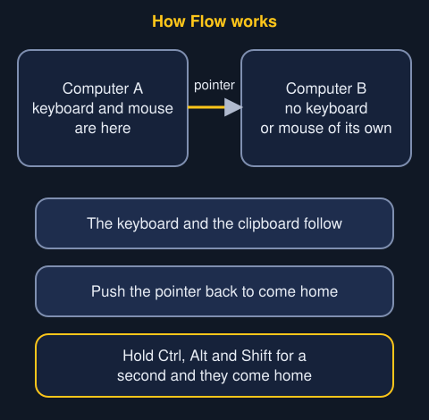
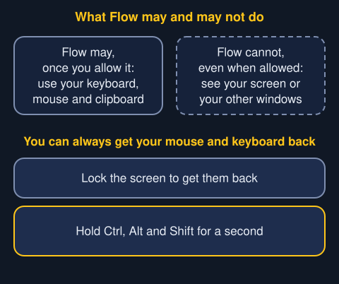

With Flow on two Trindle computers, one mouse and keyboard work on both. Move the pointer off the side of the screen where the other computer sits, and it carries on there. The keyboard and the clipboard go with it. Move the pointer back to return to the first computer.

## Setting it up

1. Open Apps and go to the Plugins page. Install Flow on both computers.
2. On the computer whose mouse and keyboard you want to use, switch on **This computer controls the other one** in Flow's settings. It can be either computer.
3. Pair the two computers once. The other computer shows a four-digit number. Type it on the computer that controls.

Nothing is installed until you press Install. Flow has a folder of its own, and it can't do anything until you allow it.

## What you are asked to allow

Flow asks your permission to control your keyboard, mouse and clipboard. Trindle shows a plain warning with this, because these are powerful things to allow. Even when you allow it, Flow can't see your screen or your other windows.

Flow also needs the other computer to be able to reach it. Trindle says so plainly and lists the ports. A port is a numbered entry point that a computer uses to talk to another one. The wording is something like "Let other computers on your home network reach it."

If you allow it, Trindle opens exactly those ports, and only for the computers on your own home network. Trindle closes them as soon as you take the permission away or remove Flow.

To carry a file you copied over to the other computer, Flow asks to read the files you copy. It can then ask Trindle for only the files on the clipboard. It can't see the folders they are in, or your hidden files. It can ask once every two seconds, and only for two minutes after you copy.

## You can always get your mouse and keyboard back

- When the screen locks, the mouse and keyboard always come back to this computer.
- Hold Ctrl, Alt and Shift together for a second, and the mouse and keyboard come back to this computer, whatever is happening.

While Flow is controlling your mouse and keyboard, Trindle shows its violet in-use dot at the top middle of every screen. Point at the dot to see that it's Flow. See [The in-use dots](in-use-dots.html).

To take the permission away for good, open Settings, then Permissions. In the Plugins card, switch off what you allowed for Flow.

## Related

- [Apps](apps.html): where Flow is installed.
- [The lock screen](lock-screen.html): what locking the screen does to Flow.
- [Glossary](glossary.html): the words plugin and permission.
