Folders is where you browse, open, copy, move and tidy your files. Open it from the ring.

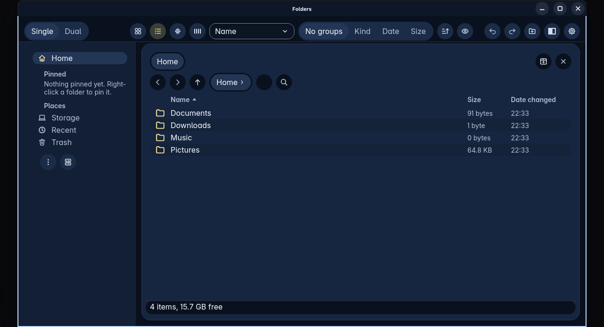

## One pane or two

A pane is one list of files. Folders opens with one pane.

1. Find the Single and Dual switch at the left of the top bar.
2. Press it, or press F3. The change happens at once.
3. Folders remembers your choice for next time.

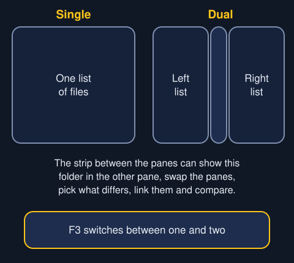

With one pane, Folders starts on Home. With two, the left pane starts on Home and the right one on Recent. In Folders' own settings you can choose where each pane starts, or have it carry on where you left it.

With two panes, each one is a card of its own. A strip of buttons sits between them. The buttons can show this folder in the other pane, swap the panes, pick what is different from the other pane, link the two panes, and compare them.

The pane you are using has a slightly different edge on its card. That shows which pane a click in the side bar will change. Both panes are always the same width.

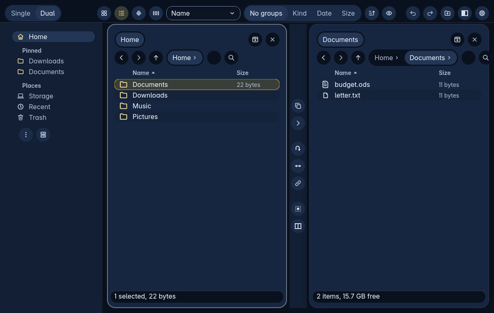

## The side bar

The side bar has a Pinned section for the folders you pin. Below that is Places, which has Storage, Recent and Trash.

Right-click a folder to pin it. If you haven't pinned anything yet, Folders pins Downloads and Documents for you. If you unpin one, it doesn't come back.

## Seeing your files

There are three views: Icons, List and Compact. In List, you can choose which columns to show, such as size, type and the date changed.

Folders shows small previews of your pictures, videos and PDFs. A separate program reads videos and PDFs inside a sealed box with no network. A booby-trapped file can't reach anything else.

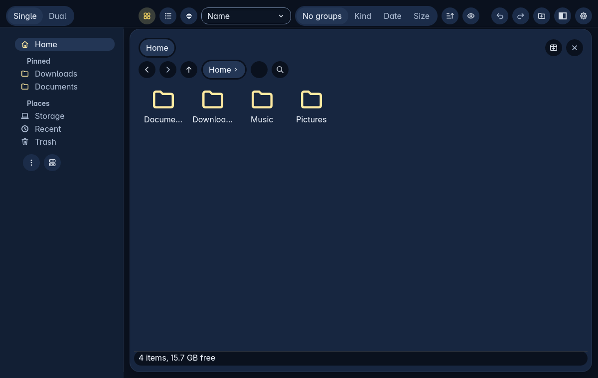

Press Space on a video or a song and it starts playing straight away. You get a pause button, a slider and a volume control, without opening another app.

## The right-click menu

The main menu shows no more than twelve lines. The ones you use least are in four sub-menus: Select, Pack, send and share, Picture, and Tools. Each line is in only one place, so you find it in the same spot whatever you right-click.

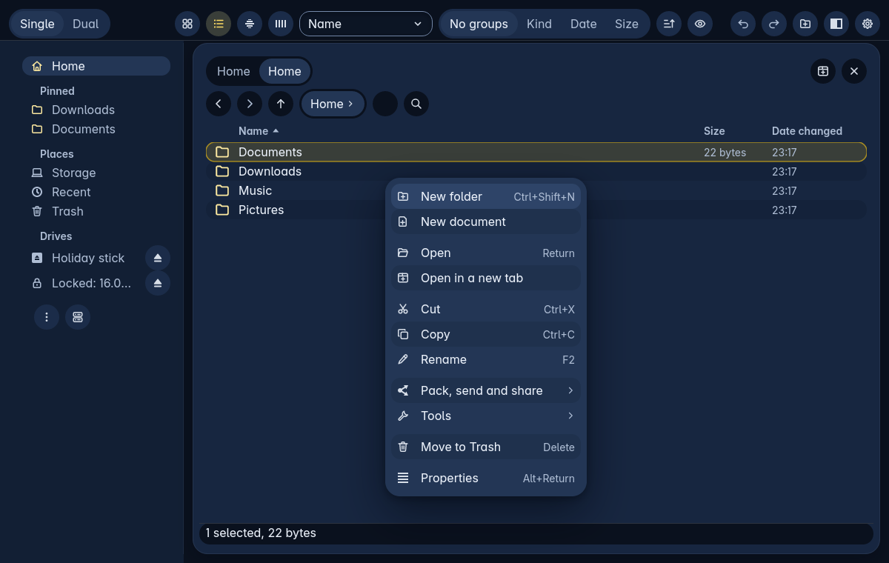

A delete is never the first line of a sub-menu. Wipe securely and Delete permanently are as far from Open as they can be in the menu.

Every file opens. If a file's name doesn't show what kind of file it is, Folders looks at its start to find out. An empty file or a plain text file opens in Text. If no app opens that kind of file, the Open with window appears so you can choose one.

## Other computers
Questions: why won't my NAS open; how do I find a shared folder on my network; how do I see other computers in Folders

Network finds the computers on your network that share folders, such as a NAS. A NAS is a small computer that stores files for your home. Folders looks in two ways at once and lists each computer once. Open a computer to see its shares.

If Folders finds no computers, it tells you how it looked.

Folders can remember a login you type for a shared folder for 90 days. The switch on the card shows this. It sends a remembered login only to an address you've used before. If a computer answers at a new address, Folders asks you again and tells you why.

An nfs:// address opens only on a server that offers NFS version 4. Only very old NAS boxes still use version 3, which Trindle doesn't use, so nothing extra runs. If a server doesn't offer version 4, a label under the files says so. NFS shares secured with Kerberos don't work.

When you save a file back to another computer, Folders writes a new copy first. It swaps the new copy in only when it is complete, so a dropped connection can't leave half a file.

## Copying and moving

Paste moves files only if you cut them in Folders. If you cut files in another program, Paste copies them and leaves the originals.

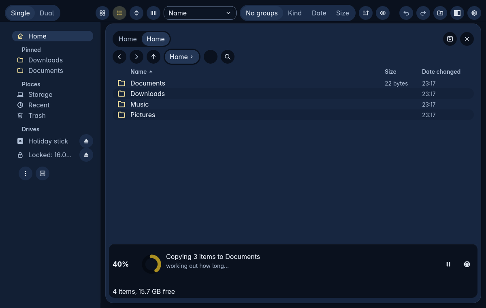

While a big copy runs, a quiet line in its row tells you that copying works the disk hard. Other programs may feel slower until it finishes.

## Folders' own settings

You change Folders' settings inside Folders itself.

1. Press the round cog at the far end of the top bar, or press Ctrl and comma.
2. A card opens over the window.
3. Change what you want. Folders saves as you go, so there is no Save button.

The card has settings for when Folders opens, the file endings and tick boxes, opening drives, and the logins Folders has kept.

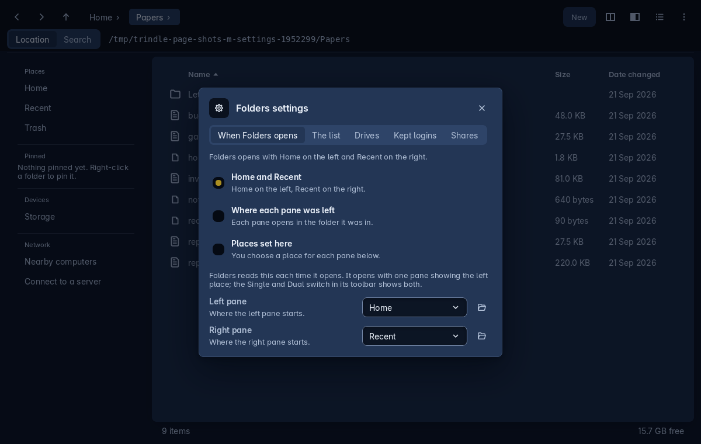

## On its own

Folders is a separate app. It doesn't need the ring or the rest of Trindle to run, and it may be offered on its own one day. Things that reach outside Folders, such as pinning to the ring or opening Settings, only appear when that part of Trindle is there.

## When something goes wrong

When Folders can't do what you asked, it shows red words at the bottom of the window, with a small round **More** button beside them. Press it and Help opens at the page for that message. Each page below explains what happened, why, and what to do.

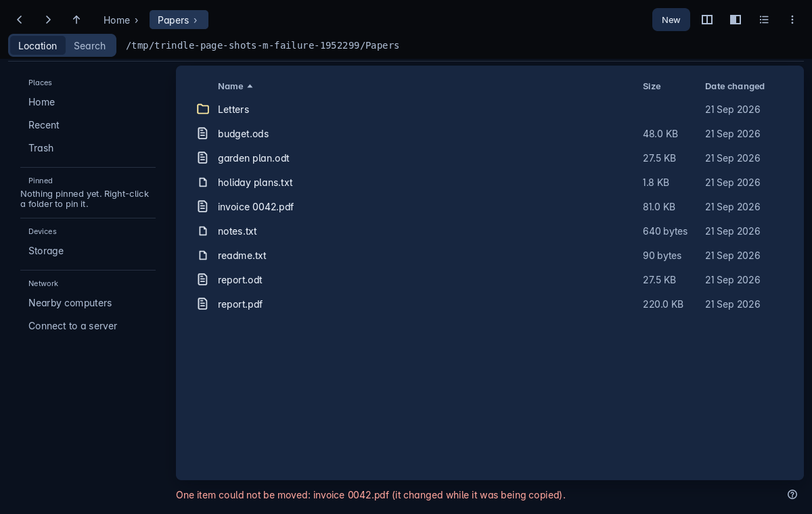

- [An archive wants a password](folders.html#archive-password): a zip or 7z file that asks for one, or doesn't accept the one you typed.
- [An archive will not open](folders.html#an-archive-will-not-open): it isn't a kind of archive Folders can read, it's damaged, or a part is missing.
- [An archive will not unpack here](folders.html#an-archive-will-not-unpack-here): it's too big, there's no room, or you can't write in the folder.
- [Work that did not finish](folders.html#work-that-did-not-finish): a copy, move or delete that left some items behind.
- [Choices that were not kept](folders.html#choices-that-were-not-kept): a setting that went back to how it was after you closed Folders.
- [A program would not start](folders.html#a-program-would-not-start): an action that passes your file to another program.
- [A part is not on this computer](folders.html#a-part-is-not-on-this-computer): an action that needs something Folders doesn't include itself.
- [A drive would not open or be put away](folders.html#a-drive-would-not-open-or-be-put-away): on the Storage page or in the side bar.

- [A server would not answer](folders.html#a-server-would-not-answer): the name wasn't found, the connection was turned away, the link dropped, or the address can't be read.
- [A server would not let you in](folders.html#a-server-would-not-let-you-in): a problem with a login, a key, a new or changed identity, or a certificate.
- [A server would not do that](folders.html#a-server-would-not-do-that): the server answered and then said no, or a secure link couldn't be made.

- [A phone would not show its files](folders.html#a-phone-would-not-show-its-files): a phone or camera plugged in by USB.
- [A name was refused](folders.html#a-name-was-refused): a name that can't be used, or an unsafe name from a server.
- [A share asks for a login](folders.html#a-share-asks-for-a-login): a Windows share that wants a user name and password, or a kept login that Folders didn't send.
- [A share would not open](folders.html#a-share-would-not-open): a Windows share or NFS export that didn't answer, wasn't found, or said no.
- [A folder could not be shared](folders.html#a-folder-could-not-be-shared): the Share part of a folder's Properties.
- [A file could not be read](folders.html#a-file-could-not-be-read): the preview, the viewer, a picture, a video, a PDF or the checksums.
- [Details could not be changed](folders.html#details-could-not-be-changed): the dates, read-only flag, photo notes and song tags in Properties.
- [A folder would not open](folders.html#a-folder-would-not-open): a pane that can't show a folder, or a place that isn't answering.
- [Colours and emblems did not follow](folders.html#colours-and-emblems-did-not-follow): something moved, but its colour or emblem stayed behind.
- [A drag from or to another program did not finish](folders.html#a-drag-from-or-to-another-program-did-not-finish): a drop that brought nothing, or a drag where the other program took only part of it.
- [Something could not be made here](folders.html#something-could-not-be-made-here): a new folder, document, link, font or wallpaper.
- [A comparison or search stopped](folders.html#a-comparison-or-search-stopped): Compare and Duplicates.

## Archive password
Questions: why does my zip ask for a password; why does Folders say that password does not open it; how do I open a locked RAR; why can't I open a password protected 7z; what does it is locked with a password mean

Some zip and 7z files are locked with a password. When you open or unpack one, Folders asks for the password on a small card called **Password for**, followed by the file's name. Type the password and press **Open** or **Extract**.

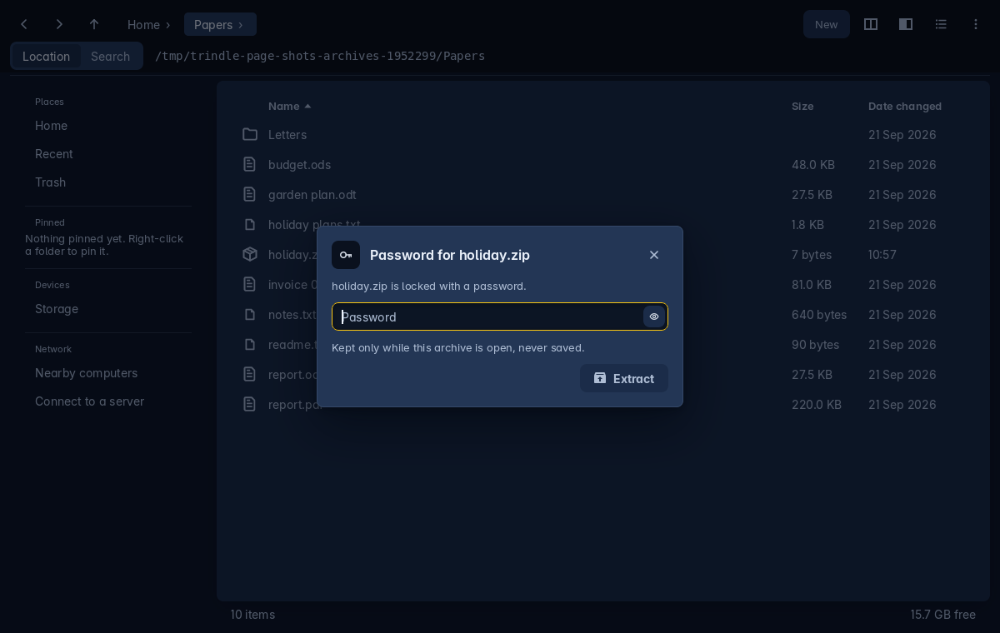

If the password is wrong, the card stays and shows red words under the box: "That password does not open it." Type another password and try again. Folders remembers the password only while the archive is open, and never saves it to the disk.

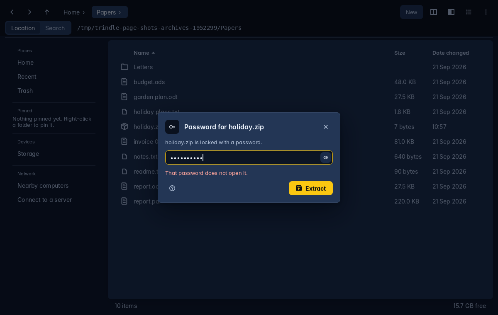

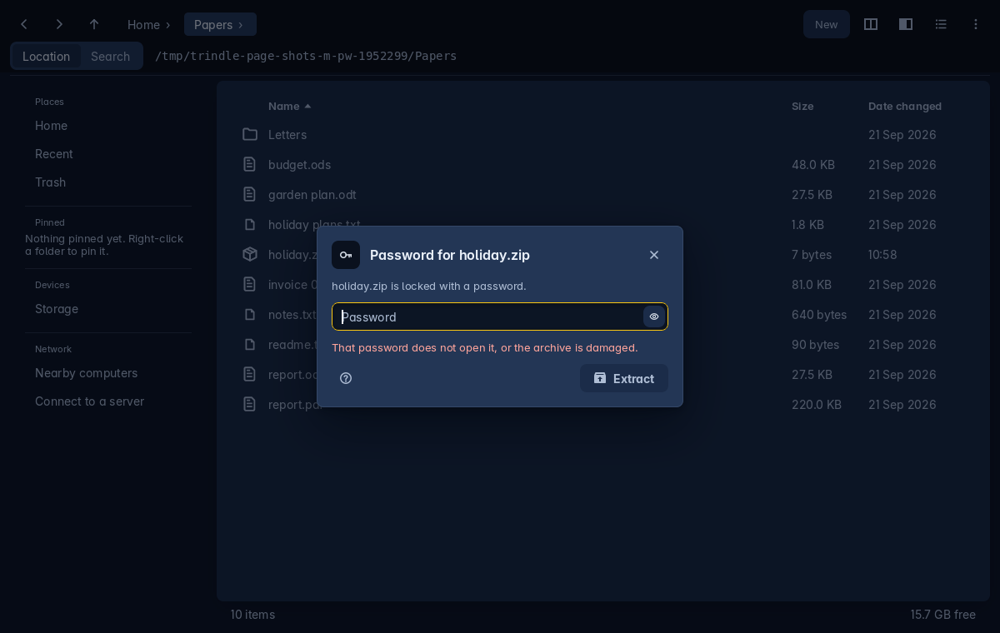

Some messages are different:

- "It is locked with a password and packed a way Folders cannot unlock." Folders has no way to unlock this kind of archive.
- "It is a RAR locked with a password, which Folders cannot unlock; nothing is wrong with the file." Use a program that can unlock a RAR.
- "That password does not open it, or the archive is damaged." With some archives, especially 7z, Folders can't tell the two apart, so the message gives both. Check the password first. If you're sure it's right, the file may be damaged, so download or copy it again.
- "holiday.zip is locked with a password. Open it again to type it." Another window was open over Folders, so the card couldn't appear. Close that window, then open the archive again.

:::expert
Folders keeps the password in memory only while a pane shows the archive, and wipes it from memory when the card closes. Folders can open zips locked the traditional zip way or with AES, and 7z files locked with their own AES lock. If the file names in a 7z are locked too, you need the password just to see what is inside it.
:::

## An archive will not open
Questions: why won't Folders open my archive; what does it is not an archive Folders can open mean; why won't my split archive open; why is the part of Trindle that reads this kind missing; what does damaged or cut short mean

Folders opens an archive like a folder, so you can look inside it. When it can't, red words tell you why in a few words. These are the reasons you may see.

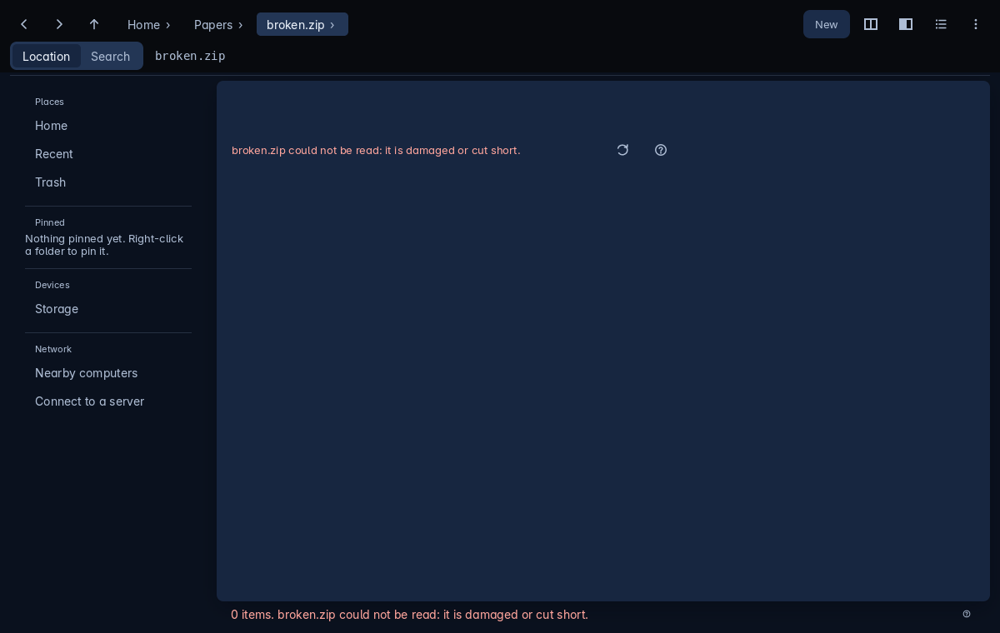

- **It is not an archive Folders can open.** Folders looks at the end of the file's name and at the first bytes of the file. The file may not be an archive at all, or it may be a kind Folders can't read. Check that it's the file you meant.
- **It is damaged or cut short.** The file ends too soon, or what is inside it makes no sense. This often happens when a download stops part way. Get the file again.
- **It is packed a way Folders cannot read.** The archive uses a method Folders doesn't know.
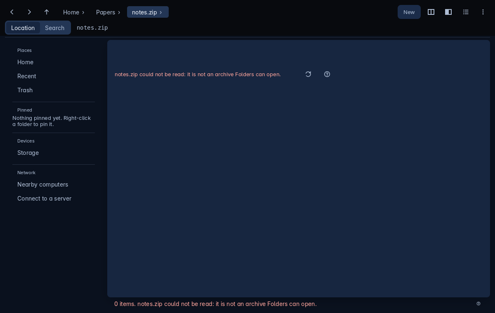

- **A part of it is missing, and every part has to be in the same folder.** A split archive is several files. Put all of them in one folder, then open the first.
- **The part of Trindle that reads this kind is missing, and installing updates puts it back.** A reader that comes with Trindle opens kinds such as RAR, disc images and .deb files. Install the waiting updates, then try again.
- **It is not there any more.** The file was moved or deleted after Folders showed it.
- **It could not be read.** Folders has no more detail than that.

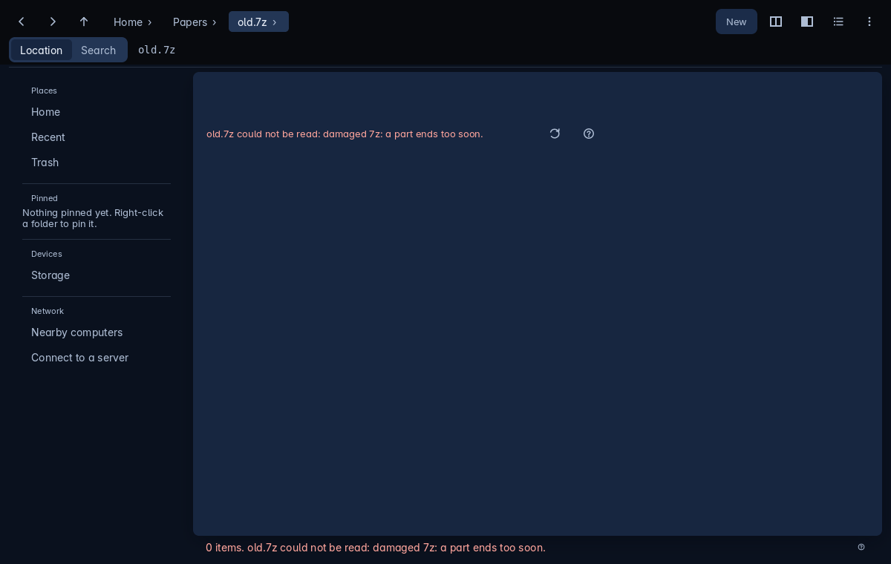

When Folders can tell what is wrong inside a zip or 7z, it adds that after "damaged zip" or "damaged 7z". For example, a check doesn't match, a part ends too soon, a header is far too big, or a count is far too big. All of these mean the file is damaged or has been made to look wrong. Get the file again.

If you were taking something out of the archive, the words start with "It could not be taken out of the archive". They end with one of the reasons above.

:::expert
Folders' own code reads zip, tar (plain, gzip, bzip2 and xz) and 7z. The system's libarchive reads every other kind, inside a box with no network and no access to the rest of your files. A booby-trapped archive can't reach anything else. If that box or reader is missing, you see the "part of Trindle" reason above.
:::

## An archive will not unpack here
Questions: why will my archive not unpack; what does there is not room here for what it holds mean; why does it say it holds more than a million things; why does it need more memory or time than Folders allows; why could names not be taken out

Unpacking is done with care. Folders won't fill a drive right to the top, and it limits what an archive from a stranger can ask of your computer. These are the reasons it stops.

- **There is not room here for what it holds.** The drive you are unpacking onto has less free space than the archive needs. Folders always leaves some space free, so it stops a little before the drive is full. Free some space or unpack onto another drive.
- **Nothing can be written in that folder.** The folder is read-only, or you aren't allowed to put files in it. Unpack into a folder of your own.

- **It holds more than a million things.** Folders won't unpack more than a million things from one archive.
- **It needs more memory or time to read than Folders allows.** Some archives are made so that opening them takes a huge amount of work. Folders stops rather than slow down the whole computer.
- **This 7z needs more memory to unpack than Folders will give it.** The same rule applies to a 7z whose settings ask for a very large amount of memory.
- **N could not be taken out, as their names reach outside or something is in the way.** An archive can contain names that try to climb out of your folder. Folders refuses those and unpacks the rest.

:::expert
Folders always leaves 256 MB free on the drive. The box that reads the other kinds may use 2 GB of memory. Listing the names in an archive may use up to 120 seconds of processor time, and unpacking up to two hours. Folders refuses a 7z whose dictionary is larger than 2 GB. Nothing is written outside the folder you chose. Links are made last, and they can't point outside it. Nothing that comes out of an archive is ever run.
:::

## Work that did not finish
Questions: why couldn't my files be copied; why did a move leave files behind; what does it was left mean; why did a delete not work; what do the words in brackets after a file name mean

When a copy, move or delete doesn't finish, the red words say how many items failed. They name the first three, then add "and N more". Each name may have a reason in brackets after it. If there are no brackets, Folders has no reason for that item.

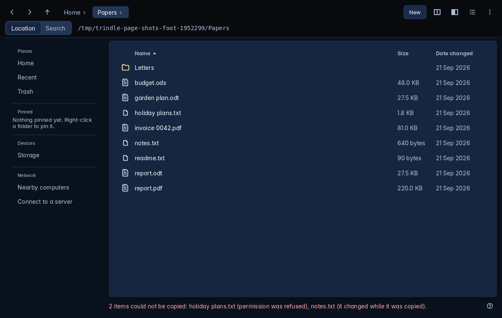

What the reasons mean:

- **It was not there when this was looked at, so it was left.** A hidden item or a link had gone by the time Folders reached it.
- **Too big to check fully, so it was left.** A hidden item or a link was in a folder too big to check right to the end.
- **It has changed since it was dropped, so nothing was brought.** You dragged it in from another program, and it changed before Folders took it.
- **Something else was given that name meanwhile.** Another program made a file with that name after Folders looked at the folder.
- **The one already there could not go to the Trash.** You chose to replace something. Folders couldn't put the old one in the Trash first, so it left both where they were.
- **It changed after it was copied, so it is still where it was.** When you move something, Folders copies it first. It removes the original only after checking that the copy is complete. This one changed, so the original stays.
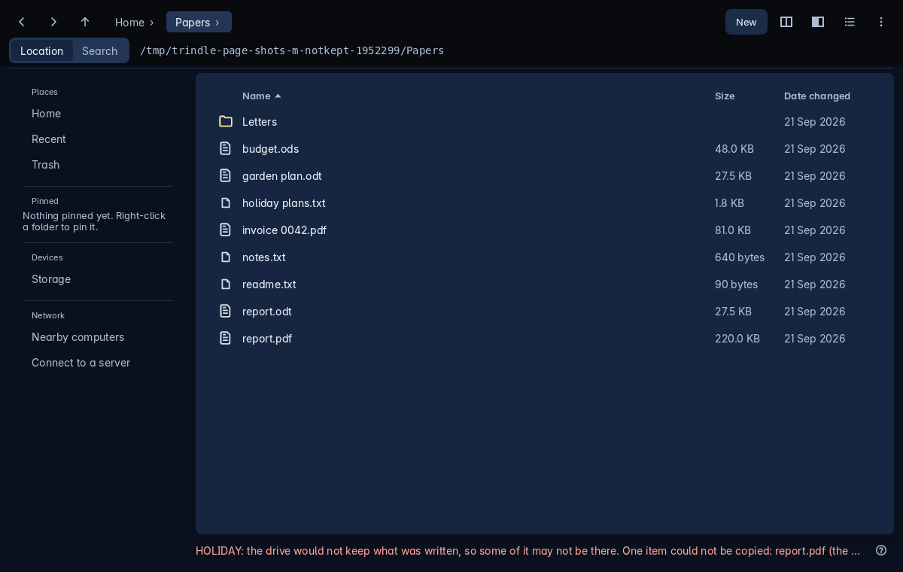

- **The drive would not keep what was written, so some of it may not be there.** The drive didn't confirm that everything reached it. Check the copy before you rely on it.
- **Not all of it could be read.** The folder's list stopped part way through.
- **It is inside the one it would replace.** You can't replace a folder with something that is inside it.
- **This copy made it.** You were copying a folder into itself, so Folders did not copy the new folder that the copy had just made.
- **The copy is not what was read.** What was written didn't match what was read, so Folders rejected the copy.

More reasons you may see:

- **It could not be looked through to its end, so it is still where it was.** A folder was too big or too slow to check before it was moved.
- **It could not be taken away.** The copy is complete, but Folders couldn't remove the original, so both exist.
- **It could not go to the Trash.** This drive has no safe place for a Trash, there was nothing to move, or the Trash already has too many items with that name. If you mean it, use Delete permanently, or free some room.
- **Not moved, with how many unreadable files, system files or other things stayed.** Folders removes a folder only after everything in it is proved to have arrived. A folder that has such things in it stays where it was.
- **Only JPEG, PNG, WebP and BMP pictures can be turned, the picture could not be read, or it is not a kind of picture Folders writes.** This applies to Turn and Resize.
- **Renaming stopped part way.** A batch rename hit something it couldn't do, and stopped. The reason follows.

Folders removes an original only after its copy is proved complete, so an item named here is still where it was. Try again with fewer items, or one at a time.

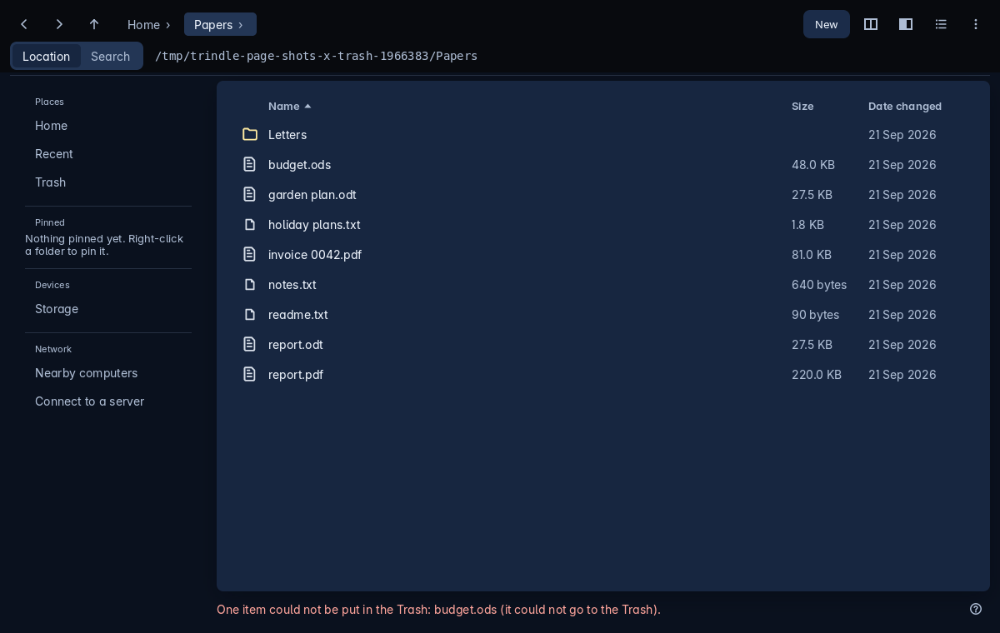

:::expert
A move across drives copies the file, checks that each copy is complete, and only then removes the original. So a failed move leaves the original in place. A file counts as moved only once its copy is known to be complete.
:::

## Choices that were not kept
Questions: why did Folders forget my view; why did my columns go back to how they were; what does could not be kept for next time mean; why couldn't Folders save my settings

Folders saves your choices in small files of its own, in the `trindle` folder of your settings. Two of them are `folders.conf` and `files-views`. They cover panes, views, grouping, columns and icon size. When Folders says a choice "could not be kept" or "could not be saved", the choice works until you close Folders. Then it goes back to what it was.

Folders can't write a file when the disk is full, or when you can't write in the folder. There is one more reason. If a settings file exists but Folders can't read it, Folders leaves it as it is and writes nothing, so nothing in it is lost.

Folders saves the ring's favourites and the pinned folders the same way, and uses the same words when it can't save them. Two more messages belong here. The middle of the ring has room for 12 favourites, and says it is full until you take one off. And a name with letters the list can't store can't be added to the ring.

What to do: make some room on the disk, or check that you're allowed to write in the settings folder. If Folders can't read the file, [report a problem](report-a-problem.html).

The same goes for messages in Folders' own settings window, such as "It could not be saved." The words after it say why. If the settings file exists but Folders can't read it, the window shows the default choices and says nothing can be changed until the file can be read.

:::expert
Folders reads and writes these files itself, so it works on its own without Trindle's settings file. `folders.conf` has one line for each setting, as `name=value`. The files for colours, emblems and views have one line for each folder. Folders writes each file as a new file that replaces the old one whole. The ring's favourites are saved in the ring's own file. Folders refuses a name that can't be stored in a settings file, or a value with a line break in it, before it touches anything.
:::

## A program would not start
Questions: why won't Folders open my file in the app I chose; why didn't a new window open; why is there no email program to share with; why couldn't the wallpaper be set; why couldn't Folders open as administrator

Some actions in Folders pass your file to another program. When that program can't start, the red words name it, or say what you were trying to do.

- **An app could not be started.** The app you chose in Open with is no longer there, or won't run. Choose another, or install it again from Apps.
- **There is no email program to share with.** Share by email needs an email program. Install one from Apps. You see the same message if you've picked only folders, because you can't attach a folder.
- **A new window could not be opened.** For this, Folders starts a second copy of itself, and that didn't work.
- **Folders could not be opened as administrator.** The administrator window didn't start.
- **The wallpaper could not be set.** Trindle's wallpaper program didn't run.

If the same thing fails every time, [report a problem](report-a-problem.html) and say what you pressed.

:::expert
Share by email asks `xdg-email` to attach the files, and `xdg-email` passes them to your email program. A new window is the same Folders program started again, on the chosen folder.
:::

## A part is not on this computer
Questions: why does Folders say a part is not on this computer; why can't I share a folder; why can't I open a Windows share; why is there no terminal to open this folder in; why can't I share with AI programs

Folders is built to work on its own, without the rest of Trindle. A few actions need a part that isn't part of Folders. On a computer that doesn't have that part, Folders tells you instead of doing nothing.

- **Sharing a folder** needs Trindle's own helper to set it up.
- **Opening a Windows share, or an NFS export,** needs Trindle's own helper.
- **Setting the wallpaper** needs Trindle's wallpaper program.
- **Opening a folder as administrator** needs pkexec.
- **Sharing with AI programs** needs Trindle's program for them.
- **Open in a terminal** needs a terminal. Install any terminal from Apps and Folders will use that one.

On a Trindle desktop the Trindle parts are there. If one is missing, install the waiting updates.

## A drive would not open or be put away
Questions: why won't my USB drive open; what does this drive is changing mean; what does drives cannot be reached just now mean; why couldn't a drive be put away; why won't my encrypted drive unlock

Folders opens a drive for you when you use the side bar or the drive's card on the Storage page. If the drive is locked with a password, Folders unlocks it first, then opens it under your own account. Putting a drive away does the reverse. Folders closes the drive, locks it again if it was encrypted, and switches it off once nothing else on it is open. You can only put away drives that are plugged in. You can never put away a disk inside the computer.

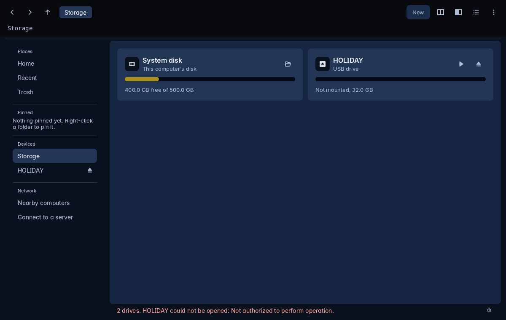

- **This drive is changing. Open it again when it finishes.** The drive is already being opened or put away. Wait for that to finish, then try again.
- **Drives cannot be reached just now.** Folders asks the computer's drive service (UDisks), and the service didn't answer. Try again in a moment. If it keeps happening, restart the computer.
- **HOLIDAY could not be opened**, with a reason after it. The drive service gives the reason, in its own words. If the drive is locked, check that you typed the right password.
- **HOLIDAY could not be put away**, with a reason after it. If the reason is that something is using the drive, close the folders and files you have open on it, then try again.

Before Folders puts a drive away, any pane showing it moves to another place, so nothing in Folders keeps the drive open.

:::expert
Folders opens and puts away drives through UDisks. It mounts a drive as you, then opens it. It unmounts a plugged-in drive, locks it again if it is encrypted, and powers it off once nothing else on it is open.
:::

## A server would not answer
Questions: why can't Folders find my server; what does no server called that could be found mean; why does it say the server did not answer; what does turned the connection away mean; why was the connection to the server lost; why does it say that address could not be read; what does there is no way through to it mean

Folders reaches another computer by its address, such as `sftp://jo@example.com`. Before it can ask for a login, it has to connect to the computer at all. When it can't, the red words say how far it got.

- **No server called that could be found.** Your network doesn't know that name. Check the spelling. If it's a computer in your home, try its number instead, such as `192.168.1.20`.
- **It turned the connection away.** The computer is there, but nothing on it is listening for this kind of connection on that port. The server program may be switched off, or it may use a different port. Add the port to the address, such as `sftp://jo@nas.example.com:2222`.
- **It did not answer.** Folders waited and heard nothing. The computer may be asleep or switched off, or on another network. Folders waits about 20 seconds before it gives up.
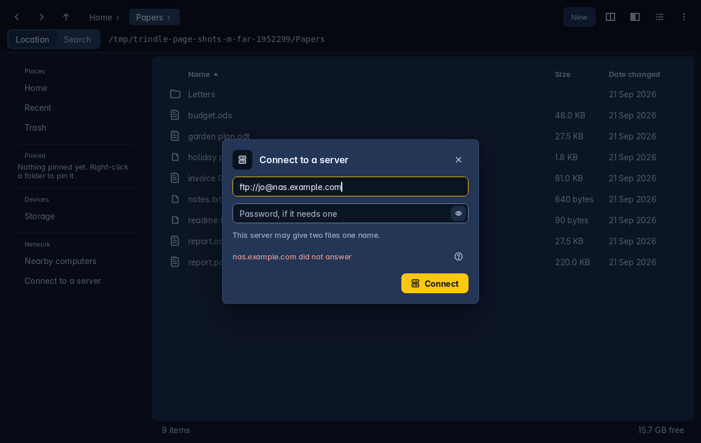

- **There is no way through to it.** Something between you and the computer, such as a firewall or a network that is down, stopped the connection.

- **The connection to the server was lost, the server stopped answering, or the server closed the connection.** The link worked, then dropped. Open the place again. Folders never keeps a half-sent file as if it were whole: it checks a copy to a server before it replaces the old one.
- **The server sent a message that could not be read.** The server and Folders have got out of step. Open it again. If it keeps happening, [report a problem](report-a-problem.html).
- **That address could not be read.** The words after it say why. The address has no `sftp://`, `ftp://` or `mtp://` at the start. Only `sftp://`, `ftp://`, `ftps://`, `ftpes://`, `dav://`, `davs://`, `smb://`, `nfs://` and `mtp://` can be opened. It can also mean that a `[` has no `]`, that no server is named, or that the server's name isn't a proper name. Or the path has a line break in it, something follows the server's name, or what comes after the colon isn't a port.
- **The server's address is not known.** A copy of a file from a server was saved, but Folders can no longer tell which server it came from.

:::expert
SFTP runs through your own `ssh` program, which waits 20 seconds to connect. So what Folders says here is what `ssh` found, put into plain words. FTP and WebDAV connect straight from Folders, which tries each address the name gives. Folders refuses a secure FTP server whose name can't be carried in a certificate.
:::

## A server would not let you in
Questions: why does Folders ask me to trust a server; what does no longer has the identity it had before mean; why does it say the server wants a password or a key; what does the certificate could not be checked mean; why wasn't my password sent; why didn't the server accept that login; what is a fingerprint

Folders is careful about who it talks to, because whatever you type goes to whoever answers. These are the times it stops and tells you why.

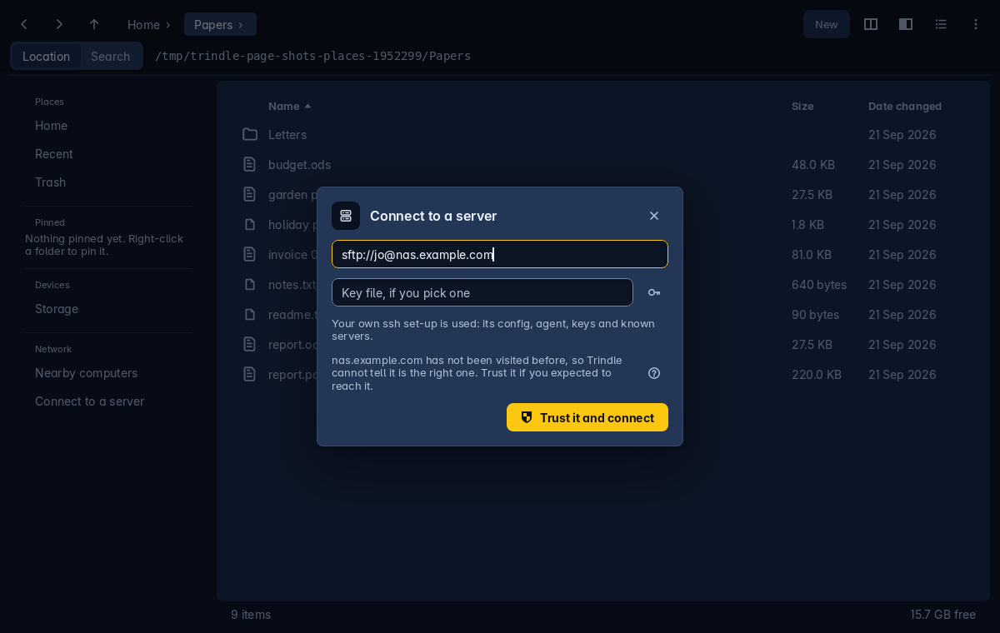

- **It has not been visited before.** Folders can't tell whether it's the right computer. If you expected to reach it, press **Trust it and connect**. Folders then remembers it, as ssh does.
- **It no longer has the identity it had before.** This one is red because you should take it seriously. The computer may have been rebuilt, or someone may be getting between you and it. Folders won't open it. If the owner changed the computer, remove the old entry from your known hosts first, then try again.
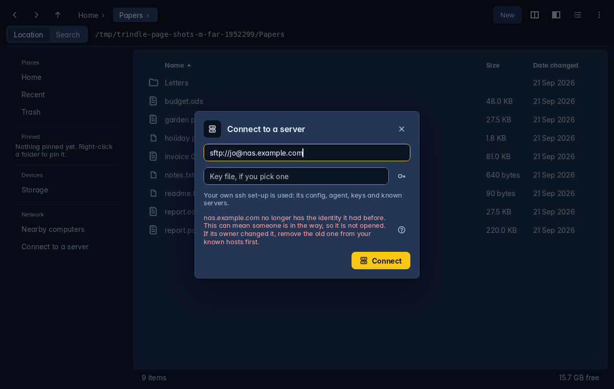

- **This server wants a password.** Type it in the password box on the card and press **Connect**.
- **This server wants a key or password.** Enter the name of your key file on the card, or add the key to your ssh agent, then try again. For ssh, Trindle asks for a password or a key's passphrase in a small window of its own.
- **The server did not accept that login.** The user name, password or key wasn't right.
- **The key is not there.** The key file named on the card doesn't exist, or it's somewhere Trindle never looks.
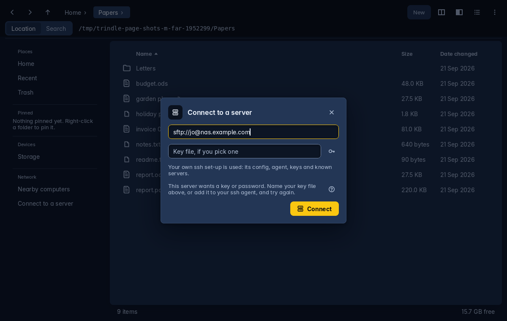

- **The certificate could not be checked.** A secure FTP server proves who it is with a certificate. This one failed the usual checks, for one of these reasons. This computer has no trusted certificates to check it against. Nobody this computer trusts has signed it, which happens with a certificate a server made for itself. It has expired. It isn't valid yet. It was made for a different name. It has been withdrawn. Or it failed the usual checks in some other way. If you can, compare the fingerprint on the card with the one the server's owner gives you, and trust it only if they match.
- **The certificate is not the one you trusted before.** Its owner may have renewed it, or someone may be getting between you and the server. Trust the new one only if its owner confirms this fingerprint.
- **The server answers at an address that was only heard on the network.** Any device on a network can answer to a name, so Folders hasn't sent the password. If that address is right, press **Connect**. Folders shows this on the card, and again in red if your work with that server stopped because the link dropped.

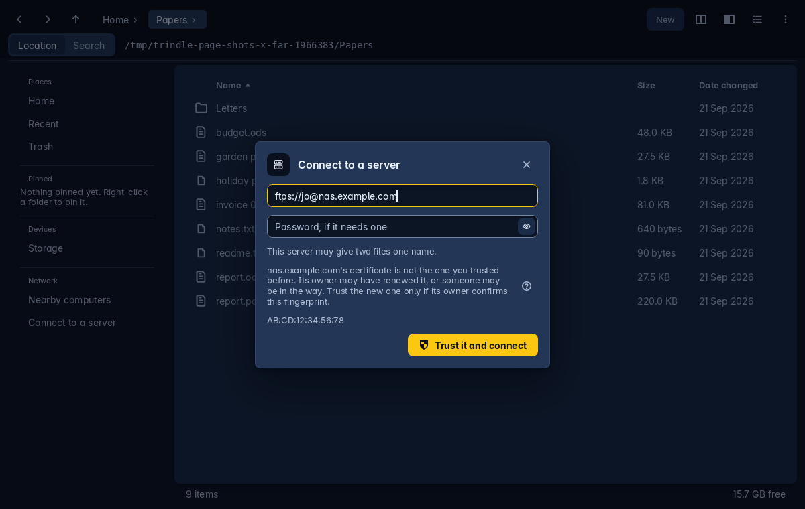

A fingerprint is a short code for one certificate or one computer's identity. If two fingerprints match, it is the same certificate or computer.

:::expert
Folders adds a trusted SFTP server to your ordinary ssh known hosts. It refuses a changed one, using strict host checking, so Folders never overrides ssh's own refusal. For a trusted secure FTP certificate, Folders remembers the fingerprint for that server, and lets through only that very certificate. Folders sends a password for FTP or WebDAV to the address you typed it for, and to no other.
:::

## A server would not do that
Questions: why did the server refuse my copy; what does the server could not do that mean; why does it say permission was refused; what does it is already there mean; why does the secure connection fail; why is ssh not installed; why does a file say it came cut short

The computer answered and let you in, but then wouldn't do what you asked. Or the secure link couldn't be made. The red words give the server's reason in plain words. If the message is a list of items from a copy, a move or a delete, each item has its reason in brackets. This is the same as on [Work that did not finish](folders.html#work-that-did-not-finish).

What a server may say:

- **It is not there / it is already there.** Someone else moved it or made it while you were working.
- **Permission was refused.** Your account on the server may not be allowed to do that in that folder.
- **It is in use by another program.** Try again when the other program has finished.
- **It is not supported yet / the server could not do that with it.** The server doesn't offer that action, or said no without giving a better reason. If the server gave one, it follows.
- **The server is full.** There is no room left for the file.
- **The folder is not empty.** This action doesn't delete a folder that has things in it. Delete what is in it first.
- **It is a file, not a folder.** The address ends in a file.
- **The file came cut short, ended before it was all sent, or the copy sent was not the length it should be.** The transfer didn't complete, so Folders keeps the old file.
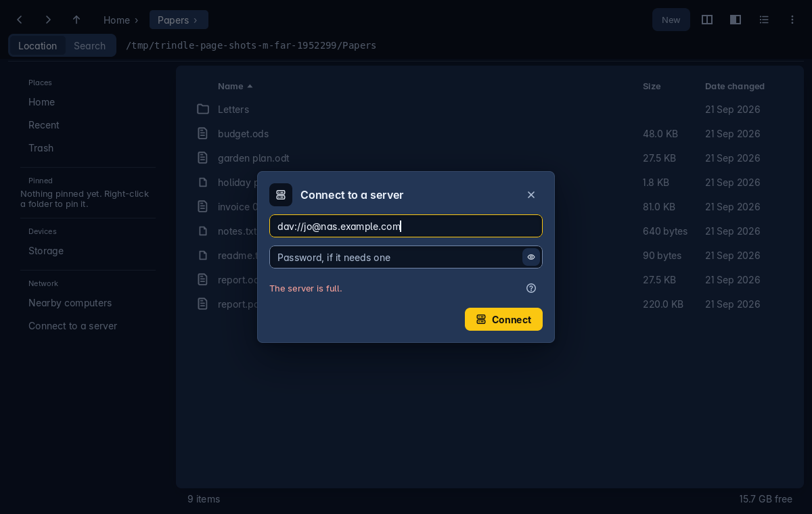

- **The folder listing could not be read.** The server answered in a way Folders doesn't understand.
- **The server does not list folders over WebDAV here, did not answer as a web server, or wants a kind of login Folders does not know.** The address may not be the WebDAV address. Check it with the server's owner.
- **A secure connection could not be set up, started, or finished.** The server stopped answering or closed the link while it was being set up. Try again. If it keeps failing, you can try the same address with `ftp://` in front, but only if you accept that nothing will be protected.

- **This server does not offer secure FTP.** Try the address with `ftp://` in front. Nothing sent that way is protected.
- **The server will not protect file transfers, so nothing was sent.** Folders won't send the file unprotected when you asked for protection.
- **The server did not welcome us.** The server answered, but didn't send the welcome that an FTP server sends.
- **The ssh program is not installed, or ssh could not be started.** SFTP needs ssh. Install it, then try again.
- **SFTP is not on this server, or it is an old kind.** The server may offer another way in, such as FTP.
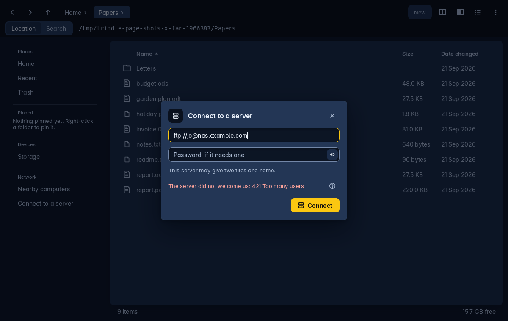

- **Left alone: it changed just before removal.** WebDAV removes a file only if it's still the one Folders looked at.
- **Two files may be given one name.** A plain FTP server can't refuse a name that is already taken, so Folders checks first, and tells you that this is all it can do.
- **Not all of it arrived, so it is still where it was.** Folders removes the original in a move only when the copy is complete.
- **A link, a pipe, a device or a socket was not sent.** Folders sends files and folders only.
- **The old one could not be removed, and is there whole as another name.** When Folders swaps in a replacement, it keeps the old file safe if it can't remove it.

:::expert
Folders writes a file on a server under a temporary name and swaps it in only when its length is right. When a move across drives is cut short, the original stays. WebDAV removes a file only on condition that its size and time are unchanged, so a file that changed in the meantime is left alone. You can't tell plain FTP to refuse a name that is taken, so Folders checks the name first. That leaves a short moment in which someone else could take it.
:::

## A phone would not show its files
Questions: why doesn't my phone show in Folders; why does it say the phone shows no storage; how do I make my phone show its files; what does permission was refused for the phone's USB connection mean; why did the phone stop answering

Phones, tablets and cameras show up in the side bar by themselves once you plug them in and unlock them. You don't type an address for one. Folders talks to the phone over the USB cable.

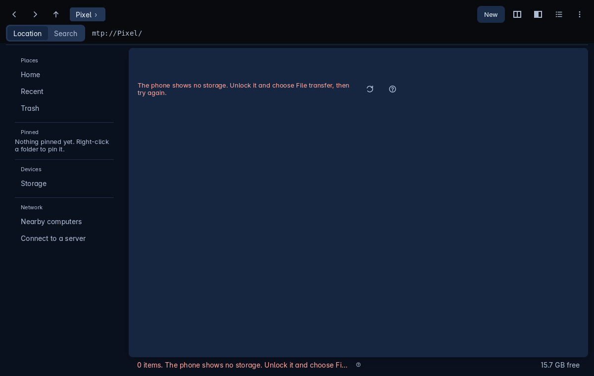

- **The phone shows no storage.** Unlock the phone and choose **File transfer** for the USB connection. Then try again.
- **That phone is not plugged in / the phone was unplugged.** The cable came out, or the phone went to sleep. Plug it in and unlock it.

- **Permission was refused for the phone's USB connection.** Trindle wasn't allowed to use that USB device. Unplug the phone, plug it back in and try again. If it's still refused, [report a problem](report-a-problem.html).
- **The phone is in use by another program.** Another program has the phone open. Close it and try again.
- **The phone stopped answering, refused that, or took only part of what was sent.** The link dropped part way through, or the phone said no. Try again, and check the file on the phone.
- **The phone sent something that made no sense.** Unplug it, plug it in and open it again.
- **The phone is full, or the file was shorter than it said.** Free some room on the phone, and copy the file again.
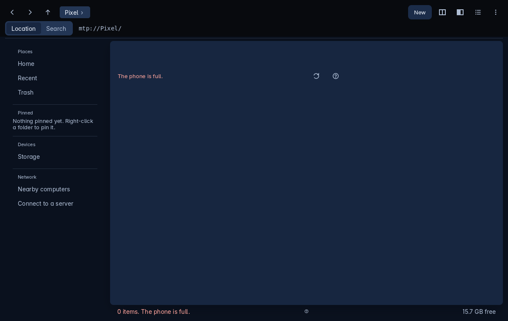

- **Files and folders can only go inside one of the phone's storages.** Open one of the storages, such as the internal one, and put things in that.
- **It is not a folder, it is a folder, or it is not empty.** The action doesn't fit what is there. You can only delete a folder when it's empty.
- **A whole storage cannot be removed or renamed.** Folders won't do either.
- **The phone refused that (code 2xxx).** The phone gave no reason in words, only a number. The number is useful in [a report](report-a-problem.html).

:::expert
Folders uses MTP and plain PTP over USB itself, without help from the system's file service.
:::

## A name was refused
Questions: why won't Folders take that name; what does a name cannot hold a slash mean; why does it say the server sent an unsafe name; why was a name skipped; what does that name is kept for the system mean

Folders checks every name before it uses it, whether you typed it or a server sent it. If Folders won't use a name, it says so in red, and nothing is renamed or made with that name.

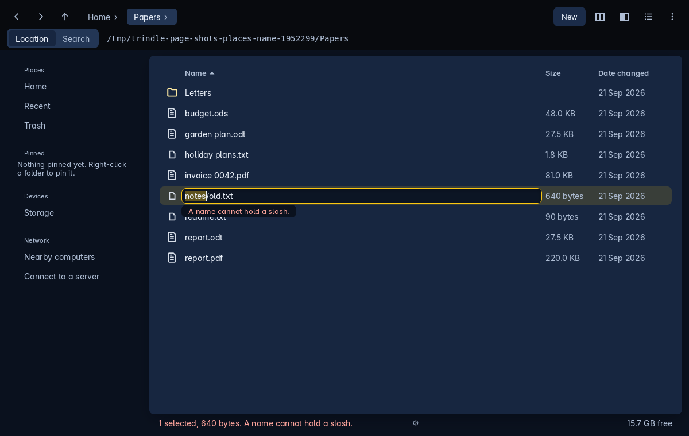

Names you type:

- **A name cannot be empty.**
- **A name cannot hold a slash.** A slash separates folders, so it can't be part of a name.
- **That name is kept for the system.** A single dot means the folder itself, and two dots mean the folder above it.
- **That name is too long.** A name can't be longer than 255 bytes. Letters outside English may take more than one byte each.
- **A file or folder called that is already here.** Choose another name, or rename or move the one that is there.
- **It could not be renamed, with a reason.** The name was fine, but the disk or the folder didn't allow the change. You may not be allowed to write in that folder, or the disk may be read-only.

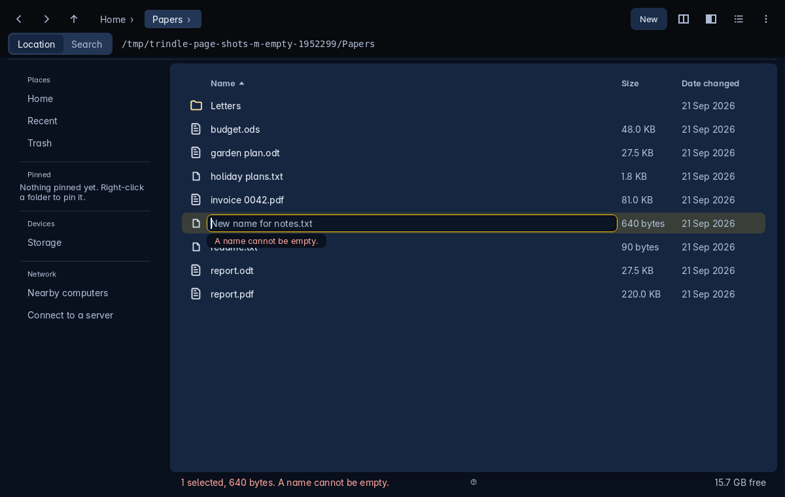

Names a server sends:

- **Skipped: the server sent an unsafe name.** A server can send a name that isn't one plain name, such as a name with a slash in it that would climb out of the folder. Folders won't make a row for it, because anything you did with it could reach somewhere you didn't intend. Folders still shows the rest of the folder. If a few were skipped, the words say how many and name them.
- **A thing with no name** is left out in the same way.

:::expert
A name from a server must be one plain name before Folders uses it on this computer, where it could become part of a path. Folders makes the same check on the name of a server's file that it fetches to open, and on the server's own name.
:::

## A share asks for a login
Questions: why does Folders ask for a user name and password for a shared folder; why does it say the user name or password was not right; what does the login kept for it has not been sent mean; why does it ask again for a share I remembered; what does the keyring could not be reached mean; why was my login not kept

A shared folder on a Windows computer or a NAS (an SMB share) often needs a user name and password. These belong to an account on that other computer, not on yours. Folders asks for them on a small card called **Open**, followed by the name of the share.

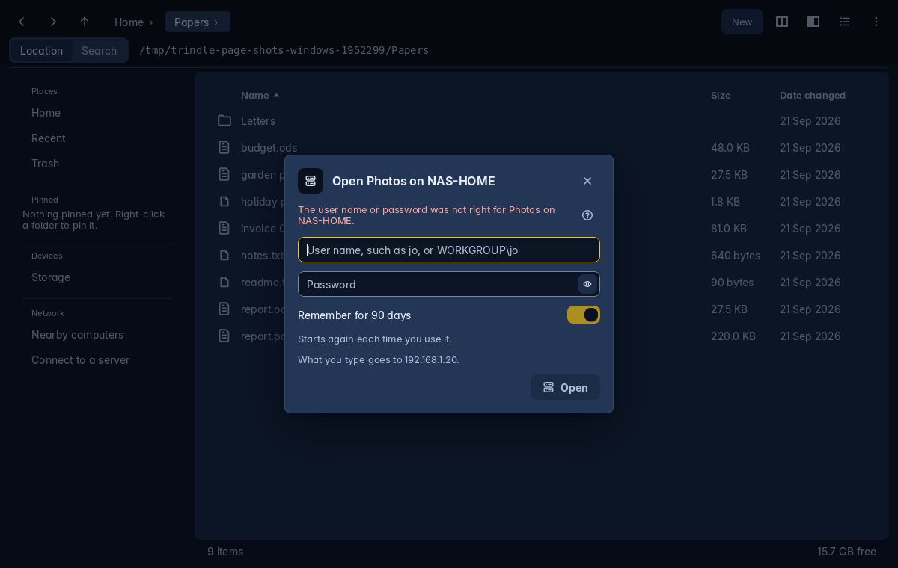

When the card shows that something is wrong, it will be one of these.

- **The user name or password was not right.** Type them again. A user name on a Windows computer may need its workgroup in front, such as `WORKGROUP\jo`.
- **That account may not open it.** The login was right, but that account isn't allowed to open this share. Ask whoever looks after the computer.
- **Your account is locked or switched off, or its password has run out.** Fix this on the other computer. Folders can't fix it.
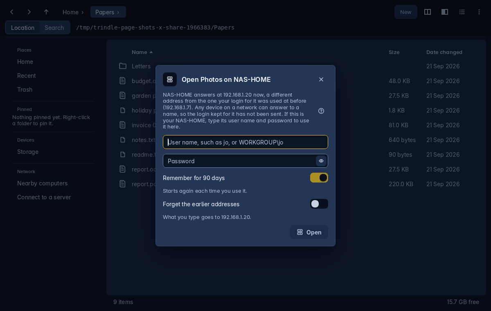

- **A login you kept was not sent.** Folders remembers a login you chose to keep for 90 days, and sends it only to an address you've used it at before. Folders won't send it if the computer now answers at a different address, at an address Folders couldn't find beforehand, or at one it only heard on the network. That is because any device on a network can answer to a name. The card shows which of these it is, and where what you type would go. If it is your computer, type its user name and password and press **Open**. If you won't use the old addresses again, switch on **Forget the earlier addresses**. Folders remembers only the last eight addresses a login was used at.
- **It is open, but the login was not kept.** The share opened, but the keyring didn't keep your login. The words after it say why.
- **The keyring could not be reached.** Folders stores remembered logins in your keyring. If Folders couldn't ask the keyring, the card shows this in red. That way you can tell a locked keyring from having no saved login. Unlock the keyring, or log out and log back in, then try again.

More about remembered logins is in [A shared folder asks for a login again](troubleshooting.html#a-shared-folder-asks-for-a-login-again).

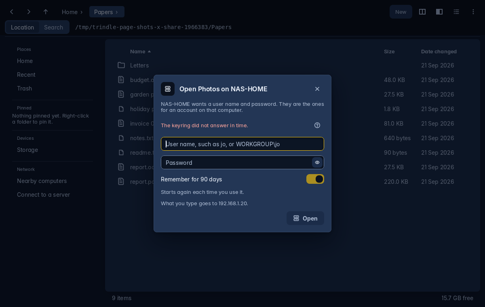

:::expert
Folders stores a kept login in the keyring, under the computer and share it was for. A second keyring item remembers the addresses the login was used at, with the time of each. Folders passes the login to Trindle's administrator helper on its standard input. The helper writes it to a file only the administrator can read, and removes that file when the mount ends. No login is sent to a name alone. It goes to the address the card shows, and to no other.
:::

## A share would not open
Questions: why won't my network share open; what does no computer called that could be found mean; why does it say the computer did not answer; what does only speaks SMB1 mean; what does does not offer NFS version 4 mean; why is smbclient not installed; what does shares nothing called mean; why couldn't a share be closed

Folders opens a Windows share (`smb://`) or an NFS export (`nfs://`) by mounting it, so it shows up as an ordinary folder. When Folders can't do that, the red words say why.

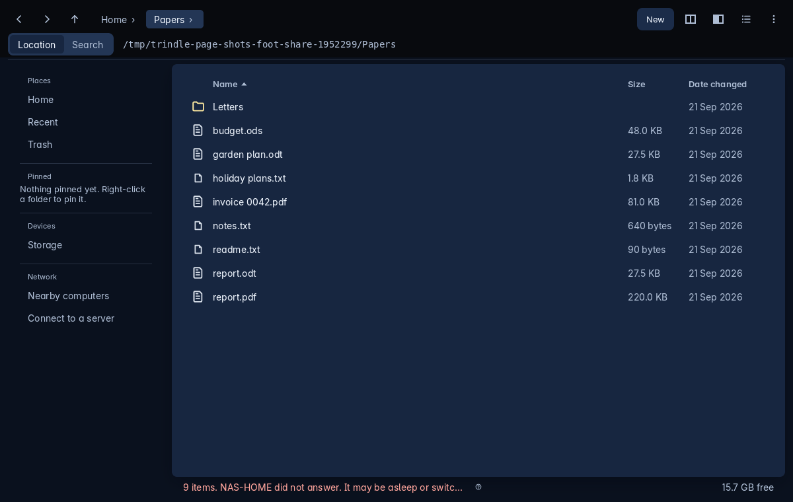

- **No computer called that could be found on this network.** Check the spelling, or use its number, such as `smb://192.168.1.20`.
- **It did not answer. It may be asleep or switched off.** Wake it, check that it is on the same network, and try again.
- **It only speaks SMB1.** SMB1 is an old way of sharing files that is no longer safe, so Trindle doesn't use it. Switch on a newer version on that computer or NAS.
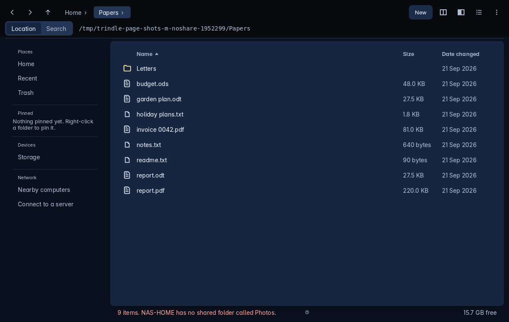

- **It has no shared folder called that.** The computer answered, but it shares nothing by that name. For NFS, the words are "shares nothing called" followed by the path you typed. Open the computer by itself to see what it does share.
- **It does not let this computer open it.** For NFS, the server's list of who may use the export doesn't include this computer. Add it on the server.
- **It does not offer NFS version 4.** Trindle opens only version 4. See [An nfs:// address does not open](troubleshooting.html#an-nfs-address-does-not-open).
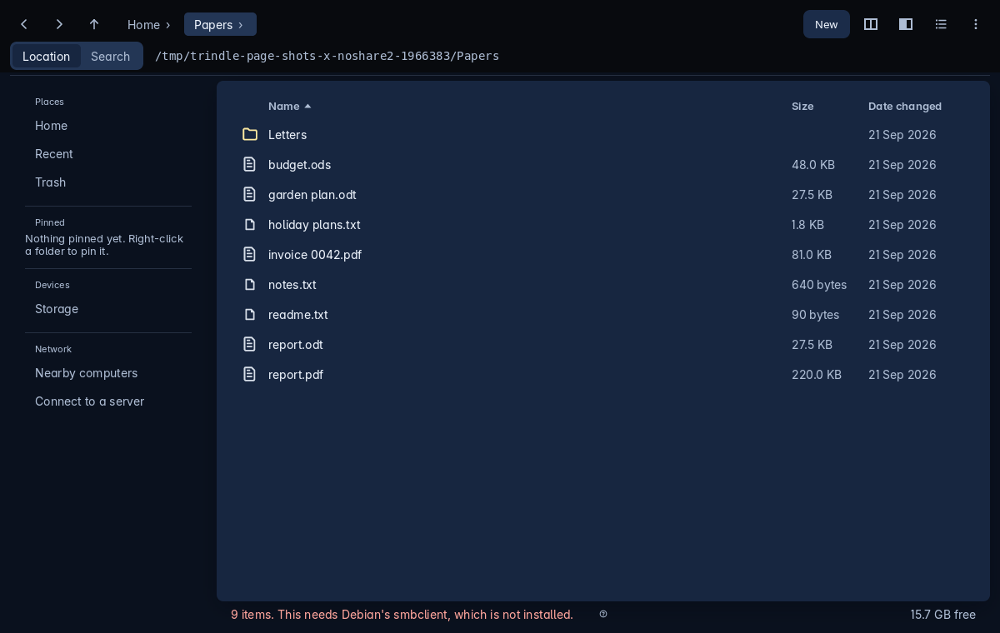

- **This needs a program that is not installed.** The words name the Debian package, such as smbclient. Install the waiting updates, or install that package.
- **The administrator's password was not given.** Mounting a share needs it. Try again and type it when asked.
- **That is not the name of a computer, or the path of a shared folder.** The address has something in it that a computer name or an NFS path can't contain.
- **It opened, but where is not known.** The share was mounted, but Folders couldn't tell where. Open the Network page again.
- **A share could not be closed.** Something on it is still in use. Close the folders and files you have open on it, then try again.

:::expert
Folders mounts a Windows share with `mount.cifs` and lists its shares with `smbclient`. It mounts an NFS export with `mount.nfs` at version 4. Both mounts go through Trindle's administrator helper, which asks for the administrator's password. The mounts are under your own folder of shares. Folders works out the words from what those programs reported.
:::

## A folder could not be shared
Questions: why can't I share this folder; what does only folders that belong to you can be shared mean; why does it say that name is taken; why is the sharing password refused; what does a share name cannot hold mean; why does Samba need setting up

Share this folder, in a folder's Properties, lets other computers at home open the folder, including Windows ones. Folders won't share a folder in these cases.

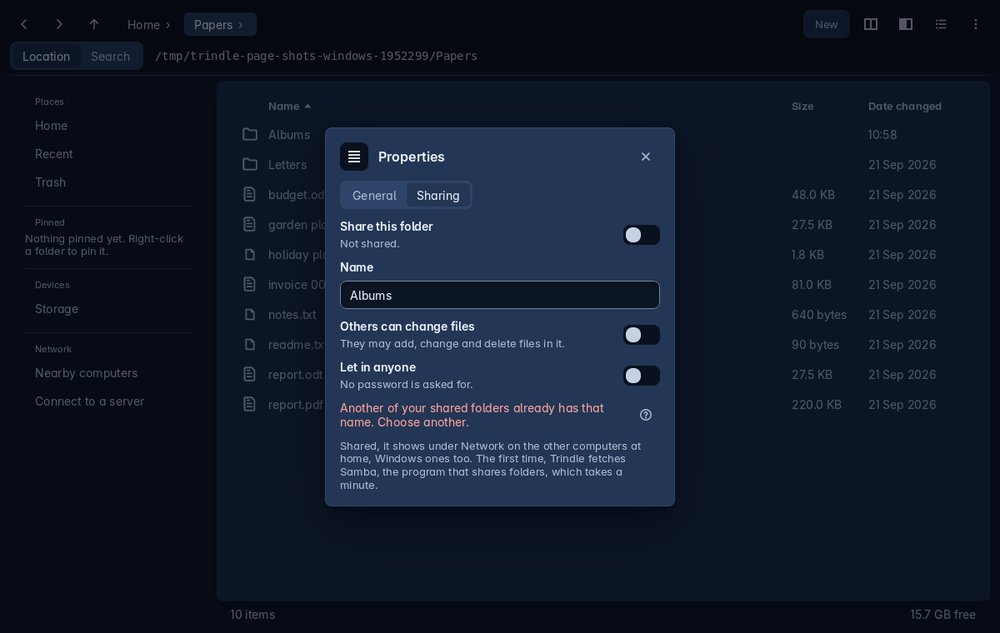

- **This folder cannot be read.** Folders can't look at it, so it can't share it.
- **Only a folder itself can be shared, not a link to one.** Share the folder the link leads to.
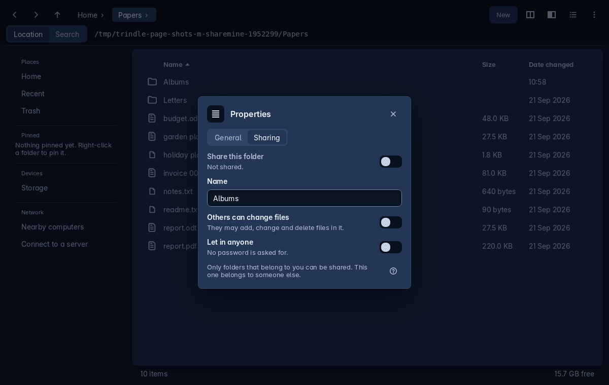

- **Only folders that belong to you can be shared.** This one belongs to someone else.
- **Another of your shared folders already has that name.** Choose another name.
- **The name is not allowed.** A name can't be empty, can be at most 80 letters long, and can't contain any of `% < > * ? | / \ + = ; : "` or a comma. It can't end in `$`, which would hide the share. Samba also keeps `global`, `homes`, `printers`, `print$` and `ipc$` for itself, so you can't use those.
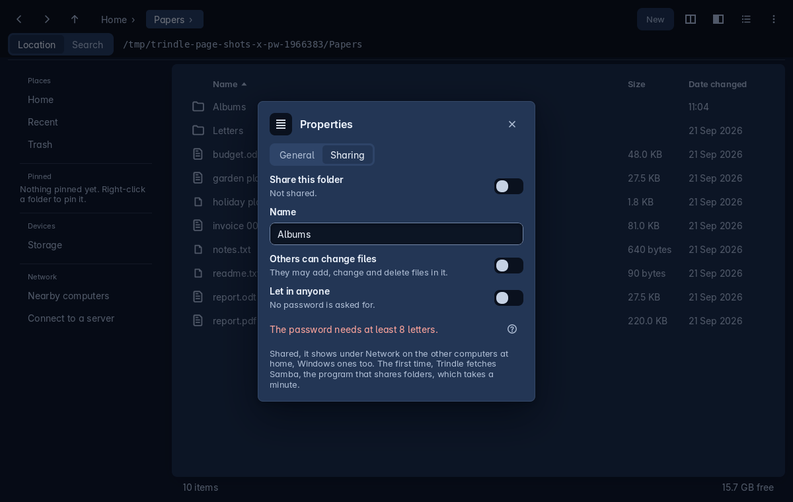

- **The password needs at least 8 letters.** The sharing password is the one other computers use to log in. It is separate from the password you log in with.
- **Other computers cannot reach it yet.** This message isn't red. **Let other computers connect** is switched off in Settings, Network. The button beside the message switches it on, after you give the administrator's password.

The first time you share, Trindle downloads Samba, the program that shares folders, and sets it up. It asks for the administrator's password first, and takes about a minute. If something goes wrong then, red words under the switches tell you.

:::expert
Folders makes a share with `net usershare`. It only ever offers a folder you own, with a name, whether others may change files, and whether guests need no password. No password is ever part of a share. A share offered to guests also needs the folders above it to be open to other accounts, so guests can get through to it. **Let visitors through to this folder** does that.
:::

## A file could not be read
Questions: why can't Folders show my picture; why does it say this cannot be played; what does it may be damaged or cut short mean; why is a picture too large to show; why does the preview say it could not be read; why does ffmpeg need to be installed; why couldn't checksums be worked out

The preview panel, the viewer and the Checksums line in Properties read a file to show it. When they can't, they say why in a few words, with a quiet **More** button beside them.

- **This file is no longer there.** It was moved or deleted after Folders showed it. Look at the folder again.
- **You do not have permission to read this file.** The file belongs to someone else, or its owner has closed it to you. Ask its owner.
- **This file could not be read, with a reason after it.** The disk or the other computer gave the reason in its own words.
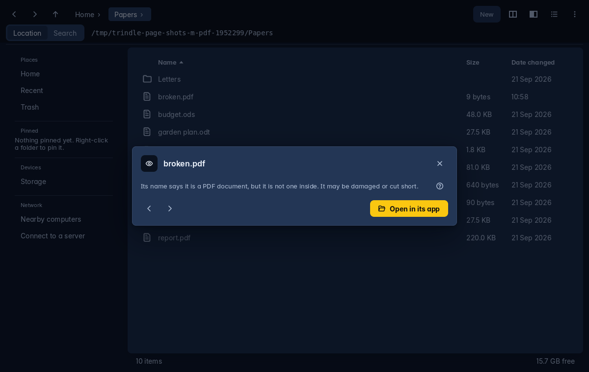

- **Its name says it is a picture, but it is not one inside. It may be damaged or cut short.** Here Folders goes by the name rather than the contents, so a download that was cut short shows this message instead of odd text. Get the file again.
- **This picture could not be read.** The picture is damaged, or it's a kind Folders can't open.
- **This picture is too large to show here.** Folders won't open a picture file bigger than 100 MB, or one with more than 120 million pixels, however small the file is. Open it in an image app.
- **This cannot be played. It may be damaged, or of a kind ffmpeg cannot play.** Try the file in another player.
- **Videos and sounds are played by ffmpeg, which is not installed on this computer.** Install ffmpeg and try again.
- **Page N could not be drawn.** A page of a PDF could not be drawn. The PDF may be damaged.
- **The rest could not be read.** Folders reads a long text file in parts. It couldn't read the next part you asked for.
- **It could not be fetched.** The file is on a server, and Folders couldn't get a copy of it. See [A server would not do that](folders.html#a-server-would-not-do-that).

- **It is not a font Folders can read, or it is too large to show.** This applies to the font sample page.
- **The file could not be read** beside Checksums. Folders works out the sums from the whole file, so it can't show any.

:::expert
Folders reads pictures, text and fonts itself. It passes sounds, videos and PDFs to other programs and never reads them itself. Folders reads a text file in parts of up to 4 MB, and the viewer offers to read more.
:::

## Details could not be changed
Questions: why can't I change the date taken; why does it say the photo's details could not be written; why does Folders say it can change the notes only in JPEG and PNG photos; what does the date taken must look like mean; why couldn't the song's details be written

In Properties you can change a file's dates, whether it is read-only or can be run, the notes in a photo, and the tags of a song. If Folders refuses a change, red words under the line say why, with a quiet **More** button beside them. Nothing is ever half-changed. Folders writes a photo as a new file beside the old one and swaps it in, so if something fails, the old photo stays whole.

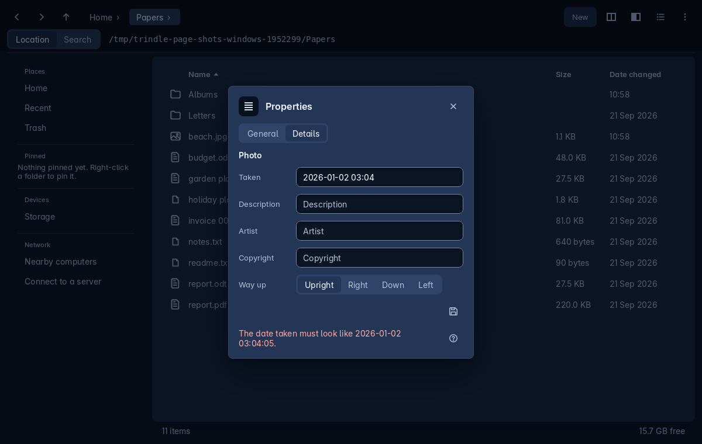

- **That could not be changed, or the date could not be set.** The file belongs to someone else, or the disk or folder doesn't allow it. The reason follows.
- **The date taken must look like 2026-01-02 03:04:05.** Year, month and day, then hour, minute and second.
- **Folders can change the notes only in JPEG and PNG photos.** Folders can read other kinds but not write them.
- **There is no room left.** The disk has no room for the new copy of the photo.
- **The notes are too long to fit in a JPEG, a tag is too big, or a note cannot hold a nul character.** Shorten the note.
- **The way up must be 1 to 8.**
- **Damaged photo notes, with a reason such as a part that runs past the end.** The notes inside the photo don't make sense, so Folders won't write over them.
- **This is a link.** Change the file the link leads to.
- **The song's details could not be written.** The reason follows.

:::expert
Folders writes photo notes (EXIF) afresh, in the photo's own part for them. The camera maker's notes stay where they were, because many of them count their own positions from the start. Folders writes a song's tags in place when they still fit. Otherwise it writes a new file beside the old one, and that file takes the old one's place.
:::

## A folder would not open
Questions: why won't my folder open; what does you are not allowed to open this folder mean; what does this folder is no longer there mean; what does there is nothing at that address mean; why does the pane say the other computer is not answering

When a pane can't show a folder, it shows the reason instead of the files, with **Try again** and a quiet **More** button.

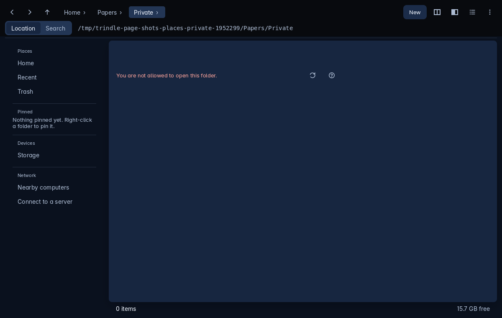

- **You are not allowed to open this folder.** It belongs to someone else, or its owner has closed it to you.
- **This folder is no longer there.** It was moved, renamed or deleted. Go up a level and look again.
- **This folder could not be read.** Folders has no better reason to give. A drive that was pulled out, or a disk that is failing, can cause this.
- **There is nothing at that place.** What you typed in the address box is not a folder, a file or a place Folders knows. Check the spelling.
- **The other computer is not answering.** Folders gives a place on the network, a share, or a drive that has gone to sleep a short moment to answer. If it doesn't, the pane stops waiting, so the rest of the window stays quick, and it offers **Cancel** and **Try again**.

:::expert
Folders checks each place in the background, away from the window's own thread, so a place that never answers can't freeze Folders. At most eight such checks run at one time, so trying again and again doesn't pile them up.
:::

## Colours and emblems did not follow
Questions: why did my folder colour disappear after I moved it; what does colours could not follow what moved mean; why did an emblem go after a rename

Folders saves the colour you give a folder, and the emblems you add to a file or folder, in two small files of its own. They are `files-colours` and `files-emblems`, in the `trindle` folder of your settings. Colours and emblems belong to a place, so when you move or rename something, Folders moves its colour and emblems with it. If Folders can't write the files, it says "Colours could not follow what moved."

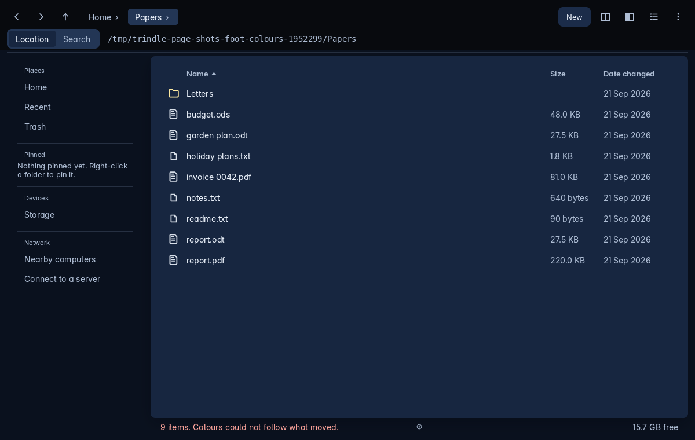

What it means: the file or folder moved without any problem. Its colour and emblems may still show until you close Folders. After that, they are gone from the new place. Nothing else is lost.

What to do: make room on the disk, or check that you're allowed to write in the settings folder, as on [Choices that were not kept](folders.html#choices-that-were-not-kept). Then give the colour or emblem again.

:::expert
Folders writes each file as a new file that replaces the old one, so if a write fails, the old file stays whole. Moving or renaming a folder also carries the colours and emblems of everything inside it, and Undo carries them back.
:::

## A drag from or to another program did not finish
Questions: why did nothing happen when I dropped a file on Folders; what does nothing was brought mean; why does it say the other program did not take all of what was dragged; why does it say what it has is a copy; why was a dropped file left where it was

You can drag files from another program into Folders, and from Folders into another program. Neither side can see what the other does, so Folders checks, and tells you when something doesn't go as it should.

- **It is not there, so nothing was brought.** The name the other program gave isn't a file that exists, or isn't an ordinary path on this computer.
- **A folder cannot be put inside itself.**
- **The place it is in is not answering, so nothing was brought.** The drive or computer it is on is asleep or not there.
- **The last thing dropped is still being looked at.** Wait a moment and drop again.
- **Answer the question about what was dropped first.** If a program names a file that is hidden, or outside your home folder and your drives, Folders asks you before it takes it. Any program can name any file.
- **Nothing came, what was dropped is too big or too slow or too many, or is not a list of files on this computer.** Drop fewer at a time, or use Copy and Paste.
- **The other program did not take all of what was dragged, so nothing here was moved** (for a move); **so it may not have all of it** (for a copy). Your originals are still where they were. Check what arrived.

- **The other program took what was dragged in a way that cannot show it read all of it, so nothing here was moved: what it has is a copy.** The same goes for a program that took a copy and couldn't say whether it was complete. Delete the originals yourself once you have checked it.
- **A thing changed after it was picked up, so it is still where it was.** It was edited between when you picked it up and when you dropped it.

:::expert
A name that a program drops must be a plain absolute path, with no dot parts, no control characters and a limited length. Folders doesn't carry out a move to another program as a real move. It removes the originals only once it knows the copy is complete, and for some programs it can't know that.
:::

## Something could not be made here
Questions: why couldn't Folders make a new folder; why couldn't the link be made; why can't this picture be the wallpaper; why couldn't the font be installed

Folders makes folders, documents and links, installs fonts, and sets wallpapers. When it can't, red words say what it was trying to do and why, with a quiet **More** button.

- **A new folder or document could not be made.** The folder may be read-only, you may not be allowed to write in it, or the disk may be full. The reason follows. Make it in a folder of your own.
- **A link could not be made.** The words say how many and name them. A link needs a name that isn't taken in that folder, and a folder you're allowed to write in.
- **The picture cannot be the wallpaper.** A wallpaper can be up to 4K (3840 by 2160). A still picture can be up to 20 MB, and a moving one up to 200 MB. The words say which limit the picture went over. See also [A wallpaper is left out](troubleshooting.html#a-wallpaper-is-left-out).
- **The font could not be installed.** Folders copies fonts into the fonts folder inside your own data folder. If it can't make that folder or write in it, the font isn't installed.

## A comparison or search stopped
Questions: why did the compare stop; why couldn't two files be compared; why did the search for copies stop; what does 1 file could not be read and was left out mean

Compare the two, the folder comparison and Duplicates read a lot of files. If one of them stops, or meets a file it can't read, red words tell you, with a quiet **More** button.

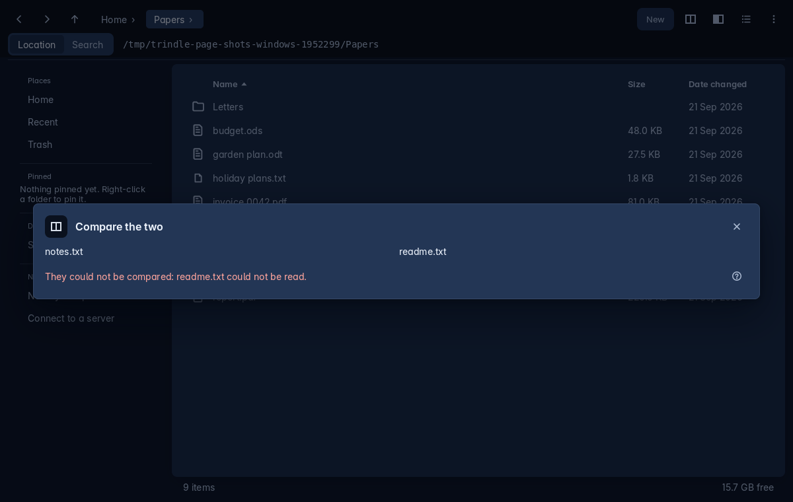

- **They could not be compared, the compare stopped, or the search stopped, with a reason.** A file changed or disappeared while Folders was reading it, a drive disappeared, or you aren't allowed to read the file. Run it again.
- **N files could not be read and were left out.** Duplicates reads every file to be sure that two files are the same. It leaves out a file it isn't allowed to read, so the list may be missing sets.

None of these changes anything. They only read.
