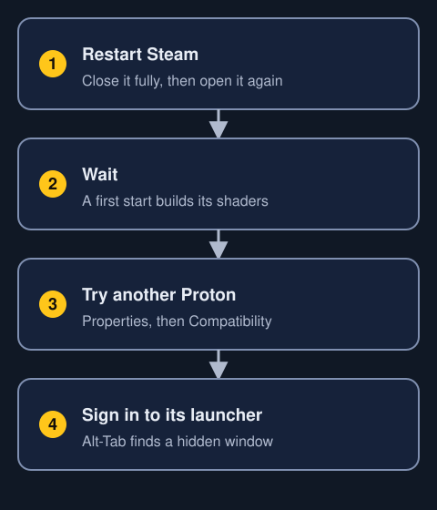

This page is about Steam and other game launchers. It only covers what has been checked, and says where something isn't built yet.

## What works

Questions: can I play games on Trindle; does Steam work on Trindle; can I play Windows games; does Proton work; which launchers work

- **Steam.** Install it from Apps. It runs as a Flatpak, in its own box.
- **Windows games.** Steam runs them through Proton. One game has been played through on a real computer.
- **Launchers.** Ubisoft Connect has been checked. Others, such as EA, Epic and Battle.net, usually work inside Steam. Each changes often and can stop working after its own update.
- **Not checked yet.** Games made for Linux, DirectX 12 games and older 32-bit games.

## What Trindle does for you

Questions: what does Trindle do for games; why does my game crash on load; does Alt-Tab work in a game; will my screen go to sleep in a game; will the mouse stay in the game

- **Memory limit.** Trindle raises it, so big Windows games don't crash when they load.
- **File limit.** Trindle raises it, so a game can open far more files at once.
- **Mouse.** When a game takes the mouse, it keeps it, and the mouse never moves to a second screen.
- **Alt-Tab.** The mouse is free while you are away, and the game takes it again when you come back.
- **Full screen.** A full-screen game stays full screen behind the window you switched to, and doesn't go black.
- **Screen.** The screen stays awake while a full-screen game is in front.
- **Resolution.** If a game changes the resolution, you see it at the game's size, scaled to fit. The screen's own resolution never changes, so nothing needs putting back if the game crashes.
- **Controllers.** See Controllers below.

:::expert
The kernel's memory map limit (vm.max_map_count) is set to 2147483642, which is the figure Valve gives for Proton. A game can open at most 1048576 files. Programs still start with the usual limit of 1024, and a program can raise its own limit up to that maximum.
:::

## A game will not start

Questions: why won't my game start; a steam game won't launch; steam game shows a black screen; my game crashes at start; ubisoft connect doesn't appear

Try these in order.

1. Restart Steam. Close it completely and open it again. If Steam has been running for days, games can stop starting. After a restart, the games started.
2. Wait. The first time you start a game, it builds its shaders. The screen can stay black for a few minutes, so let it finish.
3. Check the Proton version. In Steam, open the game's Properties, then Compatibility, and try another version, such as Proton Experimental.
4. Log in to the game's own launcher, such as Ubisoft Connect. Its window can hide behind the full-screen game. Press Alt-Tab to find it.

## Games with anti-cheat

Questions: do games with anti-cheat work; can I play Valorant on Linux; does Easy Anti-Cheat work; does BattlEye work; why does my game kick me out

- **Kernel-level anti-cheat cannot run on Linux at all.** Vanguard is one example. Nothing Trindle does can change that.
- **Easy Anti-Cheat and BattlEye** work only with games whose publisher has allowed Linux.
- **Look before you buy.** The site areweanticheatyet.com lists the games one by one.
- A game that starts and then throws you out may not allow Linux.

## Controllers

Questions: does my controller work; does a PlayStation controller work; does an Xbox controller work; what does missing permissions for input devices mean; why does Steam Input not work

- **The keyboard and mouse work.**
- **PlayStation, Switch and many Xbox controllers, and Steam Input, may not work in games yet.** Steam may show the message "Missing permissions for input devices".
- **Trindle has a small service for game controllers.** The parts of the desktop and of Steam that use it aren't finished.
- **Settings, Games** saves the changes you make to your controller's buttons. They don't reach games yet.

## HDR and variable refresh

Questions: does HDR work; does variable refresh rate work; does freesync or gsync work

- **HDR.** It doesn't work yet.
- **Variable refresh rate.** It doesn't work yet.
