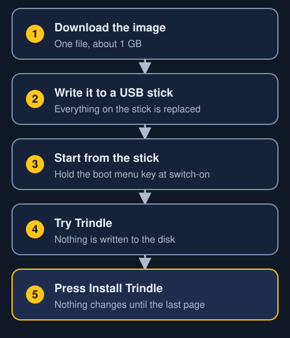
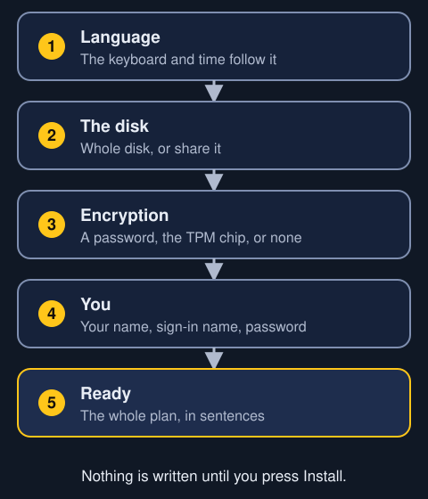
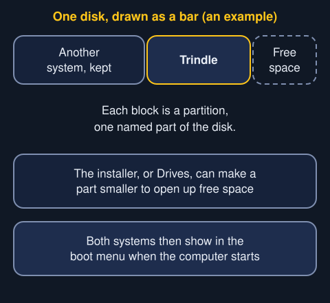
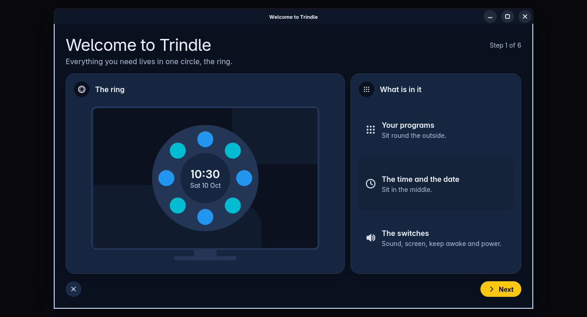
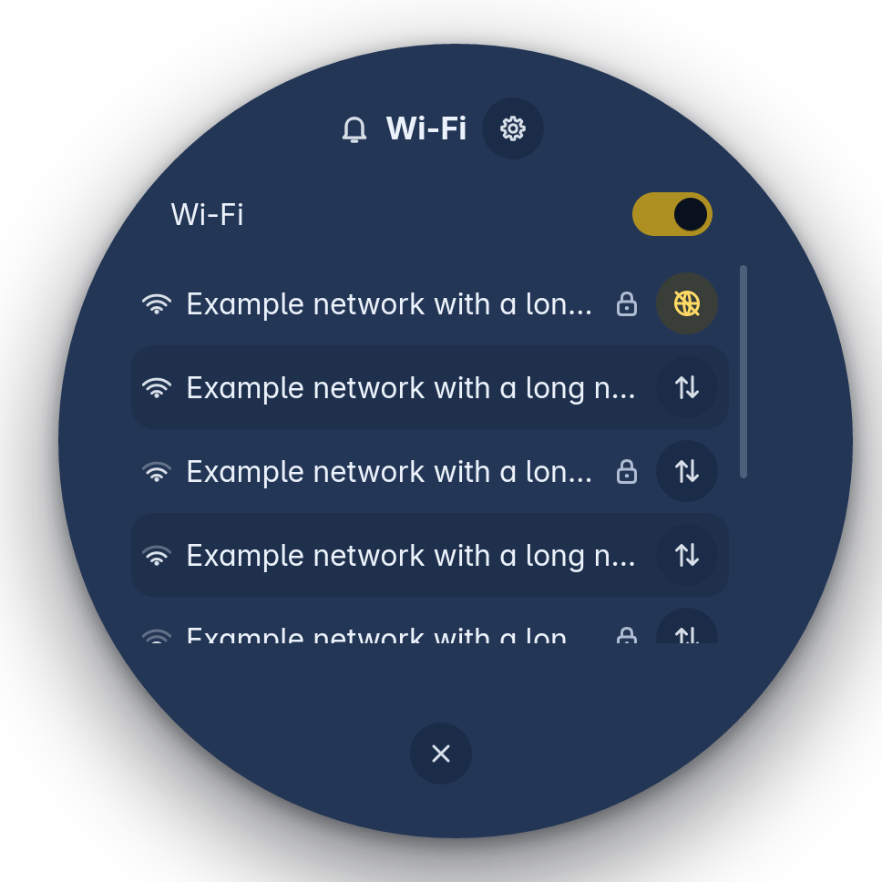
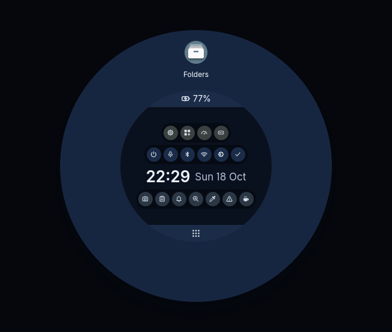

Trindle is a whole operating system, not a program you add to the one you already have. It either replaces what is on the computer or sits beside it.

> Back up everything that matters before you start. Trindle changes how the computer starts up, how you log in and how it manages its disks. You use it at your own risk.

## What you need

- A computer with a 64-bit Intel or AMD processor.
- At least 20 GB of free disk space. That can be the whole disk, or room you make beside another system.
- A USB stick of 4 GB or more. Writing Trindle to it wipes everything on it.
- About an hour. It often takes less, but don't start ten minutes before you need the computer.

## Five steps from download to desktop

Nothing on the computer changes until the last step.

1. Download the image. It is one `.iso` file, about 1 GB. An image is a copy of a whole system in one file.
2. Write it to a USB stick with Impression, balenaEtcher or `dd`. If you use `dd`, first check which device the stick is. If you pick the wrong one, you wipe the wrong disk.
3. Start the computer from the stick. Plug in the stick, switch on the computer and hold the boot menu key. It's F12 on most Lenovo and Dell computers, F9 on HP, and Escape or F11 on others.
4. Try Trindle. It runs from the stick, and the ring, Apps and Settings all work. It writes nothing to the computer's own disk.
5. Open the ring and press Install Trindle. The installer changes nothing until you press Install on its last page.

If Secure Boot is on, you may need to switch it off first. Secure Boot is a firmware setting that lets only approved software start. Firmware is the small program that runs when you switch on the computer, before the system starts.

Want to try it in a virtual machine first? Give it plenty of memory and switch 3D graphics on. If you give it too little, everything runs very slowly, and you end up judging the virtual machine instead of Trindle.

## What the installer asks

The installer asks four questions, then gives you a summary written out in sentences. A mark moves along a line as you go through the steps, so you can always see where you are. You can go back at any step, and nothing is written until you press Install.

- **Language.** Choose it once. Trindle sets the keyboard and the time to match. There is a box where you can type, so you can test the keyboard before you use it for a password.
- **The disk.** You can use the whole disk and replace everything on it, or keep what is there and share the disk. A slider sets how much room each side gets. Each disk is labelled with what is on it, so you can pick the right one.
- **Encryption.** Encryption scrambles the disk so nobody can read it without the key. You can choose to type a password before anything else appears, or let the computer's TPM chip unlock the disk by itself. The installer tells you which of these the computer can do. You can also leave the disk unencrypted.
- **You.** Here you enter your name, the name you log in with, a name for the computer, and your password twice.

The last page, Ready, shows you the whole plan. Nothing has changed yet.

### Sharing the disk with another system

If a Windows or Linux partition has spare room, the installer offers to keep it and share the disk. A partition is one named part of a disk. The installer shrinks it and puts Trindle in the space that frees up. Both systems then appear in the boot menu.

Before you resize anything, back up the other system. Shut Windows down fully instead of letting it hibernate. If you don't, the installer can't make its partition smaller.

## The first ten minutes

The first time you log in on an installed computer, the Welcome opens before the ring. It first asks how much you know. Then it shows the pages that suit you, with moving pictures and very few words. If you've used Linux before, it skips what every Linux desktop does. If you've used Trindle before, it closes and doesn't come back.

Trindle comes with almost nothing installed. The Welcome lets you pick the apps you want, such as a browser, email and an office suite. One click installs them all while you keep reading. You won't have a browser until you choose one.

Then do these three things.

1. **Join the Wi-Fi.** Open the ring, click the network icon in the middle, switch Wi-Fi on, find your network and press Connect.
2. **Set the screen size.** Open Settings, then Display. If a change looks wrong, don't do anything. Trindle puts the old setting back after fifteen seconds.
3. **Switch locking on.** Open Settings, then Power. Locking is off until you switch it on. Once it's on, your password unlocks the screen. So can a four-digit PIN, if you choose one.

Help is built into the computer too. Settings has a Help page that works even when you're offline. Every page in Settings has a small i beside its name. It opens the part of Help about that page.

## Where to go next

- [The ring](ring.html): how to open everything.
- [Apps](apps.html): how to find and install more programs.
- [Quick answers](quick-answers.html): the twenty questions people ask first.
- [The lock screen](lock-screen.html): how the screen locks and how you get back in.
- [Troubleshooting](troubleshooting.html): for when something goes wrong.
