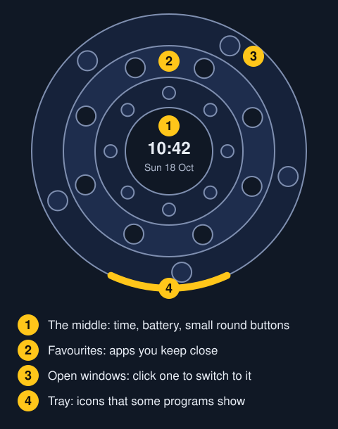
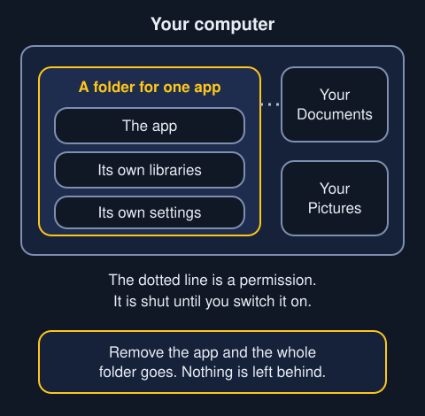
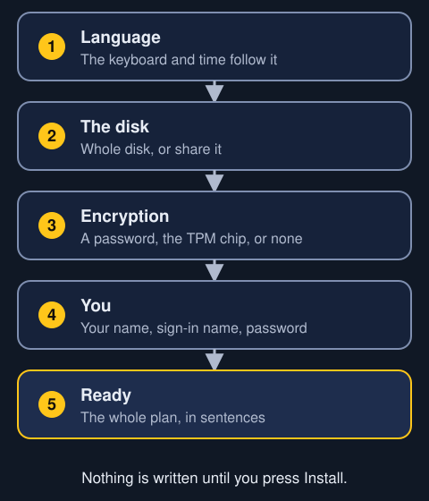
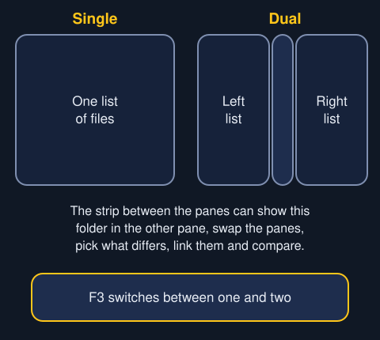
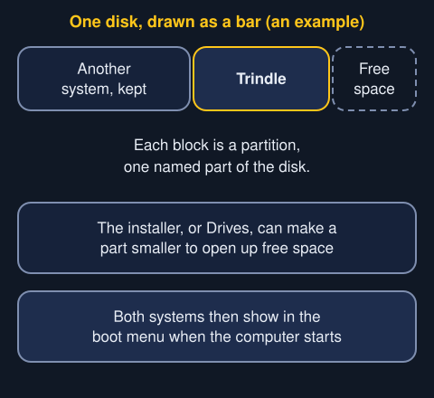
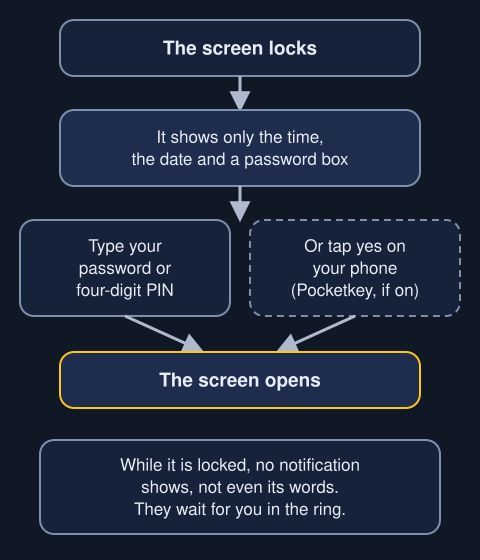

Words are in order from A to Z. The ring has parts with names of their own. This diagram shows where each one sits.

**Administrator.** A person who is allowed to change the whole computer. Drives asks for an administrator's password before any change.

**All apps.** The button at the bottom of the ring that shows everything installed. Typing any letter does the same thing.

**AppImage.** A program kept in one file. You add one in Apps with Add an AppImage, and it lives in a folder of its own.

**Apps.** Trindle's place to find, install, update and remove programs.

- [Read about Apps](apps.html)

**Boot menu.** A list the computer shows when it starts, so you can choose what to start from. Pressing a key at switch-on opens it.

**Boxed app.** A program that lives in a folder of its own with everything it needs. It is allowed only what you let it. Removing it removes all of it.

**Btrfs.** A kind of disk layout that can take snapshots. Trindle's own disk uses it.

**Clipboard.** Where the computer holds the last thing you copied, ready to paste.

**`.deb` file.** A program in Debian's package format. Debian is the system Trindle is built on. A `.deb` you open in Trindle goes into its own sealed box instead of spreading files across the system.

**Dual boot.** Two systems on one disk, with a menu at start-up to choose between them.

**Encryption.** Scrambling a disk so nobody can read it without the key. The key can be a password you type, or the TPM chip.

**Favourites.** The apps you keep close in the ring. Right-click an app in the ring to add one.

**Firmware.** The small program that runs when you switch the computer on, before the system starts. Secure Boot is set there.

**Flatpak and Flathub.** Flatpak is a way of packaging apps so each runs apart from the rest. Flathub is the online shop of them that Apps reads.

**Flow.** A plugin that gives two Trindle computers one mouse and keyboard.

- [Read about Flow](flow.html)

**Format.** To wipe a part of a drive and set it up fresh, so it can hold files.

**Home.** Your own folder, where Documents, Downloads, Pictures and the rest live.

**Image.** A copy of a whole system in one file, which you write to a USB stick. Trindle's image ends in `.iso`.

**Library.** A shared piece of code that a program needs in order to run. A boxed app brings its own.

**Log.** A diary the computer keeps of what its programs did.

**Markdown.** A way of writing plain text with simple marks for headings and lists. Text understands it.

- [Read about Text](text.html)

**Mount.** To make a drive's files show up as a folder you can open.

**NAS.** A small computer on your network that holds files for other computers to use.

**Pane.** One list of files in Folders. Folders can show one pane or two.

**Partition.** One named part of a disk. A disk can hold several.

**Permission.** Something an app asks to be allowed to do, such as reach your folders or your microphone. Each one has its own switch, off until you choose.

**PIN.** A four-digit number that can unlock the screen as well as your password.

**Plugin.** A small extra from Apps that adds to Trindle. Each lives in its own folder and is allowed nothing until you say.

- [Read about Apps](apps.html)

**Pocketkey.** A built-in extra that lets your phone answer password boxes with one tap. It locks the screen when the phone goes out of range.

**Port.** A numbered door a computer uses to talk to another computer over a network.

**Ring.** Trindle's whole desktop interface, a circle that opens and closes.

- [Read about the ring](ring.html)

**Secure Boot.** A firmware setting that only lets approved software start. You may need to turn it off to start from the USB stick.

**Snapshot.** A saved copy of the system as it was at one moment, so it can be put back.

**Super key.** The key often marked with a Windows logo. It opens the ring.

**Theme.** One file that changes the whole look of Trindle. Settings, under Appearance, holds them.

**TPM.** A chip in the computer that can unlock an encrypted disk by itself, so nothing is typed at start-up.

**Tray.** The small icons some programs show. In Trindle they sit in an arc at the bottom of the ring.

**Virtual machine.** A pretend computer that runs inside a real one. It is a safe way to try Trindle first.
