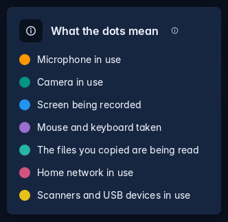
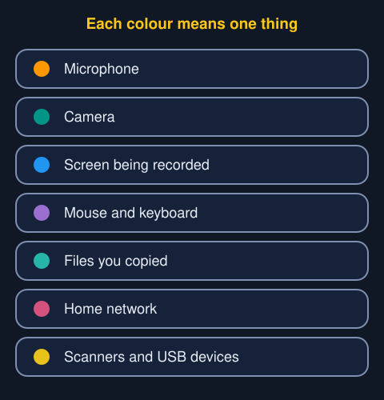

A small coloured dot tells you a program is using something of yours: your microphone, your camera, your screen and so on. Many webcams have no light of their own, so Trindle shows one for you. Each kind has its own colour, and no two share one.

## What each colour means

- **Orange.** Microphone in use.
- **Green.** Camera in use.
- **Blue.** Screen being recorded.
- **Violet.** Mouse and keyboard taken by a program, as Flow does when it carries your pointer to another computer.
- **Aqua.** The files you copied are being read.
- **Magenta.** Home network in use.
- **Yellow.** Scanners and USB devices in use.

Settings shows the same key in the "What the dots mean" card at the foot of Permissions, and the Welcome tour has a page for it.

## Where dots appear

- **The top middle of the screen.** One dot for each kind in use. Point at them to see which program is using it.
- **A window's tab in the ring.** The window of the program using the microphone, camera or screen has its dots on its tab.

A favourite's name in the ring has no dots under it. A program with no window, such as Flow, shows at the top middle of the screen only.

## If a dot surprises you

Point at it to see the program's name. If you do not expect that program to be using it, close the program. Settings, Permissions shows what each program is allowed to use.
