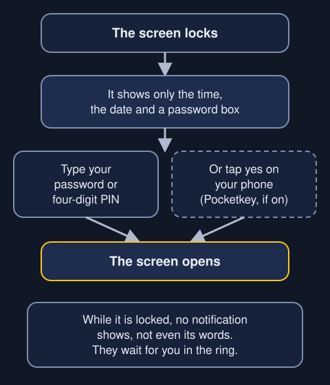
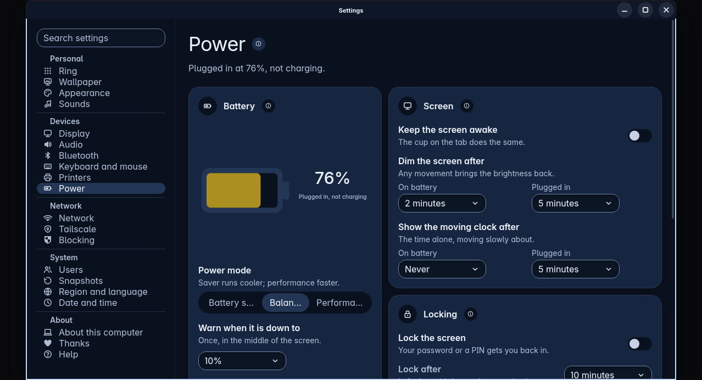

When the screen locks, the lock screen asks for your password, or a PIN if you chose one. It shows only the time, the date and the password box.

We can't take a real screenshot of the lock screen here, and a made-up picture wouldn't be honest. So this page uses a drawn diagram, and it is labelled as one. It is not a screenshot.

## Switching it on

Locking is off until you switch it on.

1. Open Settings and choose Power.
2. In the Locking card, switch on Lock the screen.
3. Use Lock after to choose how long Trindle waits before it locks the screen.

Once locking is on, your password gets you back in. So does a four-digit PIN, if you choose one as well.

## Getting back in

Type your password or PIN.

Each box has a small eye. Press it to show what you typed. You can also press Tab to reach it, then Space or Enter.

The password hides again after you try it. It also hides if you haven't pressed a key for 30 seconds, so it never stays on show if you walk away.

## What stays hidden

While the screen is locked, no notifications show, not even their words or the name of the app. They wait in the ring's notifications until you unlock.

## Pocketkey

Pocketkey is a built-in extra for your phone. Switch it on in Apps. The lock screen then shows a phone button.

With a paired phone in your pocket, you answer password prompts with one tap, yes or no. The screen locks when the phone goes out of range. Your password still works at any time.

- [Read about Apps](apps.html)

## Locking from Flow

If you use Flow, locking the screen gives the mouse and keyboard straight back to the computer they belong to.

- [Read about Flow](flow.html)

## The screensaver

Power also has a setting called Show the moving clock after. The clock shows only the time, and it moves slowly around the screen. You choose how long to wait, once for battery and once for when the computer is plugged in.
