A plugin is a small extra that adds something to Trindle. It might be an icon in the ring, a page in Settings, notifications, or something that runs when you log in. Plugins come only from Trindle's own list. The list is signed, so nobody can slip a plugin into it. Trindle tests each plugin before adding it. Each plugin runs on its own, and it can't do anything until you allow it in Permissions.

You'll find plugins in Apps, on the Plugins page. [Apps](apps.html#plugins) explains how to add and remove them. This page is about the red words you may see there.

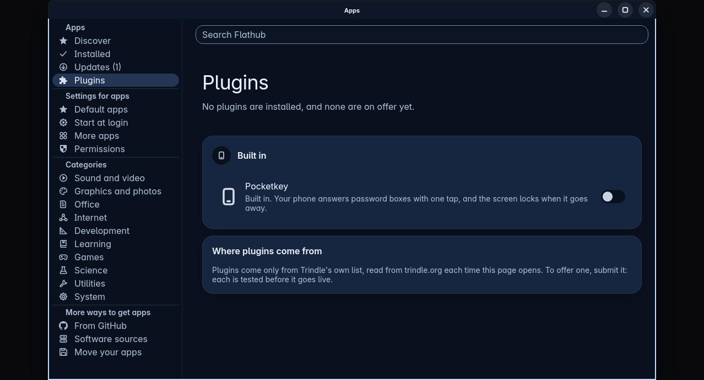

## When something goes wrong

If a plugin can't be downloaded, installed or started, Apps shows red words under the plugin's card or under Where plugins come from. A small round **More** button sits beside them. Press it and Help opens at the page for that message.

- [A plugin was refused by the check](plugins.html#a-plugin-was-refused-by-the-check): the plugin's own description file failed the check.
- [A plugin's background part is not running](plugins.html#a-plugin-s-background-part-is-not-running): the plugin is installed, but the part that runs all the time didn't start.
- [A plugin would not download or go in](plugins.html#a-plugin-would-not-download-or-go-in): downloading, unpacking or installing it failed.
- [The plugin list could not be used](plugins.html#the-plugin-list-could-not-be-used): Trindle rejected the signed list, or its record is damaged.

The Apps page [A plugin is not working](apps.html#a-plugin-is-not-working) covers the rest: a plugin that couldn't be removed, a permission that couldn't be saved, and Pocketkey not answering.

## A plugin was refused by the check
Questions: why does it say the plugin does not pass Trindle's plugin check; why was nothing installed; what does Interface mean in a plugin; why does it say the plugin needs a Name; why does it say a program is not one the plugin carries; why does it say a link leads outside the plugin's folder

Every plugin comes with a small file called `plugin.ini` that describes it: its name, what it adds, and what it asks to be allowed to do. Trindle checks that file twice. The Trindle team checks it when they build the list, and your computer checks it again as the plugin is installed. If anything is wrong, the plugin isn't installed. Nothing is ever installed half way.

The red words show the first thing that is wrong. There may be more problems after it. You can't change a plugin yourself, because only the plugin's maker can fix it. Here's what you can do:

1. Press the plugin's button again later. Trindle reads the list each time you open the Plugins page, and a corrected plugin arrives with the next list.
2. Look at the Updates page in Apps. A newer Trindle may know an interface that yours doesn't.
3. Tell the plugin's maker, or use Report a problem, and include the red words.

Here's what the check looks at, and the words it uses:

- **The file.** "There is no plugin.ini that can be read at the top of the folder" and "plugin.ini has no [Plugin] part". The file is missing, can't be read, or its first part is missing.
- **The interface.** "[Plugin] needs Interface=1." or "Interface=2 is not one this Trindle knows: it knows Interface=1." The plugin was written for a different version of the way plugins work.

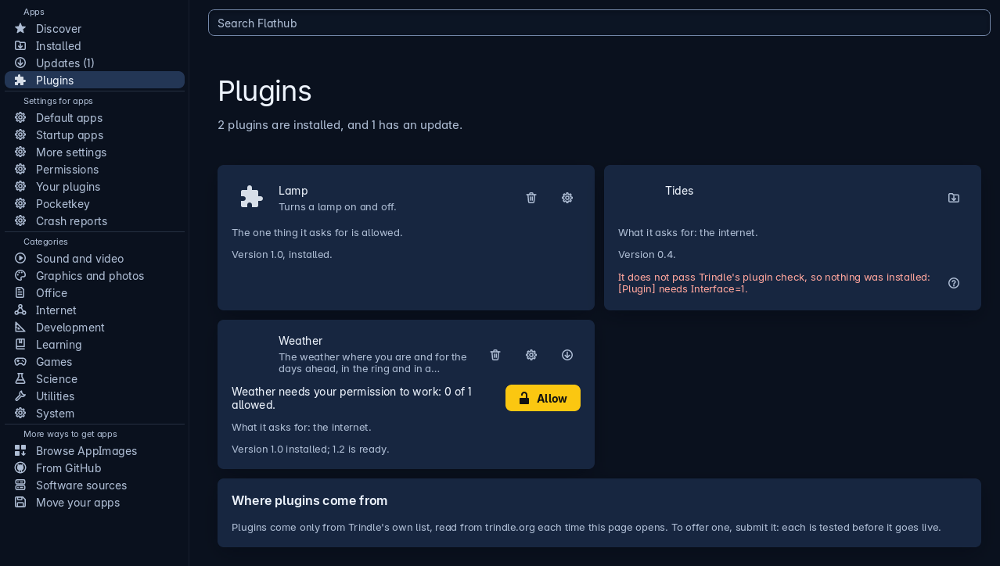

- **Its name, version and summary.** "[Plugin] needs an Id of letters, digits, dots and dashes, such as org.example.Weather", "needs a Name", "needs a Version", "Summary is one line". Name, Version and Summary are each one plain line, up to 48, 32 and 200 characters long.
- **Permissions.** "Permission ... is not one there is: they are ..." followed by the list. A plugin can only ask for permissions that Trindle has. It can't ask for both the network and the home network.

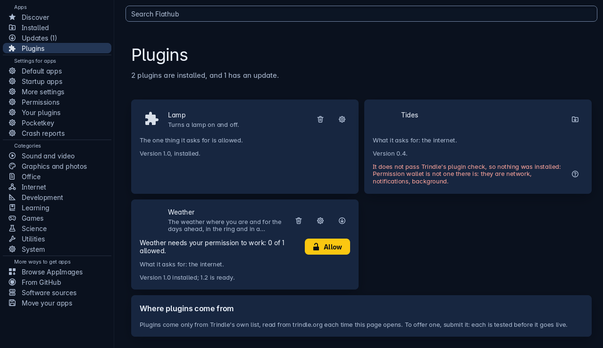

- **The ring icon.** "[Ring] needs an Icon: an SVG or PNG file in the plugin's folder", "Icon names ..., which is not in the plugin's folder", "needs a Label" and "needs Run, what a click starts".
- **A menu on the ring icon.** At most eight items. Each item needs a plain label of up to 32 characters, and an id made of letters, digits, dashes and underscores. Each id can be used only once. Each item also needs its own part and its own Run.
- **Its settings page.** "[Settings] needs Fields". Other faults are a field name with characters that aren't allowed, a field with no part of its own, and a missing Label. The check also rejects a kind that isn't switch, text, choice or note, and a switch whose Default isn't true or false. A choice needs at least two Choices (at most 32, each up to 48 characters), and its Default must be one of them. A note needs a TextFrom and must not have a Default. A file name for ChoicesFrom or TextFrom can use letters, digits, dots, dashes and underscores. It can't start with a dot, and it can't include folders.
- **ShowWhen.** A field can show only when another field has a certain value. The red words say which rule was broken. ShowWhen must be written as `field=value`. It must name an earlier field that has no ShowWhen of its own. For a switch, the value must be true or false. For a choice, the value must be one of its Choices. A note has no setting, so nothing can depend on it.
- **Hooks.** "[Background] needs the background permission". You'll also see "The plugin hooks into nothing" when it has no ring icon, settings, background part, shortcut or notifications permission.

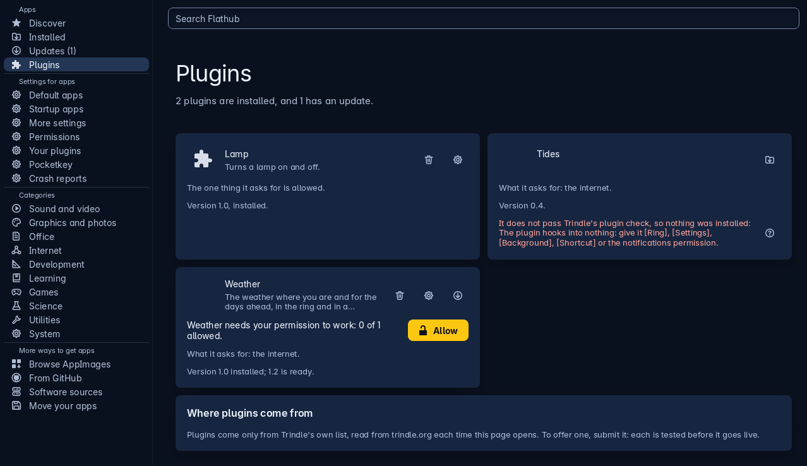

- **Programs.** "Run must name a program inside the plugin's folder"; "Run names ..., which is not a program the plugin carries (missing, or not executable)"; and "Run cannot be read as a command".
- **Links.** "... links outside the plugin's folder". A plugin can't contain a link that leads outside its folder.

- **Shortcuts.** At most four. Each needs an id, its own part, a Run, and Keys that aren't already used by one of Trindle's shortcuts or by another shortcut in the same plugin.
- **Ports to listen on.** "[Network] Listen" needs the network and listen permissions, and listen needs ports to name. You can list at most four. Each is written as `tcp:` or `udp:` followed by a port from 1024 to 65535. A port can't appear twice, and it can't be one that Trindle or a common service uses.

- **Unlocking by PIN.** "is only for Flow from Trindle's catalogue" and "needs Run, the command that is given the PIN".

:::expert
The check is `plugins::check`, and it collects every problem it finds. The catalogue install shows only the first one, in `plugins-install-check`. The check runs on the unpacked folder before anything is installed, and after the archive's SHA-256 has matched the one in the signed list. If a plugin has a different id from the one the list named, Trindle rejects it before this check ("The archive holds ..., not ..."). [A plugin would not download or go in](plugins.html#a-plugin-would-not-download-or-go-in) describes it.
:::

## A plugin's background part is not running
Questions: why does it say its background part is not running; what is the background part of a plugin; why does it say no desktop session is running; why does it say it did not start within 15 seconds; why does it say trindle-plugin could not be found; why does it say it cannot tell which desktop session to join

Some plugins have a part that runs all the time, out of sight, such as one that waits for a phone to come near. This is called the background part. A plugin has one only if it asks for the **background** permission and you've allowed it. It starts when you log in, and again when the plugin is installed or updated.

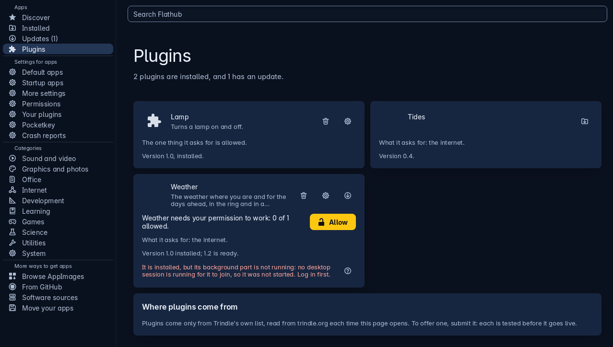

The red words say the plugin is installed, then why its background part isn't running.

- **"no desktop session is running for it to join, so it was not started. Log in first."** The background part needs to join your desktop, and with no desktop session there's nothing to join. Log in, and it will start.
- **"it did not start within 15 seconds."** Trindle waited 15 seconds and the part didn't answer. Log out and log in again. The part starts again each time you log in.

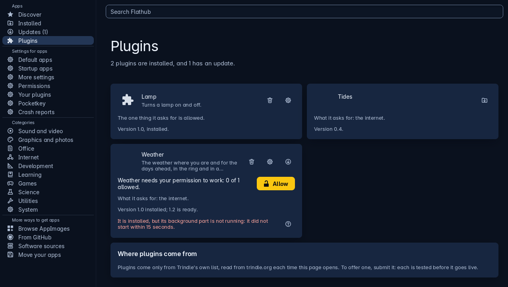

- **"trindle-plugin could not be found to start it."** Trindle can't find the program that starts plugins, so Trindle may be incomplete on this computer. Look in Apps, Updates, and use Report a problem if the message stays.
- **"it cannot tell which desktop session to join (...), so it was not started."** You have more than one desktop session open. The part can't tell which is yours. Log out of the extra sessions.
- **"... Its background part is not running: ..."** at the end of an update's words. The new version wasn't installed, and the version that was already there isn't running either. The reason for each follows. Try the update again after you've dealt with the reason.

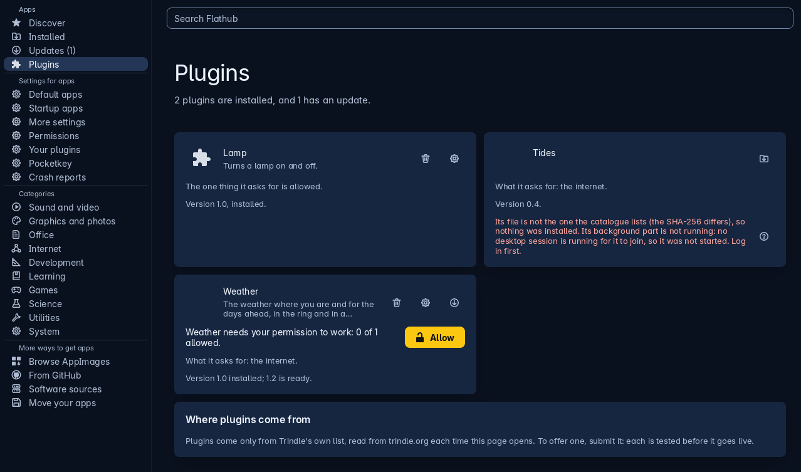

If you haven't allowed **background** in Permissions, the plugin has no background part, so there's nothing to run.

:::expert
The part is started as `trindle-plugin run ID background`. If you have a service manager, it runs in a group of its own under it (`systemd-run --user --scope`). So ending the session that started it doesn't end the part. If there's no service manager, Trindle writes that in the log, and the part ends with the session. It is started once, with one keeper for each person, and it uses the Wayland screen of the last login that still answers.
:::

## A plugin would not download or go in
Questions: why does it say it could not be downloaded; why does it say the archive could not be unpacked; why does it say its file is not the one the catalogue lists; why does it say the plugin's files could not be copied; why does it say it is not installed so there is nothing to update; why does it say the note that it came from Trindle's catalogue could not be written

Installing a plugin takes four steps. Nothing is installed unless all four work.

1. Download its file from the same place as Trindle's own list, over a secure link only.
2. Check that the file is exactly the one the signed list names, using its SHA-256 (a fingerprint of the file).
3. Unpack it into a temporary folder and run the check of its `plugin.ini` there.
4. Install it, over the old version if it's an update, and leave a note that it came from Trindle's list.

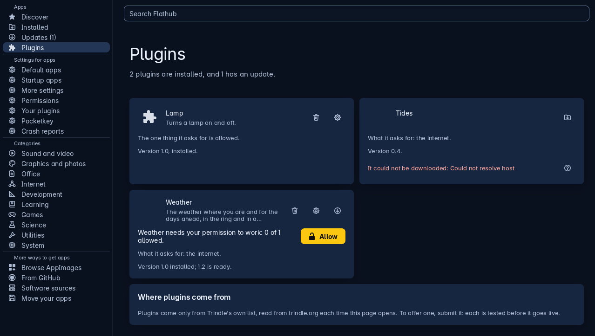

- **"It could not be downloaded: ..."** The reason follows, in the words of the download program. It's usually the internet: there's no connection, the address didn't answer, or the file was too big or took more than half an hour. Trindle won't accept a file bigger than 500 MB. Check the connection and press the button again.
- **"curl could not be started: ..."** The program that downloads is missing or won't run.
- **"Its file is not the one the catalogue lists (the SHA-256 differs), so nothing was installed."** What arrived isn't what was signed, so Trindle threw it away. This check protects you from a file that has been changed. Try again later. If it keeps happening, tell Trindle with Report a problem.

- **"The archive could not be unpacked: ..."**, **"tar could not be started: ..."** The file arrived but wouldn't open. The first line from the unpacking program follows.

- **"The archive has no plugin.ini at its top, or in the one folder at its top."** The file opened, but it doesn't look like a plugin.
- **"The archive holds ..., not ..., so nothing was installed."** The plugin inside has a different id from the one the list named, so Trindle rejects it.
- **"The plugin's files could not be copied."** The last step failed, usually because the disk is full or Trindle can't write to the plugins folder. Nothing was installed.

- **"It was put in, but the note that it came from Trindle's catalogue could not be written: ..."** The plugin is installed, but without its note. Remove it and add it again.

- **"It is not installed, so there is nothing to update."** You asked for an update to a plugin that isn't installed. Install it first.
- **"No scratch folder could be made: ..."** Trindle had nowhere to unpack the file. The reason follows, and it's usually a full disk.

:::expert
Archives are `.tar.zst`. Downloads use `curl` with `--proto =https` and `--proto-redir =https`, a size cap, and a time cap of 1800 seconds for an archive. `tar` runs with `--no-same-owner --no-same-permissions`. It drops a leading `/` and refuses names with `..`, so nothing lands outside the temporary folder. The temporary folder is deleted when the install ends, whatever the result. The note that a plugin came from the list is the one thing that tells Flow from the catalogue apart from any other plugin. That is why Trindle writes it only after the SHA-256 has matched.
:::

## The plugin list could not be used
Questions: why does it say Trindle's plugin catalogue was not used; why does it say the catalogue is not signed with Trindle's key; why does it say plugin updates are paused; what does Start again do; why does it say the last good one is shown; why does it say the catalogue is of a newer kind

Trindle reads the list of plugins from its own published address each time you open the Plugins page. Before Apps trusts the list, it checks the list's signature against the key that comes with Trindle. If a list fails any check, Trindle doesn't use it, and none of its plugins are offered. If Trindle has an earlier good list saved, it shows that one instead, and the red words say so.

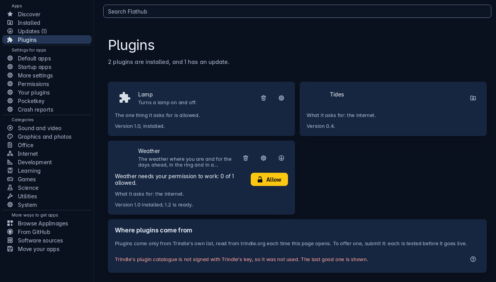

- **"This Trindle has no key to check its plugin catalogue with, so it accepts none."** This copy of Trindle is missing the key. Update Trindle from Apps, Updates.
- **"Trindle's plugin catalogue has no signature, so it was not used."** and **"The signature ... is not the size a signature is"**, **"is not signed with Trindle's key"**. The list has been altered, or something between you and the address it's read from changed it. Try again later, and if it keeps happening use Report a problem.
- **"... does not say which number it is"** and **"... is older than the one accepted before (number ..., after ...)"**. Every list has a number that goes up each time, so nobody can put an old list back. Try again later.

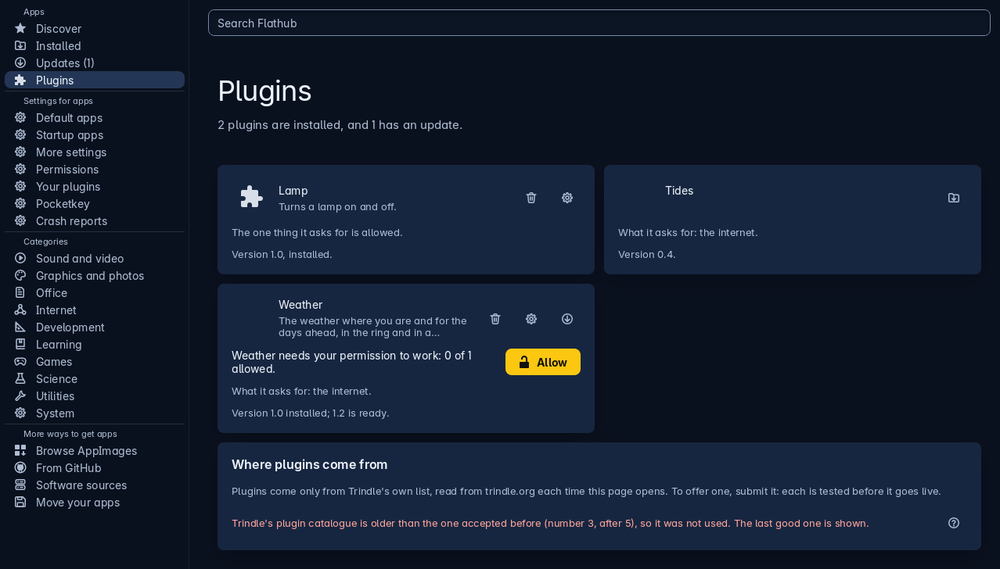

- **"... is signed but cannot be read, so it was not used: ..."**. The reason follows. It may not be text. It may be more than 1 MB, which is too big to be a list. It may have no `[Catalogue]` part with its Format. Or it may be a newer kind than this Trindle can read, which means Trindle needs updating. In every case, Trindle doesn't use the plugin list.
- **"... is left out: ..."**. Trindle leaves out one plugin on the list because one of its entries is wrong. For example, its id, its name and version, its archive name, its SHA256, its icon, or a permission that doesn't exist. The other plugins are still offered.
- **"Plugin updates are paused: the plugin list is damaged."** Trindle keeps a record of the highest list number it has accepted. If that record is damaged, updates stop, so that Trindle doesn't risk using an old list. **Start again** asks for the administrator's password and starts the record afresh.

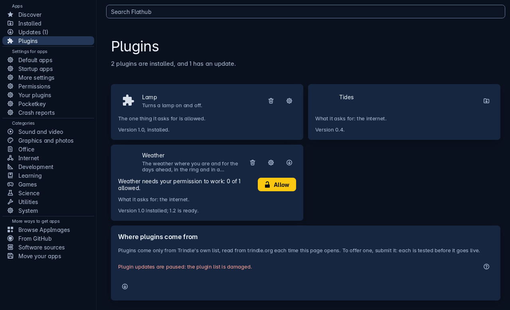

- **"Not done: ..."** or **"The record could not be taken away: ..."** after you press **Start again**. Either you closed the password box, or Trindle couldn't remove the record. Try again.

:::expert
The signature is Ed25519, checked against the public key built into Trindle. The record of the highest number accepted is kept on this computer so nobody can roll a list back. Trindle also rejects a list when its signature checks out but its text isn't a catalogue (no `[Catalogue]` part with `Format=`). It rejects a list too when it is larger than the most a list may be (1 MB). Trindle quietly leaves out entries for another plugin interface, because a newer list may include plugins that this Trindle can't run.
:::

## Related

- [Apps](apps.html#plugins): adding, updating and removing plugins.
- [Apps, A plugin is not working](apps.html#a-plugin-is-not-working): removing, permissions and Pocketkey.
- [Flow](flow.html): a plugin that shares one mouse and keyboard.
