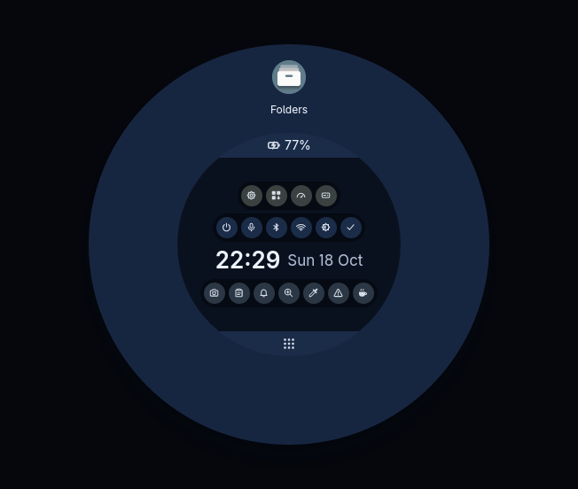
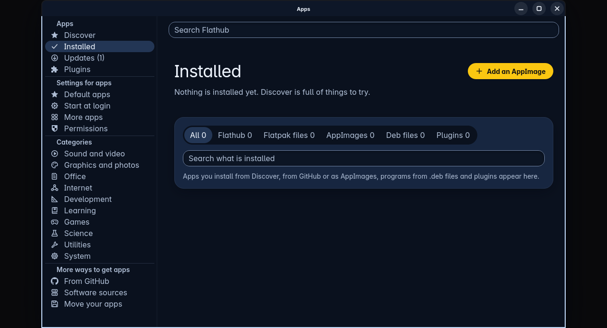
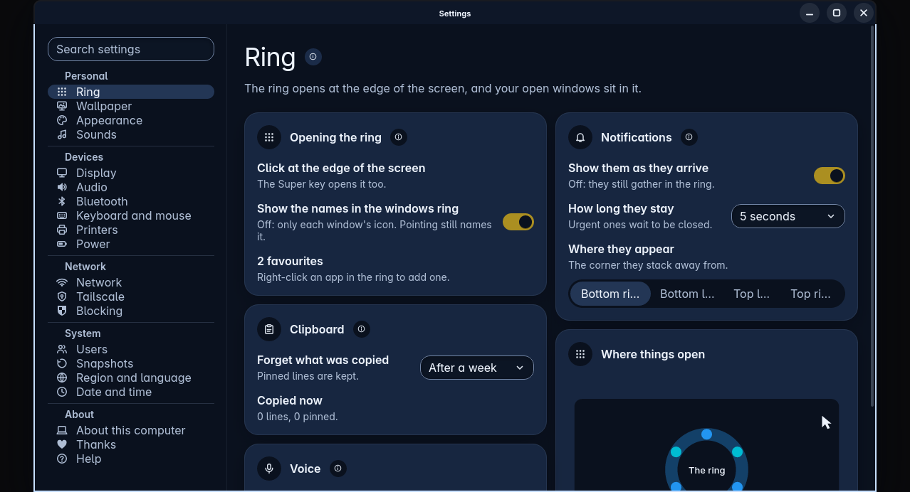
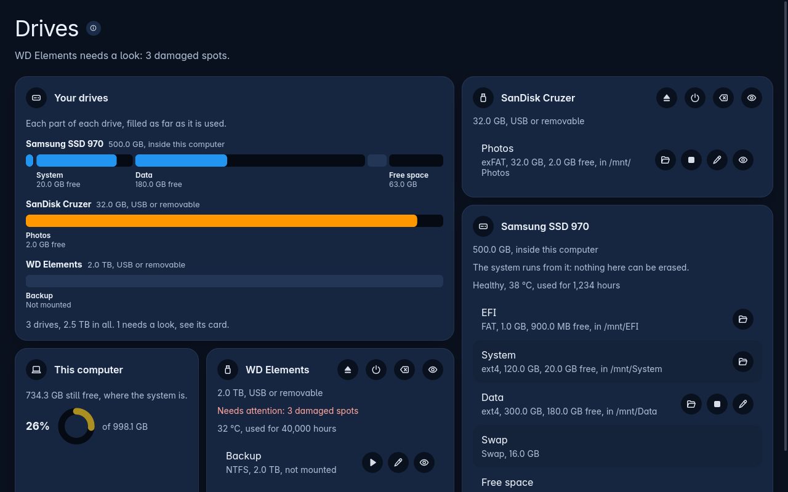

Each answer is short. The link under it goes to the full page.

## How do I install Trindle?

Write the image to a USB stick and start the computer from it. You can try Trindle first. When you are ready, press Install Trindle in the ring.

- [Getting started](getting-started.html)

## How do I open the ring?

Press the Super key, or double-click at the very edge of the screen. You can also double-click on the empty desktop.

- [Opening the ring](ring.html#opening-the-ring)

## What if the ring has gone?

If the ring stops working, a label appears in the middle of the screen to tell you. Press Super to start it again.

- [If the ring stops working](ring.html#if-the-ring-stops-working)

## How do I switch between windows?

Open the ring and click the window you want. Every open window is in the ring, with its name.

- [What is in the ring](ring.html#what-is-in-the-ring)

## How do I find and start an app?

Click the all apps button at the bottom of the ring, or start typing any letter. Then click the app you want in the matches.

- [Finding an app](ring.html#finding-an-app)

## How do I install an app?

Open Apps from the ring and choose Discover. Press the round Install button on the app's tile.

- [Finding and installing an app](apps.html#finding-and-installing-an-app)

## How do I remove an app?

Open Apps, choose Installed, then press Remove twice within three seconds. You can also right-click the app in the ring and choose Uninstall.

- [Everything you have added](apps.html#everything-you-have-added-in-one-list)

## Why is there no web browser?

Trindle starts with almost nothing installed. The Welcome lets you pick a browser and other apps, and it installs them with one click.

- [The first ten minutes](getting-started.html#the-first-ten-minutes)

## How do I join the Wi-Fi?

Open the ring and click the network icon in the middle. Switch Wi-Fi on, find your network and press Connect.

- [The first ten minutes](getting-started.html#the-first-ten-minutes)

## How do I change the screen size?

Open Settings, then Display. If the change looks wrong, don't do anything. The old size comes back after fifteen seconds.

- [The pages of Settings](settings.html#the-pages)

## How do I change the look?

Open Settings, then Appearance, and press a theme. This only tries it out. If you don't press Keep within 30 seconds, your old look comes back.

- [Appearance and themes](settings.html#appearance-and-themes)

## How do I lock the screen?

Open Settings, then Power. Switch on Lock the screen in the Locking card, and choose how long Trindle waits before it locks.

- [Switching it on](lock-screen.html#switching-it-on)

## How do I change what a key does?

Open Settings, then Keyboard and mouse. You can change any key or mouse button, and the change works everywhere.

- [Keyboard and mouse](settings.html#keyboard-and-mouse)

## How do I see two folders at once?

Press F3 in Folders, or use the Single and Dual switch in its top bar. Each pane is a separate list.

- [One pane or two](folders.html#one-pane-or-two)

## How do I write or edit a plain text file?

Open Text from the ring. If you open a plain text file in Folders, it opens in Text too.

- [Text](text.html)

## Why does a drive change ask for a password?

Trindle asks for an administrator's password every time before it changes a drive. If you close the box, nothing changes.

- [A password before any change](drives.html#a-password-before-any-change)

## How do I report a problem?

Press the Report a problem button in the ring, type what went wrong, then press Show details and Save. Trindle puts a file in your Downloads folder.

- [How to make a report](report-a-problem.html#how-to-make-a-report)

## Does Trindle send anything from my computer?

Only what you ask for, plus the update checks. Trindle sends a problem report only when you press Send, and you see all of it first. By default, Trindle looks for updates soon after you log in and then every few hours. Debian installs its security fixes every day, and the blocker refreshes its lists of bad sites every day. The Check for updates switch in Settings, under About this computer, stops all three.

- [When a program crashes](report-a-problem.html#when-a-program-crashes)

## Why did Trindle refuse to do something?

Trindle explains why in a label right where you are working. Read that label first.

- [Troubleshooting](troubleshooting.html)

## Where is the help when I have no internet?

In Settings, on the Help page. It works with the network off. Every Settings page also has a small i that opens its part of Help.

- [Help inside Trindle](settings.html#help-inside-trindle)
