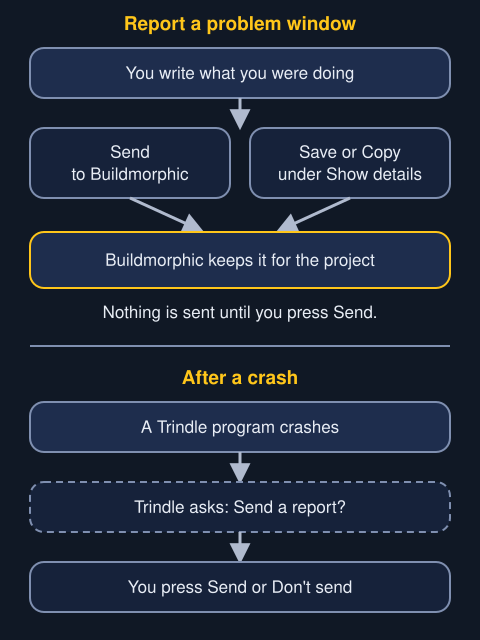

If something goes wrong, you can write it down in a small window and send it to Buildmorphic, the community that helps build Trindle. Nothing is sent until you press Send.

## Switching it on

Reports are off until you choose. Turn on "Ask about problems and sharing reports" in Settings, Crash reports, or answer "Yes, ask me" in the first-run tour. Off, the ring's Report a problem button is not shown, nothing asks you after a crash, and nothing is sent.

## How to make a report

1. Open the ring and press the Report a problem button in its lower row.
2. Type what you were doing in the box "What were you doing?".
3. Press Show details to see the whole report, word for word.
4. Press Send. Or press Cancel to close the window with nothing sent.

A second press of the ring button brings the first window forward instead of opening another.

Inside Show details there are also Save, which writes the report into your Downloads folder, and Copy, which puts the same text on the clipboard.

## What a report holds

The line in the window says what is sent: your computer model, graphics card and the error, never your files, passwords or Wi-Fi names. Show details shows all of it before you press Send.

- Your own words.
- The last 200 lines of Trindle's own log. A log is a diary the computer keeps of what its programs did.
- The Trindle version.
- The computer: its model, graphics card, processor and memory.
- After a crash, which program stopped and where.
- Your Buildmorphic username or GitHub name, only if you filled them in on the Crash reports page.

Nothing else.

## What is blanked

Before the text is shown, kept or sent, Trindle blanks anything that names you.

- Your home folder becomes `~`.
- Any other home folder becomes `/home/[name]`.
- Your login name, the words of your full name and the computer's name become `[name]`.
- Wi-Fi names, network addresses and hardware addresses are blanked.
- Every email address becomes `[email]`.

The same goes for your own words.

## Where it goes

Send posts the report to Buildmorphic. The window first asks whether reports are being taken; only then is Send shown. While it asks, it says "Checking.", and when they are not, "Reports are not being taken yet." stands where Send would be.

With no connection, a report you sent waits on this computer and goes by itself when the connection comes back. The window says "Waiting for a connection."

## What the window says when something is wrong

Words appear where you are working.

- "Write a few more words to say what happened." appears when there are too few words to send.
- "There is no log to send with it, so it cannot be sent. Save it instead." appears when Trindle's log cannot be read.
- "Already sent." and "Already saved." appear after the one send or save.
- "Could not save it", with a few words of why, appears when the file cannot be written.

## When a program crashes

When one of Trindle's own programs crashes, you get a notification. With reports switched on, a window asks "Something went wrong. Send a report?" with Send and Don't send. It asks once for each crash.

Crashes of apps are kept on the computer only and never sent.
