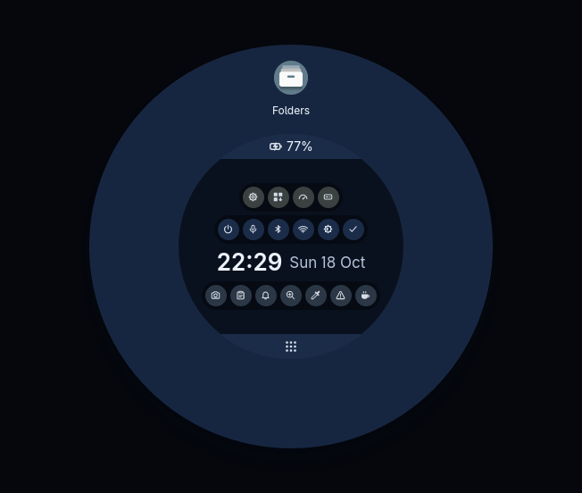
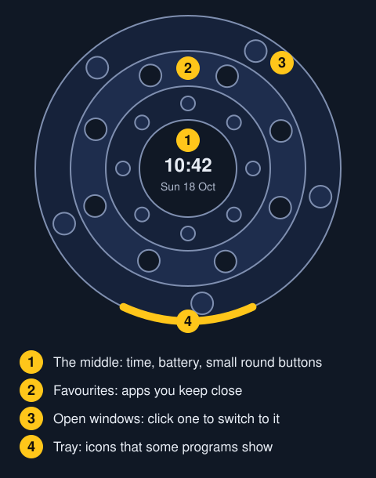
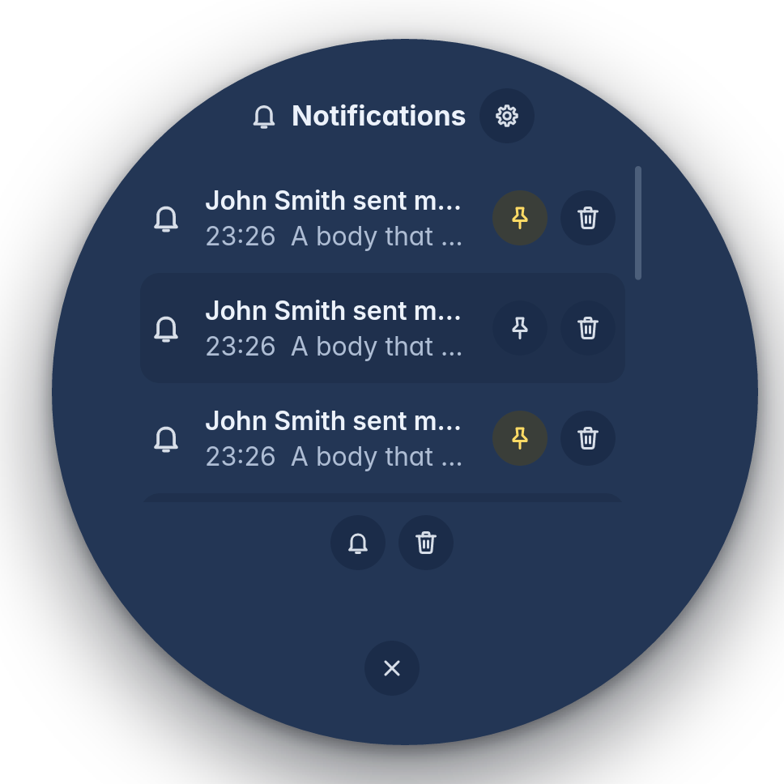

With the ring closed, your screen is completely clear. There is no panel, no tray and no clock. You see only your windows and your wallpaper.

When you want something, you call the ring. It goes away when you are done.

## Opening the ring

There are four ways in.

- **Double-click at the very edge of the screen.** Move the pointer to any outer edge and click the left button twice. One click there opens nothing. The edge is a few pixels deep. It is the same as the gap left round a maximised window, so you can still reach it when a window fills the screen.
- **Press the Super key.** It is often marked with a Windows logo.
- **Double-click, or double-tap, on the empty desktop.**
- **Log in.** The ring is already open in the middle of the screen after every login.

A single click anywhere on the empty desktop opens nothing, so you cannot open it by accident. Over a full-screen window, a click never opens the ring. A full-screen game or film is yours alone. Press Super there instead.

## What is in the ring

The ring is built from the middle outwards.

- **The middle** holds the time and date and the battery. It also holds small round buttons for things you reach for often: sound, screen, keeping the screen awake and power. Tools such as Screenshot, the clipboard history, the colour picker and Report a problem are there too. Point at a button to see its name.
- **The favourites** are the apps you chose to keep close. Right-click an app in the ring to add it.
- **The open windows** are how you switch between apps. Open the ring, then click the window you want. Each window takes an equal share and shows its icon and name. The window in front has a quiet grey dot. Point at one and a live picture of that window appears in the middle.
- **The tray** is for programs that put an icon there. It sits in a reserved arc at the bottom.

You can show icons alone if you prefer. In Settings, under Ring, turn on Show the names in the windows ring. With nine or more windows open, only icons show. The name appears when you point.

## Finding an app

1. Click the all apps button at the bottom of the ring. Or just start typing any letter.
2. Everything installed is filtered as you type.
3. The matches show as one ring, in the place where the favourites were.

## Uninstalling from the ring

Right-click any app in the ring and choose Uninstall. Trindle's own parts, and what the computer needs to run, cannot be removed. The menu says why.

## Notifications

Notifications are circles in a corner you choose. Close, Snooze and Clear all sit along the bottom. Snooze can be 10 minutes, 1 hour, 6 hours or until 8 the next morning. Drag a circle anywhere to keep it as a reminder. Clear all leaves it alone.

The ring also keeps a list of notifications, and a list of the things you copied, called the clipboard history.

## If the ring stops working

A label with a small alert sign appears in the middle of the screen, where the ring would be. It says: "The ring stopped working. Press Super to start it again."

- [Read about troubleshooting](troubleshooting.html)

## Settings for the ring

Settings, then Ring, holds how the ring opens and how notifications arrive. It also sets how long notifications stay and where they appear. It holds how long the clipboard history is kept and where things open.

- [Read about Settings](settings.html)
