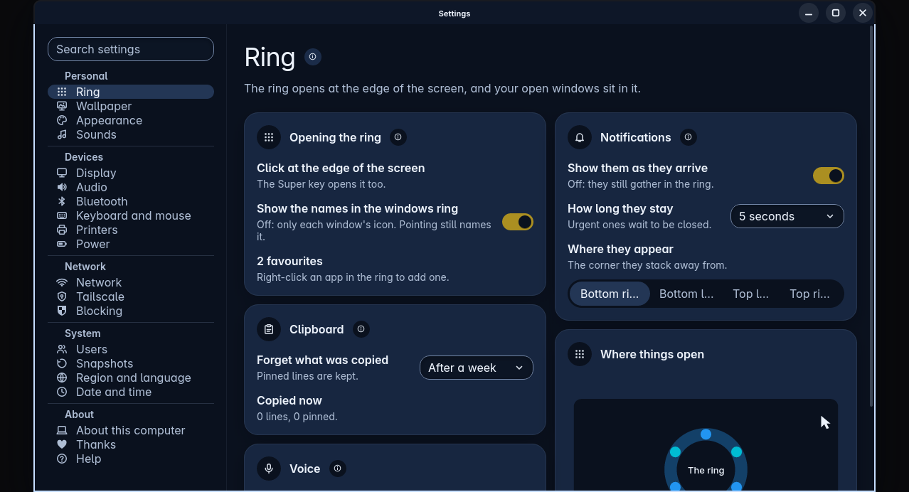
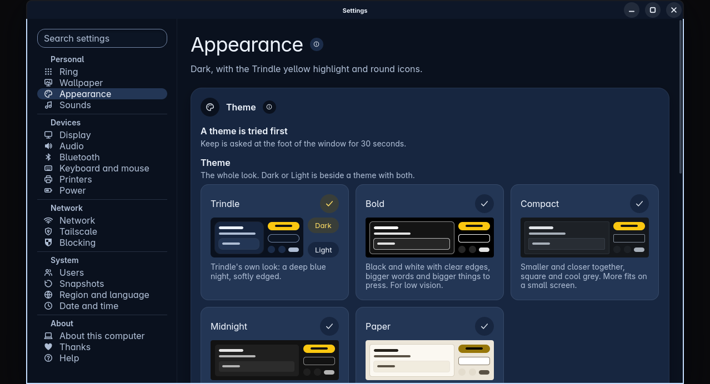
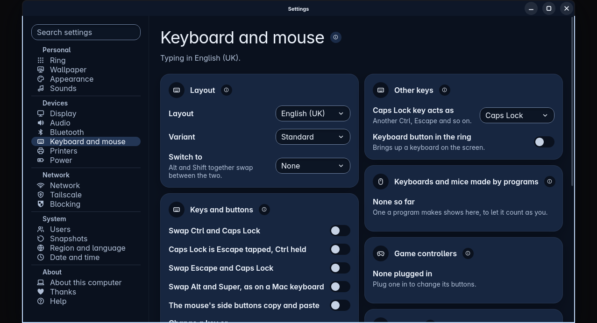
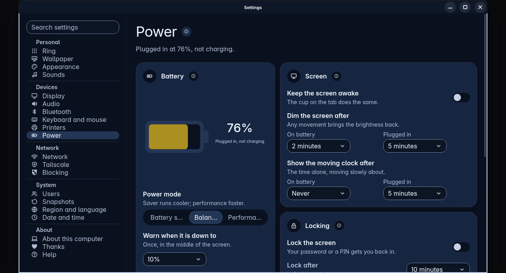
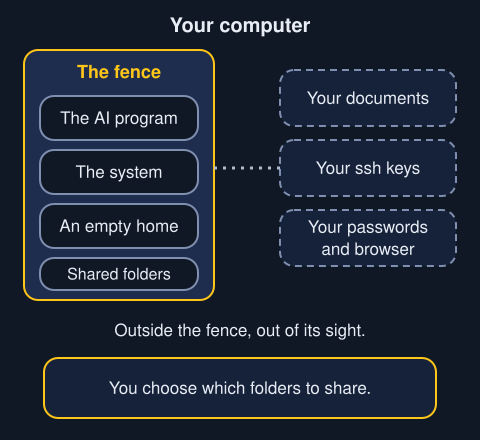

Open Settings from the ring. A side bar down the left lists the pages. A search box above it finds a setting by its name.

Each page has a small i beside its name. Press it to open the part of Help about that page.

Settings are saved as you change them. There are no Save buttons to hunt for.

## The pages

**Personal**

- **Ring.** How the ring opens, notifications, the clipboard history, voice and where things open.
- **Wallpaper.** Your wallpaper. A still picture can be up to 4K (3840 by 2160) and 20 MB. A moving one can be up to 200 MB. A bigger file is left out the moment you pick it, and a label says why.
- **Appearance.** The theme and the highlight colour.
- **Sounds.**

**Devices**

- **Display.** Screen size, and more.
- **Audio, Bluetooth and Printers.**
- **Keyboard and mouse.** Layouts, and changing any key or button.
- **Power.** Battery, screen dimming and locking.

**Network**

- **Network, Tailscale and Blocking.**

**System**

- **Users, Snapshots, Region and language, and Date and time.**

**About**

- **About this computer, Thanks and Help.**

Some pages appear only when they apply, such as the page for your plugins and the one for crash reports.

## Appearance and themes

A theme changes everything Trindle draws: colours, corners, sizes and room. Each theme is shown as a little picture of itself. Press one and every window changes at once.

Five come with Trindle: its own deep blue look, Bold, Compact, Midnight and Paper. A theme can hold a dark look and a light one. If it does, Dark and Light sit beside its picture.

A new theme is only tried first. If you do not press Keep within 30 seconds, your old look comes back by itself. So a theme that turns out unreadable never stays.

A theme cannot make words too small or too faint to read. Your highlight colour stays your own.

## Keyboard and mouse

You can change any key or mouse button here. A key can become another key or button, or keys held together, or a run of keys, or nothing. It can also be one thing when tapped and another when held.

Ready-made swaps, such as Ctrl and Caps Lock, are one switch each. A change works everywhere, from the login screen on.

These rules keep you from locking yourself out.

- Ctrl, Alt and an F key always reach a text console, whatever you change. A console is a plain screen of words. Type `trindle-settings --keys default` there to put every key back.
- On the lock screen and the login screen, Backspace, Tab, Enter, Escape and Shift are never changed. Your password can always be typed.
- Keyboards and mice that a program makes, such as remapping tools, still type. They cannot press protected buttons or type into password questions. You can switch Counts as you on for one, by name.
- Game controllers get a profile each on the Games page.
- Trindle does not have layers yet. A layer would let one key switch every other key to a second set.

## Power and locking

Power holds the battery and the power mode. It also holds keeping the screen awake, when the screen dims, and when the moving clock shows.

The Locking card turns the screen lock on and sets how long before it locks.

- [Read about the lock screen](lock-screen.html)

## AI programs

Settings has a page called AI programs. It keeps programs such as Claude Code and Codex away from your personal files.

This keeps AI programs away from your personal files in everyday use, for example if one is tricked into collecting your bank statements and sending them out. It is a limited protection, not a guarantee. A determined program, a flaw in the computer's software, or you approving a request or sharing a folder can still let something through.

What the tests of this fence have shown, with a made-up home folder:

- A fenced program sees an empty home folder. Your documents, ssh keys, keyring and browser logins are not there to read.
- It sees only the folders you share, at the same place as yours.
- Paths that climb with two dots, and links in a shared folder that point out, lead nowhere.
- It cannot see your other programs, reach your session, or make a box inside its box.
- A program it installs and runs is fenced too.
- Keys and tokens in your session do not reach it. Only a key you type on the page does.
- It cannot give itself a folder by writing a settings file.

The rest of the system stays visible, so it can read logs and run commands. Its network is open unless you turn on the limit on the page.

To share a folder, right-click it in Folders and choose Share with AI programs. Hidden folders and folders that keep keys or mail can never be shared.

Only the names on the page start inside the fence. A program started some other way is not fenced. The fence can be turned off on the page. Then AI programs can see everything you can.

## Folders and Settings

Folders keeps its own settings inside Folders, behind the cog at the end of its top bar. Settings has no page for it.

- [Read about Folders](folders.html)

## Help inside Trindle

The Help page works with the network off. It has the same plain wording as this site, and a search box for words such as Wi-Fi or printer.
