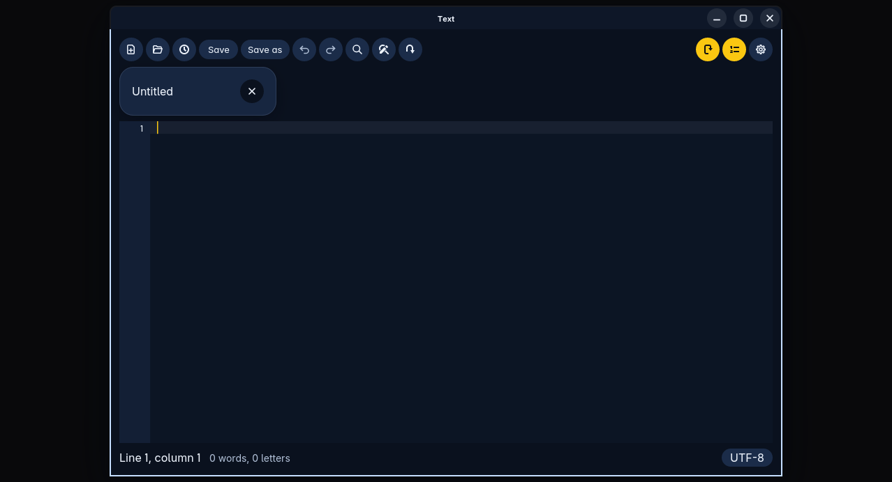
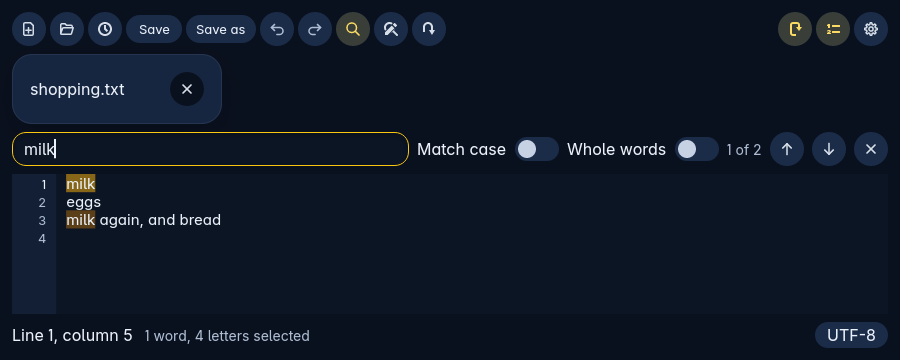

Text opens, edits and saves plain text. It is the default for plain text, Markdown, logs and source files.

## The basics

- **Several files at once.** They open as a slim row of tabs, each with its own small close button. That leaves most of the room for your text.
- **Work is never lost.** Text saves as you go. If you close something that isn't saved to a file yet, Text asks you first.
- **Saving never loses the old words.** Text writes your new words to a new file next to the document. Then it swaps that file in for the old one in a single step. So you always end up with either the whole old file or the whole new one, even if the power goes off halfway. If a save is cut short, Text puts it right the next time it starts.
- **Other encodings.** An encoding is the way letters are stored in a file. As well as UTF-8, Text reads and writes a file in whatever encoding it came in.
- **Recent files.** Text keeps a list of your recent files. A setting decides what happens when Text starts. It either reopens the files from last time or starts with one blank document.

## Editing

Text has line numbers, word wrap on or off, find and replace, a word and letter count, and go to line.

Undo and Redo are round buttons in the top bar, after the saving ones. Each one is greyed out when there is nothing to undo or redo.

To find a word:

1. Press Ctrl+H, or the find and replace button in the top bar.
2. Type the word in the bar that opens.
3. Text shows where the word appears on the page and counts the matches, for example 1 of 2. Use the arrows to move between them.

Spell checking uses the dictionaries already on the computer. If you haven't chosen one in Settings, Text uses British English when it is installed. If it isn't, Text tries the computer's own language, then American English.

You can change the font and its size. Text looks like the rest of Trindle, dark or light.

## Markdown

Markdown is a way of writing plain text with simple marks for headings and lists. In Markdown mode, a single pane switches between the raw text and the finished look. You can't see both side by side. You can save the finished look as a PDF or HTML file.

## Closing

- The close button in the title bar, or Ctrl+Q, closes Text. If any documents have unsaved work, Text asks about each one in turn.
- Ctrl+W, or a tab's own close button, closes just that document, never Text itself. If you close the last one, an empty document takes its place.

## Related

- Folders opens a file in Text whenever the file is plain text.

- [Read about Folders](folders.html)
