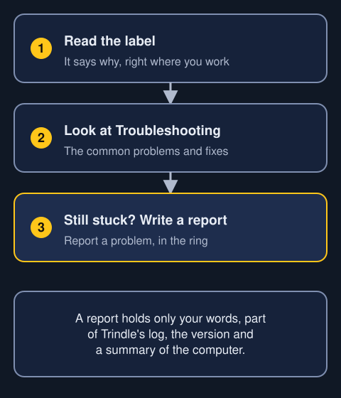
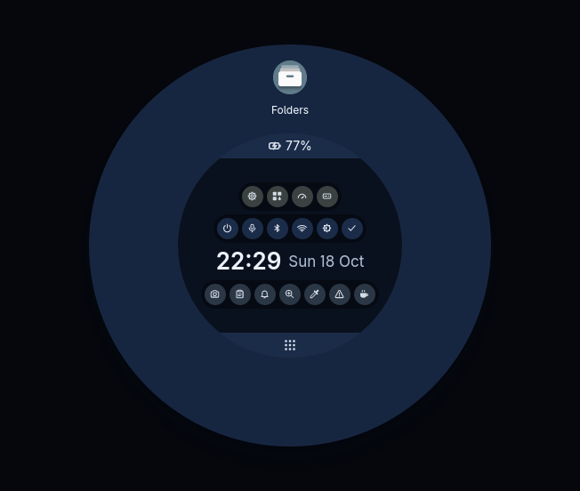
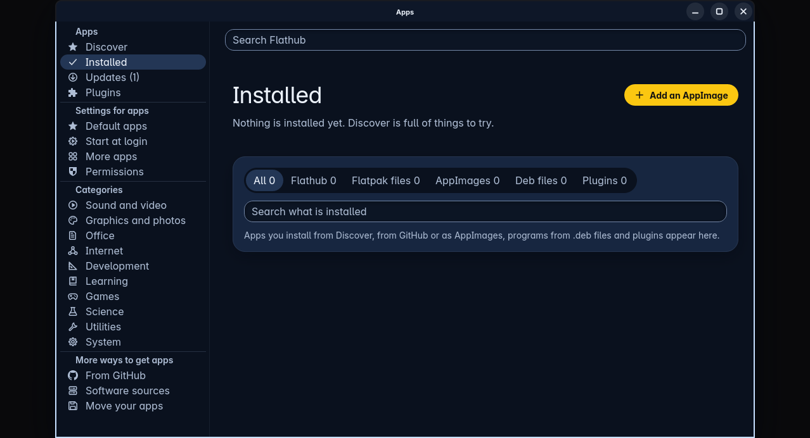
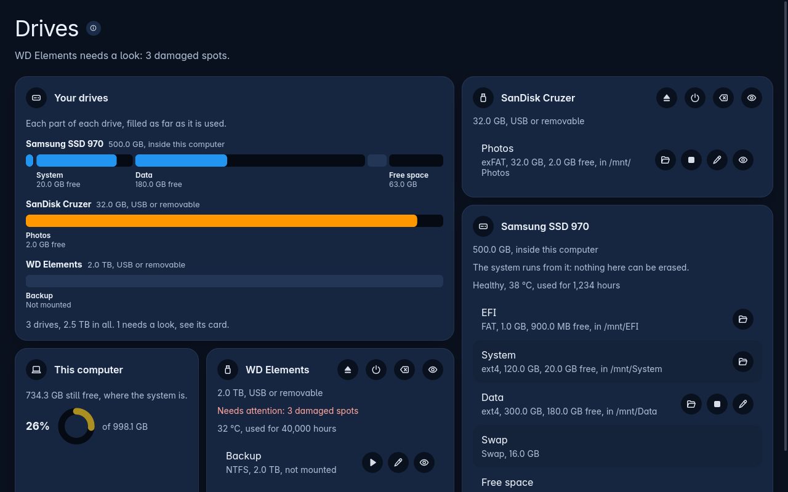

Whenever Trindle refuses something, or closes a page by itself, it says why. The reason is in a label right where you are working. Read that label first.

This page covers the common problems.

## The computer will not start from the USB stick

1. Plug the stick in, switch on and hold the boot menu key. It is F12 on most Lenovo and Dell machines, F9 on HP, and Escape or F11 elsewhere.
2. If Secure Boot is on, turn it off in the firmware settings.
3. Write the image to the stick again. Everything on the stick is replaced each time.

## Trindle feels very slow in a virtual machine

A virtual machine is a pretend computer that runs inside a real one. If it has little memory and no 3D graphics, everything crawls.

- Give it 4 GB of memory at the very least, and 8 GB if you can.
- Give it at least 2 processors.
- Turn 3D acceleration on.

Trindle leaves out its animations when there are no 3D graphics. The login screen has a Light drawing switch, on to begin with.

## The installer cannot share the disk

- Back up the other system first.
- Let Windows shut down properly rather than hibernate. Otherwise its partition cannot be made smaller.
- A disk with no boot partition to share cannot take Trindle beside what is on it. The installer says so.

## The ring has gone

If the ring stops working, a label with a small alert sign appears in the middle of the screen. It says: "The ring stopped working. Press Super to start it again." Press Super.

## I cannot open the ring by double-clicking the edge

Over a full-screen window, a double click never opens the ring. That keeps a game or film yours. Press Super instead.

Anywhere else, double-click right at the very edge of the screen, not in from it.

- [Read about the ring](ring.html)

## A button in the ring did nothing

Important buttons answer only your own presses. That covers Power, Permissions, installing in Apps, and the save and open windows. A program pretending to be you cannot switch things off or take your files.

If something other than you pressed a power button, the label under the ring says: "Only your own press can shut down this computer." Press the button yourself.

## A key does not do what I expect

Any key or mouse button can be changed in Settings, under Keyboard and mouse. A change works everywhere.

If you are locked out of your own keyboard, press Ctrl, Alt and an F key. That reaches a text console, which always works. Type `trindle-settings --keys default` there to put every key back.

## The screen changed and looks wrong

- After a change of screen size, Settings puts the old size back after fifteen seconds if you do nothing.
- A new theme that turns out unreadable goes back by itself after 30 seconds if you do not press Keep.

## I cannot find an app in Discover

The first time Apps opens, the list takes about a minute to arrive. Discover waits for it.

With no internet, Discover says so and tries again by itself. Installed, Updates, Plugins, Software sources, Move your apps and the settings for apps all work without the internet.

## An update is waiting and will not install

Install all in Apps never puts in a plugin update that asks for something new. The plugin waits for you, with a label saying so. Its row says exactly what is new. Open its row and choose whether to allow it.

## A plugin does not work

A plugin you have not allowed says so at the top of its card: "needs your permission to work". There is one button, Allow. Press it and switch on each thing it asks for.

- [Read about Apps](apps.html)

## An app will not remove

Trindle's own parts, and what the computer needs to run, cannot be removed. The menu says why. Remove asks twice for everything else. Press it again within three seconds.

## A wallpaper is left out

Wallpapers can be up to 4K (3840 by 2160). A still picture can be 20 MB and a moving one 200 MB. A bigger file is left out when you pick it, and a label says why.

## A drive change did nothing

Changes to a drive need an administrator's password every time. If you close the box, a label says: "No password was given, so nothing changed." If a change stopped half way, the row says which steps were done and which were not.

- [Read about Drives](drives.html)

## A copy in Folders is slow

While a big copy or move runs, a quiet line says that copying uses the disk heavily. Other programs may feel slower. It passes when the copy ends.

## A shared folder asks for a login again

A login kept for a shared folder is remembered for 90 days. It is sent only to the address it was used at before. If a computer answers at a new address, Folders asks again and says why.

## An nfs:// address does not open

Trindle opens NFS shares with version 4 only. Version 3 belongs to very old NAS boxes. If the server does not offer version 4, a label under the files says "does not offer NFS version 4". Switch version 4 on in the NAS's own settings, then try again. A server that has no version 4 at all cannot be opened.

## The screenshot tool froze

Trindle closes it for you, and a label says so. A Try again button starts it afresh.

## Still stuck

Write what happened in the Report a problem window and press Send. The report holds only your words, part of Trindle's log, the Trindle version and a summary of the computer. It blanks your names before it is shown, and nothing is sent until you press Send.

- [Read about Report a problem](report-a-problem.html)
